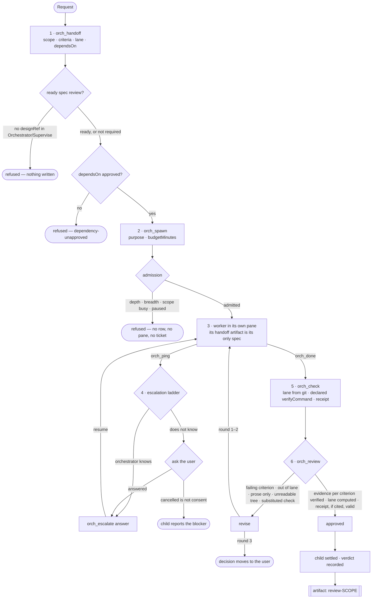
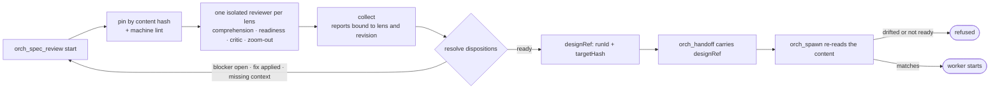
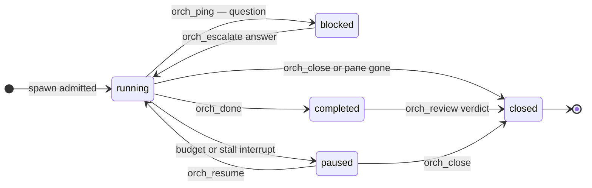

# Pi workflow extensions

Extensions for **Pi** (Node 22) that coexist with Herdr subagents, codemode, MCP adapter, VCC, auto-compact, clipboard-image, and prompt-history. Smart timeout wraps the built-in bash tool; the other extensions do not replace existing tools. No replacement of system prompt, header, footer, or global agent definitions. Input modes extend the editor and consume Shift+Tab for mode cycling.

## Repository layout

| Path | What lives there |
|:--|:--|
| `extensions/` | The installable extensions listed in `package.json` → `pi.extensions`. |
| `lib/` | Shared implementation (todo state machine, artifacts, orchestrator registry, VCC adapter). Not loaded as extensions. |
| `tests/` | `node:test` suites: `tests/*.test.ts` plus the orchestrator suite in `tests/orchestrator/`. |
| `vendor/` | Third-party code kept in-tree: `pi-herdr-subagents` (see its `VENDORED.md`) and `antigravity`. |
| `patches/` | The diffs applied to installed packages, with `VERIFICATION.md` and the VCC regression harness. Design notes and audits are inlined at the end of this file. |
| `crates/` | Optional Rust/WASM ascii animation engine (`npm run build:wasm`). |

## Install / remove

```sh
pi install /absolute/path/to/pi-workflow-extensions
# Restart Pi (or /reload in a session with no running children).
pi remove /absolute/path/to/pi-workflow-extensions
```

The local package stays in this directory. Do not delete or move it while installed. The package manifest lists each extension explicitly, so its tests and helpers are not loaded as extensions. To disable only one, use `pi config` and select this package's resources.

For development:

```sh
npm install --ignore-scripts --legacy-peer-deps   # dev-only: typescript + @types/node
npm test                                          # every suite, no network or inference
npm run typecheck
```

## 1. Conditional AI todo list

Tool: **`workflow_todo`**. Command: **`/workflow-todos`**.

**Keyboard details:** press **Alt+W**, release, then **T** for todos, **S** for subagents, or **E** for artifact details (no Enter). **Esc** cancels the prefix menu. `/workflow` opens the same menu. Todo and subagent details open as bordered pickers that drill into bordered markdown/text detail popups (`↑↓/jk`, `Enter`, digits `1`–`9`, `Esc`); artifact details open the artifact viewer's markdown popup described under [Workspace Artifacts](#4-workspace-artifacts-plans-specs-scratchpads). This keyboard path works in regular and fullscreen TUI modes, including when `/sidebar off` hides the rail; terminal mouse clicks work only in fullscreen. The prefix is registered by `extensions/sidebar.ts`; standalone todo/subagent extensions retain `/workflow-todos` and `/subagents`.

- Text-only replies and clarification questions need no assessment tool call. Before using work tools, the main AI assesses the current request. `skip` records a short simplicity reason (with a default if omitted) without making a list or showing a widget. `plan` creates concrete steps for multi-step work, with the first step already in progress. `continue` preserves an unfinished plan.
- **Dynamic Atomic Sync**: The AI can pass an entire updated checklist in a single tool call via `todos: [...]` (or `action: "sync"`). This supports simultaneous step completion and next-step activation in one turn (zero-turn handoff), dynamic task description editing, reordering, and item insertion.
- Before normal tools can run, the request must be assessed. Clarification, parent pings, interruption, and tool discovery remain available. Nested/codemode tool calls pass through the same Pi tool hooks.
- Only one item can be `in_progress` at any time. In dynamic mode, completing a step and calling a work tool automatically advances to the next pending step without blocking.
- `done` requires an evidence note. Completed items cannot be silently removed or reopened without a reason.
- `modify` allows in-place task description, continuous activeText (`activeText`), or reason/note editing.
- `cancel` supports both global scope cancellation and per-item cancellation (by providing `id`).
- On a premature final response with an actionable unfinished plan, a `turn_end` boundary requests continuation. It does not reopen a plain reply just to record a skip or invent a task to resume. This boundary is deliberately before Herdr's child `agent_end` auto-exit; a final-settlement-only hook would be too late.
- Genuine `blocked` and `waiting` states require reasons and allow yielding. They are **not completed**. The AI should report them honestly and update them when input/results arrive. Parent completion is blocked while unresolved items remain; a child may still `orch_ping` for help.
- New user requests take priority, but preserve unfinished plans. The AI can add a step and continue. Explicit scope cancellation is recorded, not silently cleared.
- State lives in Pi session custom entries, reconstructed from the **active branch**, not a global file. Reload, resume, fork/tree navigation, and normal compaction retain the plan. Separate sessions have independent state.
- No extra classifier model, inference bill, keyword guesser, timers, filesystem watcher, network, or polling. The existing AI judges complexity.

Example actions:

```json
{"action":"skip","reason":"Single factual answer; no work plan needed"}
{"action":"plan","steps":["Inspect the relevant code","Implement the change","Run focused tests"]}
{"todos":[{"id":1,"text":"Inspect code","status":"done","evidence":"Found src/login.ts"},{"id":2,"text":"Implement change","activeText":"Refactoring login auth","status":"in_progress"},{"id":3,"text":"Run tests","status":"pending"}]}
{"action":"modify","id":2,"text":"Refactor login authentication handlers","activeText":"Refactoring auth handlers"}
{"action":"update","id":1,"status":"done","evidence":"Inspected src/login.ts and its tests"}
{"action":"update","id":2,"status":"in_progress"}
{"action":"update","id":2,"status":"blocked","reason":"Need the user's choice of authentication provider"}
{"action":"cancel","id":3,"reason":"Scope removed by user"}
```

### Safety and limits

This is a workflow guardrail, not a permission sandbox or a proof of correctness. It enforces the declared plan's structure, not the truth of the AI's complexity assessment or evidence notes. An AI can still misjudge a task or claim inaccurate evidence. Final-answer reminders are capped at one per run to prevent costly infinite loops, and never continue errors or aborts. Each continuation adds a model-visible reminder entry, providing the runnable context Pi requires. At the cap, Pi warns that work is incomplete; it does not mark it done. The initial premature text can already have streamed before the continuation hook fires.

**Loops are corrected, never stopped.** When several consecutive turns contain only `workflow_todo` administration (list, continue, redundant status churn) and no real work, the guardrail does not abort or terminate the run. It instead:

1. injects a model-visible steer telling the assistant to run the current step with real tools and to stop repeating `workflow_todo`;
2. refuses the redundant administrative call for that turn so the steer cannot be ignored;
3. **fails open**: after a few steers the guardrail stops refusing and lets the agent's chosen call run, so the guard itself can never become the cause of a stall.

The plan, all evidence, and all unfinished work are always retained. Real work (or an explicit milestone: `plan`, `skip`, `cancel`, or an `update` to `done`/`blocked`/`waiting`) resets the counter immediately, so ordinary progress never trips the guard. Only intentional yields — a forwarded `ask_user`/`orch_ping` — end a turn early.

The user can always press Escape. To drop removed scope explicitly:

```text
/workflow-todos cancel requirements changed
```

## 2. Ask user / ask orchestrator

Tool: **`ask_user`**. Ask about consequential ambiguity, missing requirements, conflicting instructions, or unavailable information—not facts that can be checked using available tools, and not routine confirmations already authorized by the request.

In the main session, use Pi's native select/input dialogs rather than a custom terminal renderer. In a Herdr child, questions route through the existing **`orch_ping`** tool; no direct user dialog, sidecar duplication, parallel question transport, or change to the Herdr plugin. The parent receives the question and child session path, answers from existing context when possible, otherwise calls `ask_user`, then resumes the child with `orch_resume` and the answer. This is Herdr's exit-and-resume handshake, not a child blocking forever on a new RPC channel.

Cancelled/unavailable input is not an answer or consent. The AI must keep dependent work blocked and report missing information. Non-interactive sessions must not invent user answers. Agent definitions that explicitly restrict tools must allow `ask_user` in the parent and `orch_ping` in the child; the extensions do not override those restrictions.

**Guidance is injected only when it applies.** A Herdr child always receives the child-side rules, because they constrain tools it can reach at any moment. The parent receives the ping-handling rules **only on a `subagent_ping` turn** — not on every turn. Injecting them unconditionally made the rules read as a standing assignment, so a bare `test` arrived with hidden instructions about answering pings and resuming children and was answered with a protocol recital instead of an acknowledgement.

## 3. Durable delegated-work checkpoints & VCC history reduction

Command: **`/subagents`**. Parent tool: **`orch_history`**. Child tool: **`orch_progress`**.

- The parent records child identity, task, saved session path, pane/run identity, latest milestone, changed files, verification, next action/question, and terminal outcome. A compact widget shows recent/active work. `/subagents` lists running and completed history, opens saved checkpoints/results and transcript previews, displays a reopen command, and can explicitly request a follow-up resume for an ended child.
- **VCC Algorithmic History Distillation & Recall**: Instead of dumping monolithic raw transcripts (up to 30,000 characters) into model context, `orch_history` integrates with `pi-vcc`:
  - `vccSummary: true`: Generates a structured zero-LLM algorithmic summary (`[Session Goal]`, `[Files And Changes]`, `[Commits]`, `[Key Signals]`, and rolled-up `[Brief Transcript]`) directly from the child session branch (~95% token savings).
  - `query: "<regex>"`: Performs regex/keyword search over child session entries and returns indexed matches with pagination.
  - `expand: [<indices>]`: Expands only the requested entry indices in full untruncated detail, avoiding token bloat.
  - Terminal child completion automatically compiles a VCC summary into the parent's recorded summary.
- Dashboard previews use native editor dialogs for scrolling/copying; edits are **discarded**. They never edit child files. Transcripts are read only on request, use the active child branch, omit thinking, and show at most 40 text/tool entries / 30,000 characters. Files over 16 MiB must be reopened directly. The parent tool only reads children admitted by launches/checkpoints on the active parent branch—not arbitrary file paths or late off-branch results.
- Registry entries live in the parent session as `subagent-checkpoint:v1`. Every model request receives a fresh, bounded (14,000-character) checkpoint snapshot, including after native/VCC compaction **and** the separate 20% auto-compactor. Old records omitted by the bound remain accessible through history. No full child transcript is copied into every prompt, and no extra summarizer/model call is added. The snapshot adds context tokens to the existing request.
- Children publish meaningful milestones with `orch_progress`, not every tool call. Changes made through `workflow_todo` also publish automatically when that tool is allowed. Atomic, private `<child-session>.progress-checkpoint.json` sidecars carry only the latest milestone; event-driven filesystem notifications update the parent's widget/checkpoint journal. They do **not** wake the parent model or spend inference tokens. The next ordinary request receives the latest checkpoint. Completion still uses Herdr's existing automatic result delivery; questions needing an answer still use `orch_ping` / `ask_user`.
- Progress is not completion. A blocked-but-running milestone cannot offer a resume action. Terminal results are correlated with pane identity so delayed results from an old run cannot terminate a resumed writer. Sidecars are matched to both session path and run ID, and only previously accepted milestones establish progress ordering.
- Registry recovery is not process recovery. After reload/restart, unfinished records are labeled **unverified**: the companion restores history and milestone watching, but it does not recreate Herdr's in-memory completion watchers or prove that a child is alive. Do not reload while children are running. Check their existing panes first; never open/resume the same session concurrently. No automatic restart or duplicate writer is created.
- Existing saved launches/results on the active branch are reconstructed when possible. Old children that predate activation cannot emit the new milestone tool until they are restarted/resumed after activation. Restricted profiles receive `orch_progress` and `workflow_todo` through a minimal local Herdr control-tool allowlist patch (otherwise the existing todo guardrail would block those children before assessment). If disabling this companion entirely, revert that compatibility patch too.

Example child milestone:

```json
{"summary":"Fixed auth validation","files":["src/auth.ts"],"verification":"3 regression tests pass","next":"Review the patch","blocked":false}
```

### Activation, installed-package fixes, and rollback

This directory is already configured in `~/.pi/agent/settings.json`; the manifest now includes the checkpoint extension. **After all children finish**, restart Pi or use `/reload`. No live session is automatically reloaded by this installation.

The installed VCC compaction/recall patch keeps VCC's **zero-LLM algorithmic compiler**. It fixes selection of projected custom/branch messages and stable recall indexing; it is not a lossless summarizer. See the [test notes](#design-note-vcc-tests-readme) for exact changes, tests, retention/index behavior, rollback, and limitations. Your separate 20% auto-compactor is left intact; the request-local checkpoint hook covers that path.

Patches are under `patches/`:

- `vcc-projected-compaction-recall.patch` + `vcc-tests/`: the installed VCC sources' fix and its regression harness.
- `herdr-context-fork.patch`, `herdr-progress-control.patch`, `herdr-auto-complete.patch`, `herdr-terminal-error-shutdown.patch`: the local `pi-herdr-subagents` changes. The source they apply against is vendored at [`vendor/pi-herdr-subagents`](vendor/pi-herdr-subagents) — see its `VENDORED.md` for provenance and the exact date the snapshot was taken.
- `VERIFICATION.md`: how each patch was verified.

Package updates/reinstalls can overwrite the installed VCC/Herdr edits. Check patch compatibility and rerun tests before reapplying; do not blindly replace either package with the backups. To remove only this feature, disable `extensions/subagent-checkpoints.ts` with `pi config` (or remove it from the manifest), revert `herdr-progress-control.patch`, then safely restart. Existing checkpoint/session files remain available as history. VCC's independent fix can remain enabled.

## 4. Workspace Artifacts (Plans, Specs, Scratchpads)

Tools: **`artifact_save`**, **`artifact_edit`**, **`artifact_recall`**, **`artifact_search`**, **`artifact_list`**. Command: **`/artifacts`**.

- Decouples heavy specifications, architecture roadmaps, schemas, and scratchpads from conversational chat turns.
- **Ultra-light catalog injection**: Pi's `context` hook injects a compact index (~50 tokens) of active artifacts into model prompts (`artifact-catalog:v1`). The model recalls full text on demand with `artifact_recall({ id })`.
- **Partial reads and edits**: `artifact_recall({ id, offset, limit })` returns a 1-based line range with an `NNN│ ` gutter instead of the whole document, and `artifact_edit` changes part of an existing artifact (`append`, `replace`, `insert`, `replaceLines`) instead of forcing a full rewrite through `artifact_save`. `artifact_search` reports artifact, line and column for a text or regex hit, so the caller can jump straight to the relevant range. Each edit bumps the artifact version and keeps the same placement rules as `artifact_save` (child staging, parent sidecar-only scoped specs).
- **Subagent-to-main IPC**: When a subagent calls `artifact_save`, the artifact is written to an atomic staging sidecar (`<child>.artifact.<id>.json`). The parent process automatically detects and ingests it into the **main conversation branch** via `pi.appendEntry("artifact:v1")`, ensuring artifacts are never trapped inside child sessions.
- **Branch-aware & compaction-proof**: Stored in session `custom` entries. State is reconstructed from `SessionManager.getBranch()` on reload, resume, and tree navigation. Compaction retains active artifacts automatically.
- **Interactive browser**: `/artifacts` (or **Alt+W → E**) opens a bordered picker — `↑↓/jk`, `Enter`, digits `1`–`9`, `Esc` — and a bordered markdown detail popup (`↑↓/jk`, PgUp/PgDn, Home/End, mouse wheel, `Esc`). In the detail popup, **`o`/`v`** pauses the TUI, writes the artifact to a temp `*.md` file (so nvim gets markdown syntax), opens `$PI_EDITOR`/`$VISUAL`/`$EDITOR` (falling back to `nvim`, then nano/notepad), and restores the TUI when the editor exits.
- **`@` mentions**: Type `@` and search by artifact ID, title, or tag, then select an artifact alongside the normal file suggestions. Selection inserts `@artifact:<id>` (for example, `Review @artifact:auth-spec` or `@artifact:blabalal.md`). Use `@artifact` (with or without the trailing `:`) to show only artifacts; the dropdown opens naturally while typing, without pressing Tab. Suggestions require saved artifacts on the current branch—ordinary files and chat messages are not automatically artifacts. Sending the message attaches a compact reference placeholder with artifact metadata and recall instructions instead of dumping full content into the prompt, keeping prompt input minimal so the agent recalls full content on the go with `artifact_recall`. Mentions support IDs with or without file extensions (e.g. `@artifact:blabalal.md`). Plain `@file` mentions remain unchanged. Missing/off-branch artifact IDs are reported as unavailable rather than silently using another branch. Explicit mentions also work in RPC/print input and resolve parent/staged artifacts in Herdr children. Uses Pi's public autocomplete wrapper without replacing the input-mode editor.

### Compatibility with FFF file mentions

Pi applies autocomplete wrappers in registration order: the last provider sees input first. FFF 0.11.0 returns matching files for `@…` without consulting earlier providers, so loading it after this package can hide artifacts. Keep `npm:@ff-labs/pi-fff` **before** `pi-workflow-extensions` in the `packages` array of `~/.pi/agent/settings.json`. This lets the artifact wrapper merge saved artifacts with FFF's fuzzy file results; `@artifact` remains artifact-only. No FFF tools or file search features need to be disabled. Restart or `/reload` after all children finish to apply the order.

An optional integration test loads the real installed FFF extension with isolated temporary files/databases and no model requests. It reproduces the conflicting order and verifies the corrected order:

```sh
PI_FFF_EXTENSION_PATH=/path/to/@ff-labs/pi-fff/src/index.ts \
  node --experimental-strip-types --test tests/artifact-mentions-fff.test.ts
```

## 5. Smart bash timeout

Tool: wraps **`bash`** (including nested/codemode calls). Command: **`/smart-timeout`** shows the limits/config path.

- Stamps the active timeout on **each bash call** in the UI header (`renderCall`), so users can see the exact limit: `(timeout: 180s, idle: 90s)` for default calls, or `(timeout: <secs>s)` for explicit budgets. Tool details also store applied timeout metadata.
- Default: terminate after **180 seconds total** or **90 seconds without stdout/stderr**, whichever comes first. Continuous output cannot keep a command running forever.
- An explicit bash `timeout` disables the silence cutoff for legitimate quiet tasks, but is limited to **1800 seconds**. Invalid/over-ceiling values fail before execution.
- The result retains command output and Pi's truncation/full-output handling, returns error status/exit code **124**, and adds an agent-visible diagnostic: `fix-first` for possible prompts/watch processes/errors, `inspect-first` for ambiguous silence, or `consider-increase` for recent output at the wall limit. It includes elapsed/silent time and retry guidance. The existing agent decides what to do; no extra model call or automatic rerun occurs.
- Uses Pi's local shell backend for process-group termination, cancellation, streaming, session environment and shell settings. Each call owns independent timers, cleaned up on completion/abort; shutdown aborts active calls. Escape remains cancellation, not a timeout.
- Killing a command does **not** undo partial effects. Advice explicitly warns against blindly repeating mutations. Output activity is not proof of progress, and silence is not proof of a hang. Diagnosis uses bounded recent output and simple heuristics, not CPU/process deadlock detection.

Optional user configuration: `~/.pi/agent/smart-timeout.json` (or the configured Pi agent directory):

```json
{
  "defaultSeconds": 180,
  "idleSeconds": 90,
  "maxSeconds": 1800
}
```

All fields are optional positive numeric seconds, at most 86400, with `idleSeconds <= defaultSeconds <= maxSeconds`. Invalid config falls back to safe defaults and warns in interactive mode. Restart or `/reload` **after all children finish** to activate or apply changes. This package is already installed; no additional install is needed. New/resumed child processes receive the extension when they load this package. Existing running children are not hot-patched.

Limits: agent `bash` only, not user `!` shell commands, powershell, browser operations, or arbitrary subprocesses launched inside other tools. Deliberately detached/reparented processes may escape Pi's process-group cleanup; uninterruptible OS I/O cannot be reliably terminated by any userspace timer. Another extension overriding `bash` can conflict; only one implementation should own it. Disable `extensions/smart-timeout.ts` using `pi config` to restore ordinary bash behavior.

Focused tests: `node --experimental-strip-types --test tests/smart-timeout.test.ts` exercise real short-lived shell commands, quiet/chatty hangs, explicit budgets, cancellation, parallel isolation, descendant termination, diagnostics, validation, and extension registration.

## 6. Input modes: Normal / Plan / Orchestrator

**Shift+Tab** cycles modes. The sidebar shows a bold, theme-colored mode label with a distinct single-column icon, a concise description, and a dimmed switching hint. **◇ Normal** uses the accent color and **≡ Plan** the success color. These are standard text glyphs, not emoji or Nerd Font icons; labels remain readable without color. Without the sidebar, a compact bar above the editor uses the same icons and highlights the active mode:

```text
[ ◇ Normal ]   ≡ Plan     Supervise     ⌁ Orchestrator    Shift+Tab to switch
Chat with AI
```

- **Normal**: Pi's regular AI input, tools, commands, and shortcuts. Shell commands still run through Pi's native `!`/`!!` prefix.
- **Plan**: brainstorming and grilling, not implementation. `/plan mode` (also `/plan` or `/plan on`) enters; `/plan off` returns to Normal and restores the previous tool loadout. `/plan status` reports the policy. `/mode plan` selects the same mode.
- **Orchestrator** (also spelled **Supervise**): delegation without implementation. `/mode orchestrator` (or `/supervise on`) enters; `/mode normal` exits and restores the previous tool loadout. Direct edits, browser tools and write/edit tools are blocked; bash/python/node stay available for inspection and verification but are trusted, not sandboxed. `orch_handoff → orch_spawn → orch_review → orch_escalate` stay available. See [Orchestrator mode](#orchestrator-mode-parallel-delegated-work) and [the EGM subset](#design-note-orchestrator-egm).
- `/mode` and Shift+Tab cycle **Normal → Plan → Orchestrator → Normal**; `Supervise` is the same policy as Orchestrator and is reachable explicitly with `/mode supervise` but is skipped by the cycle. `/mode normal`, `/mode plan` and `/mode orchestrator` select explicitly (with completions). `/mode`, `/plan`, `/sidebar`, `/reload`, and `/quit` remain available in every mode; switch to Normal for other Pi slash commands.
- **A switch is a transition, not a cursor move.** Entering or leaving a restricted mode is refused while a turn or native shell command is running (or while unverified children hold permissions in Plan); a refused switch leaves both the tab and the policy unchanged, so repeating the keypress is never skipped. The transcript is the source of truth: the selected tab, the enforced allowlist and the request's mode reminder are all derived from the same branch entry.
- Switching preserves the current draft. Normal remains local input routing; **Plan policy is branch-local session state** and survives reload/resume/fork, follows tree navigation, and restores the original tools on exit. `/plan` also works through RPC/print prompts. It does not change global agent configuration.
- Shift+Tab replaces thinking-level cycling **in the main editor**; other shortcuts still go through `CustomEditor`. No global keybindings file is modified. Another extension replacing the editor can conflict.
- This is an inline command runner, **not a persistent PTY**: interactive apps such as vim/htop are not supported, and `cd`/exports do not persist across submissions. Use `cd path && command` within one submission.

### Read-only exploration / artifact-only writes

```text
/plan mode
Grill @artifact:auth-spec: what assumptions are weak, and what could fail?
/plan off
```

- Every AI run gets an explicit **current-mode briefing**, derived from the same branch-local state as the guard and sidebar. A fresh `<current-input-mode>` reminder is also appended to each model request, including tool-loop continuations, after restoring the current branch policy. Normal explicitly says **Plan mode is OFF** and that historical Plan restrictions, assistant claims, and compaction summaries no longer apply. The Plan-only prompt section is removed on exit; the AI should not ask you to exit Plan again when already in Normal. The reminder is request-local, deduplicated, and never stored in the transcript (no history growth or extra inference). No manually activated skill or global prompt change is needed.
- Plan's automatic briefing follows **clarify → recall artifacts / inspect references → grill assumptions → compare alternatives → create/refine artifacts → summarize and stop**. Questions are focused and asked one at a time; previously answered questions need not be repeated. Suggestions are not approval, and the assistant must not switch modes or start implementation itself. The guidance is rebuilt after reload/resume.
- **Read any files** accessible to the local user, including paths outside the workspace. Dedicated read/search tools, audited web search/fetch tools, MCP resource readers, and third-party tools explicitly annotated `readOnlyHint: true` are allowed. Explicit destructive hints override read-only hints. Missing hints fail closed; hints are trusted tool-author claims, not verified guarantees.
- **Create or update artifacts** through `artifact_save`, including new IDs on an empty branch. Existing artifact versions/history are retained. Raw `write`/`edit` are blocked everywhere, even for paths named `artifacts/`; the exception is the artifact API, not a directory name.
- **`ask_user` and `workflow_todo`** remain available as conversation/workflow control exceptions. Todos track research/discussion, not permission to implement.
- **Shell inspection** is supported through `bash`, `!`, and `!!` using the same conservative parser. It normalizes/quotes arguments and checks every command in pipelines or `&&` chains. Supported commands include `cat`, `ls`, `head`, `tail`, `wc`, `stat`, `rg`, `grep`, restricted `find`, and read-only Git status/log/diff/show/listing commands. Git pagers, external diff/text conversion, fsmonitor hooks and optional index locks are disabled. Redirection, expansions, glob expansion, interpreters, arbitrary executables and write/execute options are rejected. Quote literal special characters and use read/search tools for unsupported commands. Native Plan shell execution uses checked local operations; Normal preserves other shell extensions unchanged.
- Unrestricted browser/codemode/MCP script gateways, image generation, ad-hoc/implementation delegation, and unclassified tools remain blocked because their internal operations can bypass nested tool checks. Direct MCP tools with read-only annotations are supported. The `orch_*` parent tools are allowed: Plan can delegate research/review work, and spec work with a handoff; the child's `purpose`, not the parent's mode, decides its tools. Nested, deferred, stale and newly registered calls go through the same `tool_call` policy. Tool hiding is **not** the enforcement boundary. Normal-mode tool availability is restored on exit.
- **File/path and artifact completions, `/skill:` file expansion, image attachments, slash commands and templates are available in Plan**. Reading/attaching content is not permission to modify it. Keep the FFF load order documented above for combined file/artifact suggestions.
- The sidebar shows **Plan / Read; artifacts RW**. Entering/leaving Plan during an agent turn or a native shell submission through the mode editor is refused; stop/cancel it first. Shell tracking clears on completion, cancellation or failure. Entry is also refused while branch checkpoints contain running/unverified children; finish/stop them and resolve their checkpoint state first.
- Tool restoration respects Pi's destination-branch transcript, including intentionally empty/read-only loadouts and exits immediately followed by resume/switch/fork. Deferred tools that reconnect after a restored Plan exit return on the next Normal AI request; pending names survive checkpoints/reload/tree without leaking to unrelated branches or repeatedly undoing later deactivation. Normal preserves other extensions' explicit per-request tool selection.

**Boundary:** this is a read-only **agent policy, not an OS sandbox**. “No writes” means no task-directed workspace or remote mutations except artifact storage; operational transcripts, caches and temporary tool output still exist. Pi extensions and local executables run with full process permissions: their background work, direct I/O, executable resolution/configuration and native user slash-command handlers remain trusted. Earlier input/shell handlers can intercept before this extension, so cooperating extensions and correct load order remain required. The mode neither revokes external processes/children nor restricts other sessions. Direct SDK shell execution outside the mode editor is the caller's responsibility; `ctx.isIdle()` excludes native shell activity, and shell activity predating extension reload/editor replacement cannot be tracked. Disable/exit Plan before disabling its mode extension.

Add a `{ id, label, hint, route(text) }` entry to `MODES` in `lib/modes.ts` to extend the cycle; the widget and `/mode` completions follow the registry automatically. Permission-bearing modes also need policy/lifecycle handling in `extensions/modes.ts`; merely routing editor submissions does not restrict tools.

Already included in the installed package. Run `/reload` when no children are running, or restart Pi. Disable just `extensions/modes.ts` with `pi config` to restore the default editor and Shift+Tab behavior.

Verification: `tests/modes.test.ts` covers extensibility, native-shell routing, callback replacement, actual editor Shift+Tab/draft retention, `/mode`, and narrow UI widths. `tests/plan-mode*.test.ts` covers read-only inspection, new/existing artifacts, both extension orders, reload/branch restoration, busy/child guards, and real Pi direct/nested calls with codemode-only and later tool reactivation. `tests/plan-shell.test.ts` checks shell normalization, mutation/expansion/option rejection, outside-workspace reads and tool annotations. `tests/mode-transitions-runtime.test.ts` verifies the effective system prompt, matching mode widget/policy, original tool restoration, and an actual built-in file write after `/plan off`, `/mode normal`, and Shift+Tab, both live and after resuming a saved Plan session, with and without a stale Plan-mode compaction summary. It checks the fresh provider-bound reminder on every request, including the post-write continuation; unit tests verify deduplication, missed branch refresh, and no persisted reminder entries. `tests/plan-autocomplete.test.ts` covers real-editor Tab, slash names/arguments, forced completion, stale selections and async mode-change/cancellation races. `tests/mode-lifecycle-runtime.test.ts` covers resume/switch/fork before a Normal request (including empty loadouts), distinct tree loadouts, disconnected/reconnected deferred tools across reload/tree, upstream tool selection, slash commands and preloaded templates. `tests/mode-shell-runtime.test.ts` gates real Pi native-shell execution with cooperating remote operations and verifies completion/cancellation, command/Shift+Tab rejection, and draft retention. Scripted runtime tests use no real credentials, network or inference. The earlier real tmux/Pi smoke test covers inline shell output, zero inference usage, and switching back to Normal.

## 7. Minimal right sidebar

The main terminal gets a resizable right rail (**24 columns by default**) with just three sections:

```text
│ ◇ Normal
│ AI chat & tools
│ Shift+Tab · switch
│
│ Todo 1/3
│ ☑ Inspect existing UI
│ ● Build minimal sidebar
│   with readable wrapping
│ ☐ Verify resizing
│ /workflow-todos
│
│ Artifacts 1
│ · Sidebar design
│ /artifacts
```

- Shows up to three todo rows in **natural plan order** with clean unicode checked (`☑`), in-progress (`●`), and unchecked (`☐`) status glyphs (no prepended numbers). Long todo text wraps with readable hanging continuation indentation so tasks can be read carefully without truncation. Full lists and viewers remain under `/workflow-todos` and `/artifacts`; the rail does not steal editor focus.
- Replaces the todo/artifact/mode widgets rather than duplicating them. No extra model, prompt injection, files, timers, or polling. Provider state updates through Pi's local event bus.
- Below **100 terminal columns**, the rail collapses to **one compact status line** above the editor. Short terminals show fewer rows. `/sidebar` toggles it; `/sidebar on` and `/sidebar off` are explicit. Off restores full chat width without bringing back clutter. The toggle lasts for this Pi process.
- **Pluggable ASCII animations & Rust WebAssembly engine:** when spare vertical rows exist below the sidebar sections in fullscreen, an animated ASCII piece runs at its preferred frame rate without taking editor focus.
  - **Pluggable architecture (`lib/sidebar-animation.ts`):** Includes three built-in pieces:
    - **`aquarium`**: Swimming neon tetras, golden minnows, angelfish, pulsating jellyfish, red crabs on gravel, swaying kelp, and rising bubbles.
    - **`cats`**: Slow-paced autonomous cat playground with multiple scenes (laser chase, cardboard box sits, yarn acrobatics, fish snack feasts, cozy afternoon naps, playful tumble scuffles, and top-shelf kitten) and smooth star-dither cross-fade transitions.
    - **`matrix`**: Cascading phosphorescent green digital code streams with bright leading heads.
    - **`fire`**: Cozy flickering campfire hearth with dancing flames and rising embers.
    - **`auto`** (aliases: `random`, `shuffle`, `gallery`): Autonomous playlist cycling through all pieces with slow-paced durations and seamless dither transitions.
  - **Controls:**
    - `/sidebar anim`: shows current and available animations.
    - `/sidebar anim <name>`: switches the active piece (e.g. `/sidebar anim cats`, `/sidebar anim auto`, `/sidebar anim matrix`, `/sidebar anim fire`, `/sidebar anim aquarium`).
    - `/sidebar anim on` / `/sidebar anim off`: toggles animation on or off. Backward-compatible alias `/sidebar aquarium on|off` remains supported.
  - **Custom plugins:** other extensions or scripts can register animations at runtime via `pi.events.emit("sidebar:register_animation", { id, name, render })`.
  - **Rust WebAssembly optimization (`crates/aquarium-engine`):** compiles to native WebAssembly (`wasm32-unknown-unknown`, outputting to `lib/aquarium_engine.wasm`). Generates frames in under **30 µs/frame (>33,000 FPS)** directly in linear memory with zero JS garbage collection overhead. Automatically falls back to pure TypeScript if WASM is unavailable.
- **Resize:** in fullscreen, drag the vertical `│` divider left/right. Mouse must be enabled in Pi and forwarded by your terminal/tmux. In either renderer, `/sidebar width 32` sets the width, `/sidebar width` reports it, and `/sidebar reset` returns to 24. Valid widths are **20–60 columns**, automatically clamped to leave at least **76 columns for chat**. Your preferred width returns when the terminal grows; below 100 columns the sidebar still collapses. Width updates are deduplicated by integer column bounds so high-frequency terminal mouse events do not trigger redundant TUI re-renders. Dragging owns only the divider, not transcript selection or editor focus.
- **Fullscreen** keeps the host's original transcript ScrollView/editor layout. Pi exposes no public layout-root getter, so this adapter **feature-checks** the existing root field and `setLayoutRoot`, and additionally requires Pi **1.3.0 or newer** (a floor, not a pin: an equality check on `1.3.0` disabled the sidebar entirely on 1.4.0, where the layout API is unchanged). Unsupported fullscreen layouts retain the original widgets and show a warning. No installed Pi sources are patched.
- **Regular/scrollback mode** composes public TUI children, drawing the rail beside the latest visible screenful. Native terminal scrollback cannot keep it pinned while manually scrolling old terminal history. Resizing or toggling changes wrapping in either renderer.
- Main interactive UI only; child sessions and RPC/print runs keep their existing behavior. Disabling only `extensions/sidebar.ts` in `pi config` restores the independent widgets after reload.

Already registered in the installed package. **Restart Pi or run `/reload` when no children are running.** Existing sessions are not hot-reloaded automatically.

Verification: focused sidebar tests cover both renderers, two provider load orders, sidebar ownership/fallback, branch restoration, narrow layout, cursor preservation, toggles, ScrollView state, renderer switching, and cleanup. Aquarium tests verify 12–120 width scaling, border integrity, animation loop/clock pauses, row allocation, and command toggling. Resize tests also cover capture, screen-coordinate dragging, width limits, lost-release recovery, command validation/reset, and chat space on narrow terminals. Run `node --experimental-strip-types --test tests/sidebar*.test.ts`. Live tmux/Pi checks verified regular/fullscreen rendering, aquarium animation frames, 80-column collapse, reload, artifact picker/viewer, Shift+Tab, and shell output without inference. The full suite's existing filesystem milestone test needs available OS file watchers; an exhausted inotify quota produces `ENOSPC` independently of this sidebar.

## 8. Custom provider setup in the TUI

Command: **`/provider`** only. The redundant `/providers` alias has been removed. Opens Pi dialogs—no AI request or generated extension code.

```text
/provider             # interactive menu
/provider add         # provider ID, display name, API key, connection, fetched model
/provider edit        # change a configured provider's connection
/provider model       # add/update one or more models on a configured provider
/provider remove      # remove only its models.json entry
/provider list        # list configured providers (not the entire built-in catalog)
```

Supports OpenAI Chat Completions (`openai-completions`), OpenAI Responses (`openai-responses`), Anthropic Messages, and Google Generative AI compatible endpoints. For Ollama/LM Studio/vLLM and gateways, use the exact base URL (including `/v1` when required).

**Setup flow:** enter the provider **ID**, its separate **display name**, and an **API key** in a masked input. Then select the API protocol and enter the base URL (these are required to contact a custom service). The wizard fetches its model list. Select a model and save—returned context/output limits and explicit capabilities are applied automatically, without retyping them.

**Automatic model list:** `/provider add` and `/provider model` try the selected protocol's read-only model-list endpoint and show a searchable, scrollable multi-select picker. Type to search model IDs or display names (case-insensitive). **↑/↓** scroll, **PgUp/PgDn** page, **Space** toggles a model, and **Ctrl+A** selects/deselects all matching models. Selections survive search changes. **Enter** continues with all selected models (or just the highlighted model if none are checked); **Ctrl+G** switches to manual ID entry; **Esc/Ctrl+C** cancels without saving. Fullscreen also supports wheel scrolling and clicking checkboxes; regular mode uses the keyboard because the terminal owns mouse scrollback. The picker opens as a focused, centered overlay instead of replacing the prompt/editor dock, so widgets and the footer cannot clip it. Its viewport adapts to terminal height, using a compact layout on very short screens while keeping the highlighted model visible. RPC clients use repeated standard selection dialogs with a **Use selected models** action instead of the terminal picker.

Selected models are configured together and saved only after one final confirmation. Missing context limits are requested separately with the model ID shown. Existing unselected models are kept; cancelling any step saves none of the batch. If discovery is missing, unauthorized, empty, malformed, unsupported, or unreachable, the wizard falls back to the same manual-entry form without discarding your setup.

- OpenAI-compatible: `GET <base-url>/models` (typically `/v1/models`, including Ollama's OpenAI compatibility API).
- Anthropic: `GET <base-url>/v1/models`, without duplicating an existing trailing `/v1`.
- Gemini: `GET <base-url>/models`; a host-only base uses `/v1beta/models`. `models/` resource prefixes are removed for Pi's model IDs, and explicitly non-chat entries are excluded.

`/models` is a convention, not a universal standard. Native Ollama `/api/tags`, unusual gateway paths and unsupported APIs may need manual entry. Discovery uses the entered key, environment references or existing native Pi API-key credentials and provider headers. No key is included in notifications or session messages. OAuth, extension-owned providers and `!command` authentication use manual entry rather than guessing service-specific auth or executing credential commands.

Discovery has a five-second HTTP timeout and bounds of ten pages, 2 MiB and 2,000 unique models. Pagination stays on the original endpoint; redirects are rejected. `--offline` or `PI_OFFLINE=1` skips discovery. No inference request is made, but read-only discovery requests can occur before final save confirmation; rejecting save does not undo those reads. Endpoint trust confirmation for reused authentication occurs **before** discovery. Returned IDs alone do not describe capabilities. When supplied, the wizard uses validated `context_length`/`context_window`/`contextWindow`/`max_model_len`, OpenRouter `top_provider` limits, or Gemini `inputTokenLimit`/`outputTokenLimit`. It also accepts explicit returned model names, reasoning flags and input modalities; it never infers limits from a model ID. **If a fetched model omits its context window, only that limit must be entered manually**—many standard `/models` responses expose IDs only. Missing/invalid output limits retain a valid existing limit or use `min(8192, contextWindow)`, with a visible notice. Missing capabilities retain existing values or default to text-only/non-reasoning; review these fields in `models.json` if the server does not advertise them. The full manual-entry form remains available whenever discovery fails or you choose manual entry.

API-key input:

- **Paste a key**: masked in the terminal and used immediately for discovery. On final confirmation, its literal value is saved in the private `models.json` file (`0600`). Treat that file as a credential file; do not commit or share it. `$` and leading `!` in literal keys are escaped so they cannot trigger environment interpolation or commands.
- **Environment variable**: type `$ACME_API_KEY` or `${ACME_API_KEY}` in the key field. Only the reference is written. Export the variable **before starting Pi**; shell exports inside the running agent do not change its environment.
- **Blank on a new provider**: configures a dummy `pi-local` key for local servers. This is not an anonymous/no-header transport mode; the server must accept or ignore a dummy key.
- **Blank when editing**: keeps existing authentication unchanged, including credentials stored through `/login`. RPC clients cannot display the masked TUI input; they accept an environment-variable name instead, not a raw key.

**Credential precedence matters:** stored `/login` and runtime keys override model-file/environment keys. The wizard blocks changing the key/local/environment setting while such a credential is active: use `/logout` first, restart without a runtime override, or choose a new provider ID. It also refuses authentication changes on extension-owned provider IDs or when existing provider/model headers are present, since extension auth and custom headers may override the selected method. Use a unique ID, keep existing authentication, or review advanced configuration manually. Changing an endpoint with existing authentication/custom headers requires explicit confirmation showing the current source and destination. Use a unique ID to isolate a new service from existing provider credentials. Removing configuration does **not** log out, revoke keys or delete built-in/extension providers; use `/logout` separately.

Configuration is saved to `<agent-dir>/models.json` (normally `~/.pi/agent/models.json`, respecting `PI_CODING_AGENT_DIR`). Pi reloads it immediately with network catalog refresh disabled; select the new model through `/model`. The current selection is not changed. Restarted Pi sessions and `pi --list-models` load the same native configuration without this extension needing to register competing providers. SDK hosts with a nonstandard `modelsPath` must manage that path themselves; the command targets the standard agent directory.

Other providers, headers, compatibility flags, costs and advanced metadata are preserved. Existing `modelOverrides` are synchronized for the fields edited in the model form, so they cannot silently hide its changes. Model-level endpoint/API overrides still take precedence over provider connection edits. **New model prices are recorded as zero/unknown**, not a promise that the model is free; edit `cost` in `models.json` for accurate billing. Advanced compatibility flags, custom headers, OAuth integrations, nonstandard model discovery and unsupported streaming protocols remain manual configuration/provider-extension work; see the [custom-provider guide](https://pi.dev/docs/latest/custom-provider).

Escape or rejecting confirmation saves nothing. Writes use a private temporary file (`0600`), atomic replacement, Pi's file-mutation queue and a cooperative cross-process wizard lock, with conflict checks before/after staging. Stale dialogs fail instead of intentionally overwriting detected changes. Arbitrary external editors do not honor the lock, so this is **not an OS-wide compare-and-swap guarantee**; avoid simultaneous manual edits. A crashed save can leave `models.json.workflow.lock`; remove it only after confirming no provider save is running. Symlinks, malformed JSON and JSON-with-comments are refused without rewriting them. Saving normalizes strict JSON formatting; no backup copies of credentials are created. A failed refresh after saving is reported as saved-but-not-loaded, not cancellation or automatic rollback.

Main session only, idle between runs. RPC clients supporting native dialogs use environment references instead of masked key entry; print mode and Herdr children do not open setup UI. Already included in this package: **restart Pi or use `/reload` after all children finish**, then run `/provider add`. No real provider configuration is changed merely by installing this extension.

Verification: `node --experimental-strip-types --test tests/providers.test.ts tests/provider-discovery.test.ts tests/provider-key-input.test.ts tests/provider-model-picker.test.ts tests/provider-model-picker-layout.test.ts` covers fetched metadata, separate native provider display names, masked key rendering/editing/cancellation, literal-key escaping, and discovery protocol paths, authentication, pagination, timeouts/redirects/response limits, automatic selection, manual fallback, cancellation, trust-before-network, field validation, auth precedence guards, native secret login, private/atomic writes, stale/concurrent saves, model override precedence, advanced-field preservation, removal, failed refresh, and real Pi 1.3.0 model loading across fresh runtimes. Tests use fixture credentials and injected responses or loopback HTTP, never real provider inference.

## 9. Account router (multi-account, any provider)

Command: **`/router`**. Routes each request to any registered provider/model, and spreads one provider across several accounts. Works for **every** provider Pi knows about — built-in, `models.json`, or extension-owned — with no provider-specific code.

```text
/router                    # routes, pools and health
/router accounts [pool]    # per-account health
/router use <pool> <id>    # pin a pool to one account
/router reset [pool]       # clear failures, cooldowns and pins
/router reload             # re-read config files
```

Two independent layers, both optional:

- **Routes** — a virtual model `router/<name>` that dispatches to an ordered fallback chain of `provider/model` targets. Pick it in `/model` like any model.
- **Pools** — a set of accounts for one provider, rotated by strategy, so several Google logins (or several API keys) share one provider.

Config is read from the global `<agent-dir>/account-router.json` and then the project `.pi/account-router.json`; a project entry wins per route or pool name.

```json
{
  "routes": [
    { "name": "auto", "targets": ["antigravity/gemini-3-pro", "openai-codex/gpt-6-astra"] },
    { "name": "cheap", "targets": [{ "model": "antigravity/gemini-3.8-flash", "pool": "ag" }] }
  ],
  "pools": {
    "ag": { "provider": "antigravity", "source": "antigravity-accounts",
            "strategy": "round-robin", "cooldownMs": 60000 },
    "or": { "provider": "openrouter", "strategy": "least-recently-used",
            "accounts": [{ "id": "personal", "apiKey": "$OPENROUTER_KEY_1" },
                         { "id": "work", "apiKey": "$OPENROUTER_KEY_2" }] }
  }
}
```

**Routing.** A target is `provider/modelId`; a model id may contain slashes (`openrouter/meta/llama-3`). A failed target moves to the end so the retry tries the next model. Tool continuations stay on the model that answered the turn, which keeps prompt caches and thinking signatures valid; set `"sticky": false` on a route to opt out. A target may pin a `thinking` level.

**Pools.** Strategies: `round-robin`, `least-recently-used`, `priority` (declaration order) and `sticky` (hold one account). Sources: `antigravity-accounts` reads the linked Google logins from the account store (no explicit `accounts` list needed — every linked login is used, and expired tokens are refreshed through the vendored provider), and `static` (the default) uses each account's own `apiKey` expression: a literal, `$ENV`/`${ENV}`, or a leading `!command`. `$$` and `$!` escape those prefixes. Secrets are resolved inside the request path and never printed by `/router`.

A quota/rate-limit failure (`429`, `resource_exhausted`, …) quarantines the account for at least `cooldownMs` (default `60000`), honoring longer provider reset hints such as `Please wait 54h10m43s`. Cooling accounts are never used, even when the entire pool is exhausted. After the deadline, the next request selecting that account first sends a tiny `Reply OK.` recovery probe to the **same model/account**, with no conversation or tools, reasoning off, a 16-token output cap and a 15-second timeout. A failed probe renews cooldown and moves on to another eligible account; a successful probe restores normal traffic and stops further tests until another quota failure. Probes are demand-driven, not background polling, and their usage is included in the resulting response. `maxConsecutiveFailures` (default `3`, `0` disables) retires accounts after other repeated failures; quota recovery remains possible beyond that budget. Health and pins persist in the branch and in `<agent-dir>/account-router-state.json` (`0600`, atomic), including the pending-probe flag, so a restart does not re-hammer a dead account.

Health is tracked for **any** provider, not just Antigravity: a pool is exposed as a shadow provider that replaces each request's credential with the selected account's, using the request-scoped API key Pi already treats as an override. One shadow provider is registered per API group of the base provider, because Pi dispatches an extension's `streamSimple` only for a matching `api`. A pool does not modify `auth.json`, does not touch the active login, and never rotates a token on disk.

A pool whose `provider` names an **account family** (`"provider": "antigravity"` with providers `antigravity-1`, `antigravity-2`, …) uses that family's catalog and dispatches through a member, so one route or pool config keeps working as accounts are linked or removed. Per-account providers hand the pool's per-request credential to the vendored stream, so the account the pool selected is the account billed.

Route targets and pools are additive to the existing `/provider` wizard: use `/provider` to define a custom endpoint, then a pool or route to share or fall back across it. Errors are reported, never silently ignored: `/router` lists config warnings and the last error, and a route with no usable target fails the request with the reason instead of picking something arbitrary.

Verification: `node --experimental-strip-types --import ./tests/isolate-env.mjs --test tests/account-pools.test.ts tests/account-sources.test.ts tests/account-router-runtime.test.ts` covers config validation and projects-over-global merging, every selection strategy, cooldowns, failure budgets, exhaustion, state persistence and permissions, corrupt-state recovery, static/`antigravity-accounts` credential resolution, token refresh and re-login errors, routes and fallback chains, plus **real Pi sessions** proving that a pool rotates accounts across requests, that a `429` cools one account and the next request succeeds on another, that a route skips an unavailable provider, and that `/router` reports status headlessly. Tests use fixture credentials and stub providers; no real inference or account is used.

## 10. Antigravity accounts as providers (`antigravity-1` … `antigravity-n`)

Command: **`/antigravity`**. Registers **one provider per linked Google account**, so several Antigravity logins appear as separate models in Pi's own `/model` picker — no account-switching extension, no single shared `antigravity` provider.

```text
/antigravity                 # list accounts and their provider ids
/antigravity login           # link another Google account
/antigravity remove <id>     # unlink an account (others renumber)
/antigravity refresh         # refresh access tokens now
/antigravity help            # usage
```

**Why one provider per account.** A single provider can only hold one credential, so switching accounts used to mean a manual switch that the model picker could not express. With `antigravity-1`, `antigravity-2`, … each account is an ordinary Pi model target: pick it in `/model`, name it in a route, or let a pool rotate it. Numbering is **stable link order** (ties broken by account id), so ids only change when an account is actually added or removed — and removal renumbers, because the numbers are positional slots, not identities. `/antigravity` always lists the current mapping.

An account with no refresh token cannot be used, so it does not occupy a slot. A malformed, empty or missing store is reported as zero accounts, never as an error at startup. Each provider exposes the same model catalog; only the credential differs.

**Credentials are never shared.** Every request refreshes its own account's token (persisting the new one behind a mode `0600` atomic write) and passes only that account's credential to the stream. A token is never read from, or written to, another account's slot, and nothing is printed by `/antigravity` except account labels and provider ids.

**No silent account switching.** Upstream `pi-antigravity` fails a `429` over to the next linked account, which rewrites the global active login. That contradicts a provider pinned to one account, so this extension sets `ANTIGRAVITY_NO_ACCOUNT_FAILOVER=1`: a quota wall surfaces as a quota error on the account you chose instead of quietly changing accounts. Use a pool if you actually want rotation.

**No npm dependency.** The provider is vendored under `vendor/antigravity/` — see [`VENDORED.md`](vendor/antigravity/VENDORED.md) for the exact delta from upstream and the re-vendoring steps. It is not loaded as an extension itself, so there is exactly one owner of the provider ids.

Verification: `node --experimental-strip-types --import ./tests/isolate-env.mjs --test tests/antigravity-accounts.test.ts` covers provider-id mapping, stable ordering, malformed/empty stores, per-slot credential isolation, project derivation, token freshness skew, and **real Pi sessions** proving each linked account registers as its own provider with chat models and configured auth, that no bare `antigravity` provider exists, and that an unlinked install registers nothing and still loads. Tests use fixture credentials; no real inference or account is used.

## Orchestrator mode (parallel delegated work)

Mode: **Orchestrator** (`/mode orchestrator`). The supervisor decomposes a large request into work units, delegates each to a cheap-model child with a handoff spec, runs them in parallel, reviews the results with evidence, and escalates only what it cannot decide.

**The loop:**

1. **Author** — `orch_handoff` writes one spec per work unit (scope slug, goal, acceptance criteria, lane files, out-of-lane files, interfaces, guidance) and publishes it as a **scoped artifact**. A child recalls its spec by id and sees nothing else: no sibling scope, no sibling path.
2. **Delegate** — `orch_spawn` takes a `handoffId` (spec work), or runs an **ad-hoc** child with `purpose`, optional `laneFiles`/`acceptanceCriteria`, and `budgetMinutes` (default 30). The child runs in its own Herdr pane; workers with disjoint lanes run in parallel. Purpose is resolved before any pane exists, so a refused spawn leaves no trace.
3. **Steer** — `orch_steer` (Esc→settle→type→observe delivery, confirmed by echo), `orch_route` (deterministic owner resolution), `orch_interrupt`/`orch_resume`. `orch_running` reports every child with scope, lane, and pending escalations.
4. **Review** — `orch_review` records each criterion against evidence the orchestrator gathered itself; an approved verdict with a failing criterion or an out-of-lane diff is refused in code. Two consecutive `revise` rounds stop the loop and move the decision to the user.
5. **Escalate** — `orch_escalate` is the ladder: `answer` / `to-user` (through the ask-user extension — a cancelled dialog is unanswered, never consent) / `relay-user` / `cancel`.

### The flow

Every gate below is enforced in code, not by prompt text — and a refused step writes nothing: no
registry row, no pane, no ticket.



**Specification review runs in front of implementation**, and the handoff carries the reviewed
revision, so an approval cannot transfer to text nobody read:



**Child lifecycle** — these are the statuses the registry persists, so a restart reconciles
instead of guessing:



**Durability.** The registry persists to an atomic versioned sidecar (`orchestrator-registry.json`) and is restored + reconciled on session start: dead panes are closed, live panes keep running, pending escalations survive. A watchdog enforces each child's wall-clock budget and stall-detects when the pane has not changed **and** the child's session file has not been written for ~90s — interrupting and steering the parent instead of burning tokens, without interrupting a child that is quietly running its test suite. `orch_running` lazily re-verifies pane liveness, so a child whose pane died never lingers as a zombie triggering cleanup loops across sessions; `orch_resume` refuses session paths that do not exist.

### Spawn shapes and mode policy

`purpose` is resolved before any registry row or pane exists. A refused spawn writes nothing.

| `purpose` | Normal | Plan | Child policy |
|---|---|---|---|
| `research` (Plan default) | ✅ | ✅ | read-only tools + `bash`/web inspection; no `write`/`edit`/patch |
| `review` | via `orch_spec_review` | via `orch_spec_review` | isolated reviewer, no shell, no writer |
| `spec` (`handoffId`) | ✅ | ✅ | worker allowlist, lane frozen |
| `adhoc` (Normal default) | ✅ | ❌ | worker allowlist; no lane unless declared |
| `implementation` | ✅ | ❌ without an execution approval | worker allowlist |

Plan is read-only for the **parent**; delegating research, review or spec work is not implementation. Plan refuses `adhoc` and `implementation` with an explicit message. `orch_check` reports `lane: not-declared` for an ad-hoc unit with no `laneFiles` (it is not a failure), and `orch_review` treats an empty lane as "nothing to violate".

A delegated child may not spawn again (`PI_SUBAGENT_DEPTH`, default max-depth 1), and one parent may hold at most 8 running children (`PI_SUBAGENT_MAX_CHILDREN`). Both are hard stops before a pane exists and both are overridable.

### v1 removal and cut-over

The old `subagent*`, `caller_ping` and `parent_*` names are **removed**, not aliased. Everything is `orch_*`; `/subagents on|off|status` is the single switch, and `lib/delegation-tools.ts` is the single capability table. A stale global install that registers a v1 name is stripped from the active set and refused at call time. A v1 child launched before the migration must be finished or closed before reloading: resuming it would call a tool that no longer exists.

**Status:** `/orch status | list | handoffs | escalations`.

### Independent specification review (opt-in)

Reviewing only the finished diff catches problems after they are expensive. `orch_spec_review` puts an independent, **read-only** review in front of implementation:

```text
orch_spec_review({ action: "start", targetArtifactId: "retry-design" })
  → pins the document by content hash, launches one isolated reviewer per lens
orch_spec_review({ action: "collect", runId })
  → reads their reports; every finding is bound to its lens and revision
orch_spec_review({ action: "resolve", runId, dispositions: [...] })
  → records how each finding was handled; readiness settles only when no blocker is open
```

Presets: `quick` (comprehension + readiness) and `architecture` (zoom-out, comprehension, critic, readiness). A reviewer gets a snapshot quoted into its ticket, `read`, named-path search, the todo tools, and `orch_spec_review_submit` — **no** shell, **no** write tool, **no** artifact writer, **no** parent transcript pointer, and it is forced to `standalone` so an agent profile cannot widen its context. Broad search without a path and control-plane reads are refused; checkpoint and parent-brief injection are suppressed. That is enforced by the launcher and the parent's `tool_call` guard, not by prompt text. Review-ready is not human approval: the user still authorizes implementation. See [the role contract](#design-note-orchestrator-egm).

Bind the result to the work unit with `designRef`, and the gate refuses a stale approval at both ends:

```text
orch_handoff({ scope, …, designRef: { runId, targetHash } })   // refuses an unready or amended design
orch_spawn({ handoffId, … })                                    // re-reads the content and refuses drift
```

**Check receipts.** `orch_check` now returns a `checkRunId`. `orch_review({ …, checkRunId })` refuses a verdict when the receipt is missing, belongs to another scope, was taken against different acceptance criteria, or was taken against a different tree. Without a receipt, `cmd`/`test` evidence is still accepted as *attested* (shape-verified) — the difference is now visible in the audit trail instead of being indistinguishable from a real run.

**Known limitations:** receipts live in memory for the process that observed the run (a restart cannot vouch for work it did not watch); `treeDigest` covers the whole worktree, so two lanes in one checkout invalidate each other's receipt; reviewer isolation is harness isolation, not an OS sandbox.

Tests: `node --test tests/orchestrator/*.test.ts`.

## Orchestrator web dashboard (live graph + artifacts)

A local, read-only web view of the orchestrator, its subagents, and workspace artifacts. Full details in the [dashboard design note](#design-note-orchestrator-dashboard).

```text
npm install && npm run build:dashboard   # once; serves Graphviz WASM locally, no native graphviz, no CDN
/mode orchestrator                      # Pi prints a dashboard URL; open it in a browser
```

The first parent session that enters Orchestrator mode starts **one detached server** for the OS user (`~/.pi/dashboard`); every later orchestrator session — including other Pi processes and other projects — is added to the same page's left sidebar instead of starting a second one. A refused mode switch and a delegated child session never register a top-level entry. Leaving the mode publishes the new mode and keeps observing the work.

- **Names**: every worker is a person — a vendored Javanese given name plus a role (`Bima · Skeleton Builder`) — and the root is an authority, not a peer: `{Project} Manager` (`Pi Workflow Extensions Manager`). Handoffs read `Spec · Repo Skeleton`; reviews and escalations are never labelled as people. Assignment is deterministic (`fnv1a(child id)` over sorted ids, probing past claimed names), an explicit author name always wins, slugs and UUIDs are never printed as a person, and `scope` stays an immutable slug. Dictionary provenance: [`web/dashboard/NAMES.md`](web/dashboard/NAMES.md).
- **Graph**: Realtime Graphviz (WASM in the browser) of the session, workers/reviewers, handoffs, spec reviews, and escalations. Edges come from recorded ids (`handoffId`, `reviewRunId`, `supersededIds`, `childId`) — never from matching names or scopes. Kind is the primary encoding (manager `box3d`, worker rounded box, spec dashed `note`, review `hexagon`, spec review `folder`, escalation `octagon`) with status as a second layer; pan/zoom, “hide completed”, stable relayout only on topology change.
- **Motion**: 320 ms viewBox relayout, staggered node entry, edge draw-in, a slow ambient pulse for running workers only, and a 600 ms status flash — all CSS classes (no inline style, no SMIL, CSP unchanged) behind a full `prefers-reduced-motion` kill switch. Animation classes never enter the topology signature, so status updates still skip Graphviz.
- **Artifacts**: The session's effective catalog (branch + scoped-spec sidecars + ingested child artifacts), rendered as sanitized Markdown with `raw` toggle, version metadata, and live refresh. Bodies are fetched on selection; attachment HTML is never executed and remote images are blocked.
- **Health**: Producer connection state is shown separately from worker state. A disconnected Pi process never makes its workers look finished.

Bounds and trust: loopback only, separate producer/browser credentials, Host/Origin validation, size/count/SSE caps, no mutation endpoints. Snapshot projection is an allowlist — no transcripts, session-file paths, terminal tails, or credentials. Delivery is best-effort and coalesced, so a slow browser or dead server cannot block orchestration. Tests: `node --test tests/dashboard-*.test.ts`; `tests/dashboard-host-runtime.test.ts` drives a real Pi runtime, mode switch, detached server, and browser API end to end.


Tool: **`web_read`**. Opens and reads content from referenced web pages using a lightweight headless browser (`chromium_headless_shell` or `chromium` via `playwright-core`).

```text
Parameters:
- url: string (required) - URL to open and read (e.g. "https://example.com/docs")
- selector: string (optional) - Scoped CSS selector (e.g. "main", "article", "#content")
- waitForSelector: string (optional) - CSS selector to wait for before extracting
- format: "markdown" | "text" | "html" (optional, default: "markdown")
- timeoutSeconds: number (optional, default: 20, max: 60)
```

**Why a headless browser reader is needed:**
- Direct HTTP fetchers (like `fetch_content` via `undici`) fail on Single Page Applications (React, Vue, Next.js, Vitepress, GitBook) and JavaScript-rendered documentation, returning empty shells (`<div id="root"></div>`) or "Please enable JavaScript".
- Interactive browser agents (like `betterwright`'s `browser` tool) are heavyweight, require complex script authoring (`code: string`), launch stateful browser daemons, and are blocked in Plan mode.
- `web_read` bridges this gap: it executes client JavaScript in an ultra-lightweight headless shell, aborts images/media/fonts to keep bandwidth and latency minimal, extracts structured Markdown directly from the rendered DOM, and is annotated with `readOnlyHint: true` (and allowlisted in `PLAN_TOOLS`) so it works safely in both Normal and Plan modes.

Verification: `node --experimental-strip-types --import ./tests/isolate-env.mjs --test tests/web-read.test.ts` covers binary resolution, Playwright loading, tool registration, read-only policy compatibility, DOM-to-markdown extraction, selector scoping, text formatting, truncation bounds, and abort signal handling.

## Design notes, audits and plans

These used to live in `docs/`. They are inlined here so the repository has one document
to search, and each one is collapsed until you need it.

| Note | What it covers |
| --- | --- |
| [Orchestrator role contract and EGM subset](#design-note-orchestrator-egm) | Roles, the review-ready vs human-approved distinction, supported subset, audit targets. |
| [Orchestrator web dashboard](#design-note-orchestrator-dashboard) | How the live graph, artifact views and dashboard server work. |
| [VCC auto-compaction](#design-note-vcc-auto-compact) | Model-aware compaction policy, budgets and rollback. |
| [What is wrong with the workflow_todo concept](#design-note-todo-concept) | The diagnosis behind the todo design and what replaced it. |
| [Architectural improvement plan: dynamic todo engine](#design-note-improvement-plan) | Design and rationale for the atomic todo sync surface. |
| [Context-forking subagents](#design-note-context-forking-subagent) | Audit of subagent context forking, gaps and the implementation plan. |
| [Subagent fork context and Plan-mode state fixes](#design-note-fix-subagent-bug) | The active-leaf/trailing-user bug and its fix. |
| [Compatibility audit](#design-note-audit-compatibility) | Which Pi behaviours the extensions depend on, and where they are fragile. |
| [Baseline before the delegation-namespace migration](#design-note-baseline) | Verification state captured before the orch_* cut-over. |
| [VCC projected compaction + recall fix — test notes](#design-note-vcc-tests-readme) | Exact changes, tests, retention/index behaviour, rollback and limitations. |

<a id="design-note-orchestrator-egm"></a>
<details>
<summary><strong>Orchestrator role contract and EGM subset</strong> — Roles, the review-ready vs human-approved distinction, supported subset, audit targets.</summary>

#### Execution baseline

Before this change (commit `9a6cf72`), working tree clean:

- `npm run typecheck`: exit 0.
- `npm test`: 1001 passed, 1 skipped, 2 failed. Only the documented
  `native regular/fullscreen inline custom UI reproduces clipping…` failures.
- Pi runtime: installed release 1.4.0; extensions use jiti and `tool_call`
  in-place input mutation. Tests must include the real loader, not just TS imports.
- EGM upstream `main` inspected at `d0a2e744d8df68c8cb042b98beca32f5df3c95f4`:
  https://github.com/google/elephant-goldfish-model

#### Scope

Implement the spec-driven Elephant/Goldfish core, not the whole upstream plugin.
The parent is the context-rich Elephant; independent specification reviewers are
Goldfish; implementation workers are neither role by default.

The user requested a lightweight reviewer shell. Orchestrator/Supervise parents
will use **trusted scripts with prompt-enforced review intent**, not an OS
sandbox. Bash/Python/Node can write files; hidden write/edit tools do not change
that. Plan retains its conservative shell grammar. Goldfish get no shell.

##### Shell trust boundary

- Orchestrator/Supervise parent: arbitrary bash/python/node for inspection,
  parsing and verification. Direct write/edit/patch tools remain unavailable.
- Plan: the existing read-only command grammar (`lib/plan-shell.ts`).
- Goldfish reviewer: no bash at all (denied by policy and the launch allowlist).
- The Orchestrator shell is **not sandboxed**. A script can write. The prompt
  forbids repair, formatting, installs, commits/resets and control-plane writes,
  and changes must be delegated to a worker. Evidence gathered only through the
  shell is attested, not authenticated; `orch_check` receipts are the stronger
  form. Never label this shell "read-only enforced".

Regression tests accompany each fix (rather than committing a deliberately red
suite). Each coherent unit is verified and committed before the next.

#### Role contract

| Role | Context | May change | Purpose |
| --- | --- | --- | --- |
| Elephant (Orchestrator parent) | full session, artifacts, repository | specs and control plane; no product code in Supervise | decompose, delegate, verify |
| Goldfish (spec reviewer) | pinned snapshot plus named permitted paths | its report only | independent judgement |
| Worker | exactly one handoff/ticket | its lane | implement and verify |

An ordinary Normal or Plan child is a worker, not a Goldfish. Goldfish is a
mechanism — a fresh `standalone` session with a spec-only policy and no author
channel — not a persona name.

#### Review-ready, human-approved, implemented

These are three different facts:

- **Review-ready**: every launched lens filed a complete report and no blocker or
  missing-context finding remains open.
- **Human-approved**: the user authorized implementation. Review readiness is
  never consent; a cancelled dialog is not consent either.
- **Implemented**: a worker changed its lane and verification passed.

A revised spec needs a fresh review. Approving a stale snapshot is refused at
both the authoring and spawn ends.

#### Supported subset

Ported: pinned artifact/file review, the four review lenses, direct reviewer
dispatch, findings and dispositions, stale-review detection, `designRef`
admission, and read/write separation between roles.

Not ported: upstream skills/commands, the staged scheduler and review UI,
bootstrap/drift machinery, and every upstream persona. The four lenses are
implemented here as rubrics plus prompts; adding a lens is not a framework port.

Reviewer context is the ticket's pinned text and explicitly named references.
Reviewers get `read`, named-path search, todo tools, and the submit tool. A
search with no path is refused because it can walk control-plane state; a
reviewer cannot read the registry sidecar even when it lives under the working
tree. Checkpoint snapshots and parent briefs are suppressed for spec-only
reviewers.

#### Audit targets

All audit targets below are implemented and covered by regression tests:

- Reject partial reviewer policy instead of treating it as an ordinary worker.
- Refuse generic reviewer resume/author-answer routes before side effects; fresh
  isolated review attempts are the recovery path.
- Block readiness on blocked/incomplete reports and unresolved missing context.
- Require ready matching spec reviews for Orchestrator implementation admission,
  including resume; Normal delegation is unchanged.
- Inspect real reviewer context and filesystem search boundaries; no parent
  pointer, no checkpoint injection, no broad search, no control-plane reads.

Review-ready is not human execution approval. Ordinary user authorization to
implement is still required; a model-authored boolean is not proof of consent.

</details>

<a id="design-note-orchestrator-dashboard"></a>
<details>
<summary><strong>Orchestrator web dashboard</strong> — How the live graph, artifact views and dashboard server work.</summary>

A local, read-only dashboard for the orchestrator, its subagents, and workspace artifacts.

#### Start

Install the package dependencies and build the local browser assets:

```sh
npm install
npm run build:dashboard
```

Reload Pi after updating this package, then enter `/mode orchestrator` (or cycle to Orchestrator with Shift+Tab). Pi displays a dashboard URL. Open that URL in a browser on the same machine.

The first parent session starts a separate background server. Later parent sessions reuse that server and appear in its left sidebar—even when they are separate Pi processes or projects. Selecting a new session is explicit: a newly registered session does not steal the current selection.

The URL authorizes access to local session data. Treat it as private. The browser exchanges its access token for an HTTP-only, same-site cookie; producer authentication is separate and is never included in dashboard state.

The dashboard is not started merely by loading the extension. A refused mode switch and a delegated child session do not start a top-level dashboard entry. An already-Orchestrator session reconnects on resume/reload.

#### What you can see

- Parent orchestrator, workers/reviewers, handoffs, and explicit review/escalation relationships.
- The session's **current goal** as its title. The graph root appends `Manager`
  (`Dashboard polish Manager`); the sidebar and topbar show the goal alone and the
  project stays in secondary metadata. Set or change it with the `session_goal`
  tool, `/session-goal <title>`, or Pi's `/name`; it publishes live and persists on
  the active branch. Replacing a todo plan, claiming a task, finishing a review or
  a child session never retitles the parent. The first owned committed plan seeds
  the title once when none exists; internal verification plans cannot overwrite it.
- Observed worker statuses, scope, task, lane files, milestones, budgets, and known artifact associations.
- Distinct producer connection health and last observed worker state. Disconnecting a parent does **not** imply that a worker succeeded or stopped.
- Workspace artifact catalog and safe rendered Markdown/code, metadata, versions, raw view, and live changes.

Relationships come from recorded identifiers, not matching names. Artifact visibility follows the parent session's effective catalog, including scoped-spec sidecars and ingested child artifacts. Changing the selected branch changes the published catalog; abandoned branch entries are not treated as current.

#### Lifecycle

Leaving Orchestrator mode updates the displayed mode but retains observation of existing work. Closing the Pi process disconnects its producer, not other sessions' server. The last observed data can remain visible as disconnected.

The server is independent of the first Pi process. Live producers reconnect and republish full state after a server restart. The server shuts down after an idle grace period when there are no live producers or connected browser streams.

This is a current-state viewer, not a durable history database. Offline/disconnected sessions are subject to bounded retention; server restarts do not promise historical session recovery.

#### Read-only and local-only

There are no browser actions for spawning, steering, stopping agents, running shell commands, editing artifacts, or browsing arbitrary files. The server binds to loopback and validates local browser requests. Remote access is intentionally unsupported.

Artifact HTML is not executable. Remote embedded resources are restricted, and graph labels/SVG are treated as untrusted. Raw terminal tails, full transcripts, and producer credentials are not part of the dashboard protocol.

All browser libraries and Graphviz WASM are served locally after the build. No native Graphviz installation or CDN is required.

#### Development

```sh
npm run build:dashboard
node --experimental-strip-types --import ./tests/isolate-env.mjs --test tests/dashboard-*.test.ts
npm run typecheck
```

Implementation is split between `lib/dashboard/` (protocol, server, lifecycle, transport, projection), `extensions/dashboard.ts` and the mode/orchestrator/artifact publishers, and `web/dashboard/` (browser UI).

`tests/fixtures/dashboard-browser-fixture.ts` supplies explicitly synthetic sessions for manual browser verification; it is never loaded by production extensions. Use a private temporary directory when running it. Its control file changes only fixture state.

Dashboard delivery is best-effort: a slow browser or failed server must not block orchestration. Snapshots are coalesced and bounded, and reconnects recover through a complete replacement snapshot rather than an unbounded event log.

</details>

<a id="design-note-vcc-auto-compact"></a>
<details>
<summary><strong>VCC auto-compaction</strong> — Model-aware compaction policy, budgets and rollback.</summary>

Model-aware compaction controller for `pi-vcc`. Replaces the previous
"trigger at 20% of the context window, keep `trigger/4` of recent tail" policy
with one that separates **capacity**, **quality target**, and **post-compaction
target**, and that verifies the whole request it is about to send.

#### Why the old policy was wrong for small models

| Window | Old trigger (20%) | Old tail budget (`trigger/4`) |
| ---: | ---: | ---: |
| 8K | 1.6K | 400 |
| 16K | 3.2K | 800 |
| 32K | 6.4K | 1.6K |
| 128K | 25.6K | 6.4K |

Two problems:

1. The trigger scaled with the window, not with how well the model actually uses
   context. A small-window model compacted very early.
2. The summary itself had no token budget (it was capped by 120 transcript
   *lines*), and successful tool results were dropped from the brief. So the
   agent compacted early, lost findings, and still carried an oversized summary.

#### Current policy

```text
A = contextWindow - outputReserve - safetyMargin      hard input capacity
T = profile.qualityTarget ?? 0.70 × A                 compaction trigger
P = 0.70 × T                                          post-compaction target

summaryBudget = 0.25 × P       (headers + evidence, protected)
evidenceBudget = 0.35 × summaryBudget
tailBudget    = clamp(P - fixedOverhead - summaryBudget, tailMin, tailMax)
```

`fixedOverhead` is the system prompt/tool block plus queued steering messages:
tokens compaction cannot remove. `tailMax` defaults to `min(40k, 0.6 × T)`.

The fallback ratios (0.70/0.70/0.25) are **engineering seeds to evaluate**, not
research-proven optima. `resolveBudget()` marks them `calibrated: false`.

##### What survives compaction

Protected summary sections, in order:

1. Compiler header sections (`[Session Goal]`, `[Files And Changes]`, `[Key Signals]`, …)
2. `[Observed Evidence]` — bounded, de-duplicated findings from tool results
   (successful output and errors), with the command/path they came from
3. The recall note

Only the transcript tail is elastic. It is trimmed oldest-first, never
mid-section, and replaced with `...(N earlier transcript lines omitted; use vcc_recall)`.

##### Refusal conditions

The controller commits nothing and preserves history when:

- the cut would split a tool call from its result, or drop a result from the turn
  that just finished
- too few new tokens accumulated since the last compaction (`minProgressTokens`)
- the protected summary alone exceeds `summaryBudget` (it is never truncated)
- the compacted request would still exceed `A`
- the summary would save less than 5% of current usage
- the session, leaf, or abort state changed during compilation

After a refusal it skips the next 3 turns before retrying.

#### Configuration

`~/.pi/agent/pi-vcc-config.json`, inside the existing `autoCompact` block:

```json
{
  "overrideDefaultCompaction": true,
  "autoCompact": {
    "enabled": true,
    "mode": "budgeted",
    "shadow": false,
    "profiles": {},
    "telemetry": { "enabled": true }
  }
}
```

| Key | Meaning |
| --- | --- |
| `mode` | `"budgeted"` (default) or `"legacy"`. A bare `maxPercent` with no `mode` is treated as legacy so old configs keep their behaviour. |
| `maxPercent` | Legacy only: trigger at this % of the window. |
| `shadow` | Compute, verify, and log the plan without committing it. |
| `defaults` | Tuning applied before profile overrides. |
| `profiles` | Per-model tuning keyed by `provider/model`, then `model`, then `*`. |
| `telemetry` | `{ enabled, path }`. Default path is next to the config file. |

##### Profile fields

`qualityTargetRatio` (fraction of `A`), `qualityTargetTokens` (absolute, wins),
`postCompactionRatio`, `summaryRatio`, `evidenceRatio`, `tailMaxRatio`,
`maxTailTokens`, `minTailTokens`, `outputReserveRatio`, `safetyMarginRatio`,
`safetyMarginMin`, `safetyMarginMax`, `minQualityRatio`, `minProgressRatio`,
`headroomToleranceRatio`, `charsPerToken`, plus `calibrated` and `source`.

```json
{
  "profiles": {
    "opencode-go/deepseek-v4.1-flash": {
      "qualityTargetRatio": 0.55,
      "calibrated": true,
      "source": "sweep-2026-05-32k-window"
    }
  }
}
```

Only set `calibrated: true` after measuring task outcomes, not because a ratio
"feels" right. Telemetry distinguishes the two so a guess is never read later as
a measurement.

#### Calibration

The reviewed research does not supply per-model optimal budgets. Measure them:

1. Build traces from real coding/research sessions (held-out tasks, repeated
   trials, confidence intervals).
2. Sweep total-input budgets: 4K, 8K, 16K, 32K, 64K, 128K, clipped to `A`.
3. Compare: legacy 20% policy, budget-only, observation pruning only, and
   pruning + active state + recent groups.
4. Score: task completion/test pass, retention of mandatory constraints,
   correctness of decisions, ability to continue without repeating finished work,
   re-fetch count, overflows, cost, latency.
5. Pick the cheapest budget inside an acceptable quality band. A 2-point solve-rate
   band is a product decision, not a research result. Constraint violations are
   never an acceptable trade.

Runtime occupancy and self-reported confidence are not quality measurements.

#### Telemetry

JSONL, metadata only — no prompt text, tool output, file contents, or secrets:

```
ts, mode, outcome(committed|shadow|skipped), reason, provider, model,
contextWindow, calibrated, profileKey, usageTokens, triggerTokens,
inputAllowance, qualityTarget, postCompactionTarget, summaryBudget,
tailBudget, tailTokens, prefixTokens, newTokens, summaryTokens,
evidenceTokens, evidenceItems, fixedOverheadTokens, afterTokens,
headroomSatisfied, exception, durationMs
```

Rotates to `<path>.1` at 2 MB. Compare `afterTokens` with the next provider
`usage.input` to see how conservative the estimator is for that model.

#### Commands

`/vcc-budget` — mode, model profile, resolved `A`/`T`/`P`, current usage,
distance to trigger, and the last five telemetry records.

#### Ownership and deployment

Canonical source in this repo:

```
lib/vcc/estimate.ts        conservative token estimation
lib/vcc/budget.ts          A/T/P resolution and tuning
lib/vcc/config.ts          config schema, mode, profile lookup
lib/vcc/evidence.ts        observation extraction
lib/vcc/summary-budget.ts  team token-budgeted summary packing
lib/vcc/plan.ts            budgeted + legacy cut planning
lib/vcc/telemetry.ts       JSONL records
lib/vcc/controller.ts      turn_end controller and /vcc-budget
vcc/auto-compact.ts        deployed entry point (imports pi-vcc)
```

Deploy (this is what `~/.pi/agent/extensions/auto-compact.ts` runs):

```bash
node scripts/sync-vcc-auto-compact.mjs          # copy
node scripts/sync-vcc-auto-compact.mjs --check  # fail on drift
```

It mirrors `vcc/auto-compact.ts` → `<agent>/extensions/auto-compact.ts` and
`lib/vcc/*.ts` → `<agent>/extensions/lib/vcc/*.ts`.

**Single instance.** The deployed file is the only live controller. Do not add
it to `package.json` → `pi.extensions`; the sync script refuses to run if a
duplicate entry exists. Reload Pi after syncing.

The pre-redesign controller is archived at
`patches/vcc-auto-compact-legacy.ts` for diffing.

#### Small-model caveat: core compaction settings

`autoCompact` owns threshold compaction, but Pi core still has its own trigger
(`contextWindow - reserveTokens`). Global defaults in `~/.pi/agent/settings.json`:

```json
"compaction": { "enabled": true, "reserveTokens": 20000, "keepRecentTokens": 20000 }
```

For a 16K-window model that reserve is larger than the window, so core would
compact immediately and near-continuously. Those absolute numbers cannot express
a ratio, so add explicit overrides when you enable a small-window model:

```json
"compaction": {
  "enabled": true,
  "reserveTokens": 20000,
  "keepRecentTokens": 20000,
  "modelOverrides": {
    "provider/small-model": { "reserveTokens": 2048, "keepRecentTokens": 4096 }
  }
}
```

Leave core compaction enabled: it is the emergency overflow path when a prompt
arrives above capacity or the provider rejects a request. The budget controller
is the primary path; core is the backstop.

#### Tests

```bash
node --experimental-strip-types --import ./tests/isolate-env.mjs --test tests/vcc-*.test.ts
```

Coverage: budget ordering and clamping for 8K–1M windows, calibrated profiles,
config normalization, profile precedence, conservative estimation, evidence
retention/de-duplication/trimming, summary packing (protected overflow, no
mid-section starts, single recall note), budgeted and legacy planning
(tool-pair invariants, capacity exception, progress guard), and controller
behaviour (trigger source, evidence retention, verification, shadow mode,
refusal, legacy parity, staged-entry/abort handling).

</details>

<a id="design-note-todo-concept"></a>
<details>
<summary><strong>What is wrong with the workflow_todo concept</strong> — The diagnosis behind the todo design and what replaced it.</summary>

Status: design critique + proposal. Evidence is cited against this tree.

---

#### 1. Live evidence, from this very session

While researching this document, the extension injected the following **four times**, none of which was requested by the user and each of which cost a turn:

```
Current branch state (data, not instructions):
{"version":1,"assessed":true,"reason":"Multi-step task","total":4,"done":3,
 "items":[{"id":4,"status":"in_progress","text":"Draft a better concept ..."}],
 "omitted":3,"mode":"normal"}
```

and

```
Set the next todo in_progress before doing more work.
```

That is the whole critique in miniature. The tool was **not helping me track work**; it was **auditing me** while I worked, and I had to spend calls servicing the audit. A todo system that competes with the task for the agent's attention has negative value.

---

#### 2. Root cause (one sentence)

The todo is modelled as a **compliance contract** — a record the agent must file *before* it is allowed to work and keep *truthful at all times* — instead of as the agent's own **working memory of intent**.

Every specific defect below is a consequence of that framing. The extension is not badly written; it is well written around the wrong object.

---

#### 3. The specific defects

##### 3.1 The assessment gate taxes every request, and buys almost nothing

`todo.ts:917` blocks **every** non-exempt tool until `state.assessed`:

```ts
if (!state.assessed) {
  if (adminRounds >= 3) return steer(ASSESS_STEER);
  ...
  return { block: true, reason: "First assess this request with workflow_todo: ..." };
}
```

For "what does this function do?" the cost is: blocked `read` → `workflow_todo{action:"skip"}` → `read`. **3 calls instead of 1**, plus a ~30-word steering message.

The gate has no upside for that class of request, because a request with no plan needs no assessment. The trichotomy `skip | plan | continue` (`todo.ts:75-86`) only exists *because* the gate demands an answer. Remove the gate and `skip` disappears as a concept.

Worse, the gate is the direct cause of the loop it tries to fix. `adminRounds`/`loopSteers` (`todo.ts:204`, `900-930`) exist to stop the model from looping over the very tool the gate forced it to call. That is a symptom engine fighting its own root cause.

##### 3.2 `evidence` is a string, so "done requires evidence" is a syntax check

`todo.ts:71` — `evidence: Type.Optional(Type.String({ maxLength: 2000 }))`. Nothing resolves it. The rule at `todo.ts:675` —

```ts
if (item.status === "done" && !note) throw new Error(`... marked done requires evidence.`);
```

— is satisfied by `evidence: "done"`. It enforces the **form** of honesty, not the fact. Meanwhile the repo already has the machinery to do it properly: `artifact_state` versions, test results, `laneFiles`, exit codes. Evidence should be a **typed reference the harness can resolve**, not prose.

##### 3.3 One `note` field carries three incompatible meanings

`todo.ts:22` — `note?: string`. It is evidence when `done`, a reason when `blocked|waiting|cancelled`, a mode-switch explanation at `todo.ts:757`, and free commentary in `modify`. Three lifecycles, one field, no way to tell them apart downstream. Anything that later wants to *use* completion data (a report, a handoff, a retry) cannot.

##### 3.4 `blocked` / `waiting` are declared, when they are computable

The model must *assert* it is blocked and supply a reason (`todo.ts:678`). But blockedness is a **fact about dependencies**, not an opinion: a task with an unfinished prerequisite is blocked; a task claimed by another live agent is waiting. Declaring it costs a call, produces an unverifiable string, and lets the model be wrong in both directions (missing real blockers, inventing fake ones).

Same for ordering: there is no `deps` concept at all. Array position is the only ordering, so the model must re-send the whole array to resequence.

##### 3.5 Monotonic retention means the list can only grow

`todo.ts:700-722`: any item omitted from `sync` is **restored**. Deletion is impossible; `cancel` requires a reason (`todo.ts:813`) which the model must invent or interrupt the user for.

So the plan is append-only, `MAX 50` (`todo.ts:643`) becomes a real ceiling, and stale entries from finished turns accumulate. The extension already had to invent `simpleResponse` (`todo.ts:746`) and `lastInjectedState` (`todo.ts:210`) to stop those stale entries from re-invading unrelated prompts — a comment at `todo.ts:580` admits a throwaway `test` prompt looked like resumable work.

The instinct behind retention is right (never silently lose scope). The **layer** is wrong: retention belongs in the append-only event log, not in the status of board items. `appendEntry` is already append-only. The board should be a projection that can shrink; the log cannot.

##### 3.6 State mutates outside the tool call

`todo.ts:727` flips the first `pending` item to `in_progress` during a `sync`, and `todo.ts:935` does it again inside `tool_call` during an unrelated tool. So the documented "atomic sync" contract is false: after a `sync` the stored state differs from what the model sent. And "only ONE item in_progress" (`todo.ts:648`) is a global WIP=1 that fights the repo's own parallelism model (`orch_handoff` `laneFiles`, multiple named children).

##### 3.7 The plan-mode guard is regex NLP over task prose

`todo.ts:154`:

```ts
const DISALLOWED_PLAN_STEP = /^(?:(?:edit|modify|patch|delete|remove)\s+(?:(?:\S+\s+)?files?\b|code\b|...
```

A task title is **data**. Permissions belong to the **tool** being invoked. This regex rejects a legitimate plan step containing "fix" and accepts "Delete the deprecated adapter" if phrased differently, and it duplicates `lib/tool-policy.ts` which already decides what may run.

##### 3.8 One tool, nine actions, eleven optional parameters

`sync | skip | plan | continue | add | update | modify | cancel | list` on a single schema (`todo.ts:75-101`), where **which parameters are required depends on the action** and violations become error round-trips (`"update requires an existing id and status."`). `sync` (atomic, whole-array) and `update` (granular) are two different APIs with different invariants wearing one name; `cancelled` vs omitted-vs-restored vs `dropped` are three answers to "make this go away".

##### 3.9 IDs are positional counters

`nextId++` (`todo.ts:660`, `782`) plus `Math.max(...ids)+1`. Under `/fork`, `session_tree`, or two children seeded from one parent, both branches mint the same IDs, and `restore()` (`todo.ts:470-505`) is a pile of `ownerSessionId` / timestamp heuristics trying to tell whose plan is whose.

##### 3.10 There is no concept of a *plan going stale*

Nothing records *why* a plan exists or *which request* it serves. On a new user message, `assessed` resets (`todo.ts:568`) but items persist, and the only defence is `simpleResponse`. The academic name for the resulting failure is **semantic/task drift**: the immediate context of the last step dominates the original goal.

---

#### 4. What is already right (keep it)

| Instinct | Where | Verdict |
|---|---|---|
| One thing in flight at a time | `todo.ts:648` | Right instinct, wrong invariant — should be per-*resource*, not global |
| Completion needs justification | `todo.ts:675` | Right instinct, wrong enforcement — needs resolvable refs |
| Never silently drop scope | `todo.ts:700` | Right instinct, wrong layer — belongs in the log |
| Compact state, not full dumps | `compactState` `todo.ts:109` | Correct, keep |
| Append-only persistence | `persist` `todo.ts:487` | Correct — it is already an event log |
| Fail-open loop guard | `todo.ts:905` | Correct instinct: blocking must never become the loop |
| Readable UI + `/workflow-todos` escape hatch | `todo.ts:1045` | Correct |

---

#### 5. What the wild does

| System | Core model | Statuses | Ordering / blocking | Evidence |
|---|---|---|---|---|
| **Beads (`bd`)** | Dependency **graph** in Dolt, hash IDs `bd-a1b2`, hierarchy `bd-a3f8.1.1` | open · in_progress (via atomic `--claim`) · closed · reopened | Explicit `blocks` edges; `bd ready` = tasks with **no open blockers**; `is_blocked` maintained on every write | git commits, comment threads, `bd remember`; **compaction** summarizes closed tasks to save context |
| **Claude Code `TodoWrite`** | Flat ephemeral checklist | `pending` · `in_progress` · `completed` | Array order; max one `in_progress` | none (deliberately throwaway) |
| **Cline focus chain** | One mutable focus document re-emitted each turn | free-form | Linear | file edits |
| **Jira / Linear** | Issue graph | configurable workflow with **transition guards** | `blocks` / `is blocked by`, parent-child | branch+PR linkage **auto-transitions** on merge |
| **GitHub Issues** | Flat + markers | open/closed, everything else is a label | `- [ ] #123` markers | `fixes #123` and merge automation |
| **Temporal / DBOS / LangGraph** | Durable execution | run/activity attempt states | activity dependencies | checkpoint / replay log |
| **BDI agents** (Rao & Georgeff; Kinny & Georgeff) | Intentions with **commitment strategies** | active / dropped / achieved | preconditions | — |

**Literature.** LLM planning agents fail in documented, structural ways, and the failures map 1:1 onto the defects above:

- **Open-loop plans degrade**; `AdaPlanner` (arXiv:2305.16653) separates *in-plan* from *out-of-plan* feedback and revises only on violation — the opposite of "re-sync the whole array every turn".
- **Structural validity matters**: `PlanBench` (arXiv:2206.10498) shows free-form plan text hides infeasibility; `LLM+P` (arXiv:2304.11477) gets reliability by compiling to a formal representation with preconditions and effects.
- **Long horizons cascade**: `ReAct` (2210.03629), `Reflexion` (2303.11366), `Plan-and-Solve` (2305.04091), `TaskWeaver`, `TravelPlanner` (2402.01622) all converge on *short-horizon steps + explicit intermediate state + replanning*, not one long checked list.
- **BDI commitment theory** is the precise vocabulary for `drop` vs `persist`: an intention is dropped when it is *achieved* or *proven impossible*, not when the agent supplies a reason string.

**Tool-design guidance** (Anthropic, *Writing effective tools for agents*, Sep 2025) — three rules this design violates directly: *"more tools don't always lead to better outcomes"*, prefer **consolidated, purpose-named** tools over endpoint wrappers, and **strict data models** with unambiguous parameter names. A single tool whose parameter requirements change per action is the anti-pattern.

---

#### 6. The better concept: an intent graph with a computed frontier

##### 6.1 Three objects, not one

```
Goal        the verbatim user request + acceptance criteria. Immutable for a turn-scoped plan.
Task        a node: id, title, deps[], resource?, status, claim?, evidence[]
Event       append-only: created | claimed | settled | superseded | dropped
```

`Event` is the truth. `Task` is a projection. The board can shrink; the log cannot. This is the one structural change that dissolves 3.5 and 3.10 at once.

##### 6.2 Statuses: four stored, two derived

```ts
type Stored  = "open" | "claimed" | "done" | "failed" | "dropped";
type Derived = "ready" | "blocked";   // never stored, never typed by the model
```

- `ready` = all deps `done` **and** no live claim **and** not `stale`
- `blocked` = some dep not `done` · `waiting` = claim held by another **live** owner

`blocked`/`waiting` stop being declarations. That deletes two statuses, two mandatory-reason paths, and the whole "is the model's self-report honest" question. Their information survives as derived facts.

##### 6.3 Claims, not a global WIP limit

```ts
claim: { owner: sessionId, at: number, expiresAt: number, resource?: string }
```

Exclusivity is on the **task** and the **resource**, not on a global counter. Two agents may legitimately research in parallel; two agents may not write the same file. `resource` maps directly onto the repo's existing `laneFiles` concept, so the harness can reject a conflicting claim instead of counting `in_progress` statuses. Expired leases return work to `ready` — which gives you "yield for a named async worker without polling" for free, with no `waiting` status and no reason string.

##### 6.4 Evidence is typed and resolvable

```ts
type Ev =
  | { kind: "file";   path: string; line?: number }
  | { kind: "cmd";    cmd: string; exit: number }
  | { kind: "test";   name: string; pass: boolean }
  | { kind: "artifact"; id: string; version: number }
  | { kind: "commit"; sha: string };
```

`settle(done)` requires **≥1 resolvable ref**. The harness checks: file exists · artifact id exists · test recorded · commit in log. Resolvable → `done`. Unresolvable → `done_unverified`, and unverified work is *visible* in the frontier and in any parent report.

That is the difference between "we asked the model to be honest" and "the system can tell". It also lets a reviewer, a DSM report, or `orch_review` consume completion state mechanically — impossible today, because `note` is prose (3.3).

##### 6.5 Two scopes, and therefore no assessment gate

```
scratch    turn-scoped, in-memory, never persisted, evidence not required. Default.
committed  durable, evidence-gated, re-injected once per turn as one line.
```

A request with no committed plan **simply has none**. There is nothing to assess, so the gate at `todo.ts:917` is deleted — and with it `skip`, `continue`, `simpleResponse`, `adminRounds`, `loopSteers`, `ASSESS_STEER`, `LOOP_STEER`, and the `lastInjectedState` cache. Scratch is the common case and is free; committed is opt-in and earns its cost.

This is the single highest-value change in the document. Roughly 250 of the 1057 lines in `todo.ts` exist to manage a gate that should not exist.

##### 6.6 Staleness is data, not a heuristic

`goal` is stored verbatim (hash-compared). On a new user message:

- goal unchanged → re-inject **one line**: `plan p-3f2a 2/5 · ready #4,#5`
- goal changed → plan `superseded`, frontier empty, nothing injected

No `isRepetition` / `isEchoingTodoList` string magic (`todo.ts:178-196`), no timestamp-vs-header forgery detection for child sessions.

##### 6.7 Three tools, one purpose each

```ts
todo_plan({ goal, tasks: [{ title, deps?, resource? }], scope })   // declare / replace
todo_act ({ id, transition: "claim"|"done"|"failed"|"drop", evidence?, reason? })
todo_next({ })                                                      // read; gate-exempt
```

Measured against the current single tool: 9 actions → 3 tools; 11 optional params → 3 purpose-scoped schemas; per-action required-field errors → unrepresentable states. `drop` needs no reason (3.5); the log keeps it. `todo_next` is a **read** and is exempt from every gate — reads cannot corrupt state, and this repo already has `isGateExempt` for exactly that distinction (`lib/tool-policy.ts`).

Prompt guidance drops from ~180 words (`todo.ts:139-145`) to ~40. Injected state drops from a JSON blob to one line.

##### 6.8 Delete the plan-mode regex

`DISALLOWED_PLAN_STEP` goes. If plan mode must forbid writes, forbid **tools** at the policy layer that already does this. A task title is not a permission.

##### 6.9 Stable identity

`id = "t-" + hash(goal, normalizedTitle).slice(0,6)` (Beads' `bd-a1b2` trick). Forks and parallel children converge on the same id for the same work; `sync`-style merges de-duplicate instead of colliding. `restore()` loses its provenance heuristics because identity no longer depends on a counter.

---

#### 7. Mapping: current → proposed

| Today | Becomes |
|---|---|
| `skip` | *deleted* — no gate, nothing to skip |
| `plan` / `sync` | `todo_plan` |
| `continue` | *deleted* — resumption is reading the frontier |
| `add` / `modify` | `todo_plan` (declarative diff) |
| `update{status}` | `todo_act{transition}` |
| `cancel` | `todo_act{transition:"drop"}` — no reason required |
| `list` | `todo_next` |
| `in_progress` status | `claimed` + `claim{}` lease |
| `blocked` / `waiting` | **derived** from `deps` / live claims |
| `cancelled` | `dropped` (board) + event (log) |
| `evidence: string` | `evidence: Ev[]`, harness-resolved |
| `nextId++` | content hash |
| `assessed` gate | **deleted** |
| `adminRounds`/`loopSteers` | **deleted** with the gate |
| `DISALLOWED_PLAN_STEP` | **deleted** → `lib/tool-policy.ts` |

Net: the enforcement apparatus disappears, and what remains is a data structure the agent wants to read.

---

#### 8. Rollout, and how to know it worked

1. **Measure first.** Instrument today's behaviour: calls per request, admin-call ratio, blocked-tool attempts, `evidence` strings that are <20 chars or unresolvable, 50-cap hits, count of state injections per session (this session: 4 for one research task).
2. **Land the graph + derived statuses behind a flag**, keeping `workflow_todo` as a translating shim (`skip` → no-op, `sync` → `todo_plan`, `update` → `todo_act`).
3. **Delete the gate** in the same release as the shim. Run `tests/todo-*.test.ts` before/after; `todo-efficiency.test.ts` and `todo-loop-guards.test.ts` are the ones that should *shrink*, not grow.
4. **Then** remove the shim and the `adminRounds`/`loopSteers`/`simpleResponse`/`lastInjectedState` machinery.

Success criteria, stated falsifiably:

- **Median tool calls per request drops** for single-read and single-edit requests (target: no overhead vs. no extension).
- **Zero state injections** on requests that created no committed plan.
- **≥90% of `done` tasks carry a ref the harness resolved** — versus ~0% today, since today's "evidence" is unverified prose.
- **No task resurrection**: a dropped task never reappears; a superseded plan never re-injects.
- **`todo-loop-guards.test.ts` can be deleted**, because the loop it guards cannot form.

---

#### 9. The one-line version

Today the agent maintains a **record of its compliance**, audited by the harness, kept true by assertion.
Instead it should read a **working memory of its intent**, with a computed frontier, and completion the harness can check.

Everything else in this document follows from that sentence.

</details>

<a id="design-note-improvement-plan"></a>
<details>
<summary><strong>Architectural improvement plan: dynamic todo engine</strong> — Design and rationale for the atomic todo sync surface.</summary>

**Project:** `pi-workflow-extensions` (Pi Coding Agent)  
**Target:** Dynamic, State-of-the-Art Task Management Aligned with OpenCode & Claude Code  
**Goal:** Deliver fluid, dynamic task tracking while guaranteeing strict runtime stability and eliminating agent loops  
**Date:** October 2026  

---

#### 1. Executive Summary

##### 1.1 The Challenge
Modern coding agents rely heavily on task checklists (todo lists) to maintain focus across multi-step software engineering challenges. However, the current `workflow_todo` extension in `pi-workflow-extensions` suffers from architectural rigidity:
- **Single-Action RPC Model:** Every mutation requires a distinct tool call (`update` step 1 -> wait for tool result -> `update` step 2 -> wait for tool result).
- **Two-Step Transition Lock:** Because only one item can be `in_progress` at any time, moving from one step to the next forces a jarring two-step round-trip. If an agent tries to activate the next step before completing the current one, the extension rejects it; if it forgets to activate the next step, the pre-tool guard blocks subsequent shell/edit actions.
- **Plan Immutability:** Agents cannot dynamically edit the text of existing tasks, insert steps into the middle of a list, reorder tasks based on new findings, or cancel an individual task without wiping out the entire plan.
- **Model Frustration & Friction:** Frontier models (Claude 3.7 Sonnet, Claude Opus, GPT-5, Qwen 2.5 Coder) naturally think dynamically. Constraining them to micro-RPC commands often triggers administrative thrashing, repetitive tool ping-pong, and edge-case continuation loops.

##### 1.2 The OpenCode & Industry Paradigm
In contrast, modern agents like **OpenCode** (`todowrite`) and **Claude Code** (`TodoWrite` / `Task*` APIs) implement **dynamic, atomic task management**:
1. **Atomic Full-List Synchronization:** The agent can pass the entire updated checklist in a single tool call (`todowrite({ todos: [...] })`). Status updates, task description refinements, newly discovered subtasks, and completed items are all synced in one shot.
2. **Dynamic Adaptation:** As agents explore files and encounter unexpected complexities, they can refine existing task descriptions, reorder priorities, or drop obsolete steps without breaking the workflow.
3. **Strict Single-Task Invariant:** Exactly one task is marked `in_progress` at any given time, providing laser focus without administrative overhead.

##### 1.3 Core Objective
Transform Pi's `workflow_todo` into a **dynamic task orchestration engine** matching OpenCode's fluidity and Claude Code's discipline, while introducing **rock-solid stability guardrails** so the todo list never becomes unstable, hallucinatory, or prone to infinite continuation loops.

---

#### 2. Comparative Benchmark & Industry Analysis

| Capability / Feature | Pi Current (`workflow_todo`) | OpenCode (`todowrite`) | Claude Code (`TodoWrite` / `Task*`) | Proposed Pi Target (`workflow_todo` Dynamic) |
| :--- | :--- | :--- | :--- | :--- |
| **Mutation Paradigm** | Granular RPC (`plan`, `update`, `add`, `cancel`, `skip`, `continue`) | Atomic array replacement (`todos: [...]`) | Dual: Historical `TodoWrite` array + modern granular `Task*` CRUD | **Hybrid**: Atomic full-array `sync` + granular actions (100% backward compatible) |
| **Step Hand-off Overhead** | **2 full turns** (Mark #1 done, mark #2 in_progress) | **1 atomic call** (Simultaneous completion & activation) | **1 atomic call** (or direct task state transitions) | **1 atomic call** (Simultaneous mark done + next in_progress) |
| **Task Description Editing**| ❌ Not supported (Immutable once created) | ✅ Fully supported (Rewrite item `content`) | ✅ Supported (Update task description) | ✅ Fully supported (`text` / `content` edits preserved) |
| **Task Reordering & Splitting**| ❌ Append-only (`add` at end) | ✅ Fully supported (Reorder array at will) | ✅ Supported via dependencies/subtasks | ✅ Fully supported (Array order determines priority) |
| **Individual Cancellation** | ❌ All-or-nothing (`cancel` cancels all) | ✅ Supported (Remove item or mark `cancelled`) | ✅ Supported (Mark individual task `cancelled`) | ✅ Supported (Per-item cancellation with reason) |
| **Active Continuous Form** | ❌ Only static title | ⚠️ Implicit | ✅ Dual form (`content` imperative + `activeForm` continuous) | ✅ Dual form (`text` + optional `activeText` for TUI spinner) |
| **Persistence Layer** | Session Custom Entries (`workflow-todo:v1`) | In-memory session (v2.1.0 experimental) | Filesystem (`~/.claude/tasks`) | Session Custom Entries (Durable across branches/reloads) |
| **Context Injection Overhead**| ✅ Bounded (`compactState`, <=3 items, 1600c) | ⚠️ Re-injects active list in system prompt | ⚠️ Re-injects tasks in system prompt | ✅ Bounded priority compaction (Zero token bloating) |
| **Subagent Isolation** | ✅ Full branch & header UUID isolation | ⚠️ Shared or subagent-restricted | ✅ Shared via `CLAUDE_CODE_TASK_LIST_ID` | ✅ Full branch & header UUID isolation (Herdr compatible) |
| **Loop Circuit Breakers** | ⚠️ Bounded retry counter + repetition heuristics | ❌ None (Relies on provider timeout) | ⚠️ Turn-level reminders | ✅ Multi-layer fail-open circuit breaker + diff analysis |

---

#### 3. Deep Diagnosis: Current Friction Points & Instability Risks

To ensure we build a stable system ("so we don't end up with an unstable todolist"), we must analyze the exact root causes of instability in the current codebase:

##### 3.1 The "Two-Step Hand-off" Tool Ping-Pong
**Problem:** In `todo.ts`, line 440:
```ts
if (args.status === "in_progress" && next.items.some(i => i.id !== item.id && i.status === "in_progress")) {
  throw new Error("Finish, pause, or block the current step before starting another.");
}
```
And line 526:
```ts
if (!simpleResponse && state.items.length && actionable(state).length && !state.items.some(i => i.status === "in_progress")) {
  roundAdmin = true;
  return { block: true, reason: "Set the next todo in_progress before doing more work." };
}
```
**Consequence:**
When Step 1 finishes:
1. Turn N: Agent calls `workflow_todo({ action: "update", id: 1, status: "done", evidence: "..." })`.
2. Agent wants to run `read` or `edit` for Step 2.
3. Pre-tool hook intercepts and blocks: `"Set the next todo in_progress before doing more work."`
4. Turn N+1: Agent is forced to call `workflow_todo({ action: "update", id: 2, status: "in_progress" })`.
5. Turn N+2: Agent can finally read the file.
This creates unnecessary token consumption, adds latency, and increases the risk of tripping `adminRounds >= 3` loop steers.

##### 3.2 Plan Rigidity vs Real-World Discovery
**Problem:** In real coding, the agent does not have complete information at the start.
- An agent plans: `["Step 1: Check auth", "Step 2: Add OAuth callback handler", "Step 3: Test OAuth"]`.
- In Step 1, it discovers that OAuth callback handler is already written in `src/auth/oauth.ts`, but the JWT cookie signing is broken.
- Current behavior: The agent cannot edit Step 2 or delete it. It can only `add` Step 4: `"Fix JWT cookie"`. Step 2 remains an awkward zombie item. If the agent marks Step 2 `done`, it must invent evidence; if it cancels Step 2, the current `cancel` action cancels *everything*.

##### 3.3 The Threat of Dynamic Instability (What Must Be Prevented)
When opening up a todo list to dynamic updates (allowing the model to rewrite or replace items), naive implementations fail in catastrophic ways:
1. **Hallucination Thrashing:** The model gets confused, wipes out its previous checklist, and generates a completely unrelated plan every turn.
2. **Premature Done Inventions:** The model marks tasks `done` without actually running shell commands or editing files.
3. **Continuation Loop Deadlocks:** The agent outputs partial text, halts, the harness continuation injects a reminder, the agent outputs more text without tools, leading to runaway API calls.
4. **Context Window Rot:** The agent expands the todo list to 40 items with 100-word descriptions each, blowing up the prompt tokens on every turn.

---

#### 4. Architectural Design: The Stable Dynamic Todo Engine

##### 4.1 Core Design Principles
1. **Atomic Agility:** Allow agents to sync their desired checklist state in a single call.
2. **Monotonic Integrity:** Tasks marked `done` are cryptographically/logically locked. The model cannot silently un-complete or delete finished work without explicit justification.
3. **Strict Invariants:** Exactly one task `in_progress` at any time during active execution.
4. **Zero-Friction Transitions:** Allow simultaneous completion of the current task and activation of the next task in the exact same tool call.
5. **Universal Compatibility:** Preserve existing `skip`, `plan`, `continue`, `update`, `add`, `cancel`, `list` signatures so existing test suites (465 tests) and workflows run without modification.

##### 4.2 Unified Tool Schema Specification

We expand `workflow_todo` to accept either granular commands OR an atomic array of `todos`:

```ts
import { Type } from "typebox";

export const TodoStatusSchema = Type.Union([
  Type.Literal("pending"),
  Type.Literal("in_progress"),
  Type.Literal("done"),
  Type.Literal("blocked"),
  Type.Literal("waiting"),
  Type.Literal("cancelled"),
]);

export const TodoItemInputSchema = Type.Object({
  id: Type.Optional(Type.Integer({ minimum: 1, description: "Existing ID for updates, or omitted for new items" })),
  text: Type.String({ minLength: 1, maxLength: 500, description: "Task description (imperative form)" }),
  activeText: Type.Optional(Type.String({ minLength: 1, maxLength: 500, description: "Present continuous form displayed while running" })),
  status: TodoStatusSchema,
  evidence: Type.Optional(Type.String({ minLength: 1, maxLength: 2000, description: "Proof of completion (required when status is done)" })),
  reason: Type.Optional(Type.String({ minLength: 1, maxLength: 2000, description: "Reason (required when status is blocked, waiting, or cancelled)" })),
});

export const WorkflowTodoParameters = Type.Object({
  // Action discriminator: 'sync' for dynamic full-array sync, or legacy RPC actions
  action: Type.Optional(Type.Union([
    Type.Literal("sync"),     // New dynamic full-list replacement/sync
    Type.Literal("skip"),     // Mark request simple (no plan)
    Type.Literal("plan"),     // Initial plan creation
    Type.Literal("continue"), // Resume retained plan
    Type.Literal("add"),      // Append single item
    Type.Literal("update"),   // Modify single item status/evidence
    Type.Literal("modify"),   // Edit text/details of existing item
    Type.Literal("cancel"),   // Cancel scope
    Type.Literal("list"),     // Read paginated list
  ])),

  // Dynamic Array Input (OpenCode/Claude Code alignment)
  todos: Type.Optional(Type.Array(TodoItemInputSchema, {
    minItems: 1,
    maxItems: 50,
    description: "The complete, dynamically updated todo list (atomic sync)",
  })),

  // Legacy & Granular Parameters (Fully Retained)
  reason: Type.Optional(Type.String({ minLength: 1, maxLength: 2000 })),
  steps: Type.Optional(Type.Array(Type.String({ minLength: 1, maxLength: 500 }), { minItems: 2, maxItems: 30 })),
  text: Type.Optional(Type.String({ minLength: 1, maxLength: 500 })),
  activeText: Type.Optional(Type.String({ minLength: 1, maxLength: 500 })),
  id: Type.Optional(Type.Integer({ minimum: 1 })),
  status: Type.Optional(TodoStatusSchema),
  evidence: Type.Optional(Type.String({ minLength: 1, maxLength: 2000 })),
  offset: Type.Optional(Type.Integer({ minimum: 0 })),
});
```

##### 4.3 Atomic Transition Mechanics (`action: "sync"` or `todos: [...]`)

When an agent invokes `workflow_todo({ todos: [...] })` or `{ action: "sync", todos: [...] }`:
1. **Identifier Reconciliation:**
   - Existing items match on `id`.
   - Items without an `id` receive the next available auto-incremented ID (`nextId++`).
   - If the model reorders items, the new order is respected in the TUI and internal priority list.
2. **Completion Lock (Monotonic Progress):**
   - If an item was previously `status: "done"`, it CANNOT be changed back to `pending` or deleted unless the call explicitly includes a `reason` explaining why earlier work must be reopened.
3. **Atomic Hand-off Validation:**
   - The array is evaluated as a whole.
   - Example valid atomic transition:
     - Item 1: `status: "done", evidence: "Tests pass in test/auth.test.ts"`
     - Item 2: `status: "in_progress"`
     - Item 3: `status: "pending"`
   - Result: Step 1 becomes `done` AND Step 2 becomes `in_progress` in a **single turn**. The subsequent tool call (`edit`, `bash`) is immediately permitted without blocking!
4. **Single-Active Invariant Enforcement:**
   - If more than one item in `todos` is set to `in_progress`, the call rejects with:
     `"Only ONE task can be in_progress at any time. Mark other tasks pending, done, or blocked."`
   - If zero items are `in_progress`, but actionable items exist, the engine automatically sets the first pending item to `in_progress` if the agent is starting work, or allows zero if the plan is completed/blocked.

---

#### 5. Stability & Guardrail Architecture

To ensure the system never creates an unstable or runaway todo list, the following stability layers are implemented:

```
+-------------------------------------------------------------------------+
|                         LLM Reasoning Layer                             |
+-------------------------------------------------------------------------+
                                    |
                                    v
+-------------------------------------------------------------------------+
|             Layer 1: Structural & Monotonic Schema Guard                |
|  - Validates single in_progress invariant                               |
|  - Enforces evidence for 'done' and reasons for 'blocked'/'waiting'     |
|  - Locks completed tasks against accidental regression / deletion       |
+-------------------------------------------------------------------------+
                                    |
                                    v
+-------------------------------------------------------------------------+
|             Layer 2: Administrative Loop Circuit Breakers               |
|  - Detects redundant todo-only calls without code/terminal work          |
|  - Tracks adminRounds; injects model-visible corrective steer           |
|  - Fails open after 2 steers to prevent deadlock or stall               |
+-------------------------------------------------------------------------+
                                    |
                                    v
+-------------------------------------------------------------------------+
|             Layer 3: Boundary & Continuation Protectors                 |
|  - Bounded turn_end continuation (Max 1 reminder per user turn)         |
|  - Suppressed continuation when asking user questions (ends in '?')      |
|  - Immediate break on text repetition or todo-list echoing              |
+-------------------------------------------------------------------------+
                                    |
                                    v
+-------------------------------------------------------------------------+
|             Layer 4: Context Compaction & Branch Isolation              |
|  - Session Custom Entries ('workflow-todo:v1') persisted on branch     |
|  - Injected prompt context capped at 3 priority items (<= 1600 chars)   |
|  - Header UUID isolation prevents child subagents from corrupting state |
+-------------------------------------------------------------------------+
```

##### 5.1 Layer 1: Monotonic Completion & Evidence Guard
- An agent cannot simply mark all tasks `done` in an instant. Every `done` status MUST be accompanied by an `evidence` string (minimum 1 character, recommended concise proof like file path or test result).
- Completed tasks cannot be quietly dropped from the array. If an incoming `todos` array omits an item that was previously `done`, the engine automatically re-attaches the completed item to preserve historical evidence.

##### 5.2 Layer 2: Loop Breakers & Fail-Open Resilience
- **Admin Counter (`adminRounds`):** If an agent executes 3 consecutive turns of only `workflow_todo` administration without executing real work tools (`bash`, `edit`, `write`, `browser`, `read`), the harness intervenes.
- **Progress Steer:** It injects:
  `"Repeated todo-only calls are not progress. Execute the current step now with real tools. Update the todo only when the step is genuinely done or blocked."`
- **Fail-Open Safety:** If the model still attempts real work, the guard does NOT block it. It fails open after 2 steers so that the harness itself never becomes the obstacle.

##### 5.3 Layer 3: Turn-End Continuation & Question Detection
- If an agent ends its turn with items still `in_progress`, the harness checks:
  1. Did the assistant ask the user a question (`isAskingUser(text)`)? If yes, **do not continue**; wait for the user to answer.
  2. Are all items `done` or `cancelled`? If yes, **do not continue**; the task is finished.
  3. Is the assistant's response identical to the previous turn (repetition loop)? If yes, **break loop immediately** and notify.
  4. Is the assistant merely echoing the todo list text without executing tools? If yes, **break loop immediately**.
  5. Otherwise, inject exactly ONE continuation reminder:
     `"Unfinished todo step X: execute this step using work tools. Do not call workflow_todo unless updating a completed step with evidence."`
  6. Hard cap: Max 1 continuation reminder. If work is still incomplete, post a warning notification and cleanly yield to the user.

##### 5.4 Layer 4: Context Compaction
- Full todo state lives in Pi session custom entries (`workflow-todo:v1`) and the TUI sidebar widget.
- The prompt context only ever receives a bounded snapshot via `compactState()`:
  - Top active item (`in_progress`).
  - Next blocked/waiting items.
  - Omitted count and done ratio.
  - Maximum payload size strictly capped under 1,600 characters regardless of whether there are 5 or 50 items.

---

#### 6. Implementation Blueprint: Code Modifications

##### 6.1 Schema & Type Expansion in `extensions/todo.ts`

```ts
// Enhanced Item interface supporting dynamic text edits and active forms
interface Item {
  id: number;
  text: string;
  activeText?: string;
  status: Status;
  note?: string;
}

// Support both atomic sync and legacy actions
export const WorkflowTodoParameters = Type.Object({
  action: Type.Optional(enumOf(["skip", "plan", "continue", "add", "update", "modify", "cancel", "list", "sync"])),
  todos: Type.Optional(Type.Array(Type.Object({
    id: Type.Optional(Type.Integer({ minimum: 1 })),
    text: Type.String({ minLength: 1, maxLength: 500 }),
    activeText: Type.Optional(Type.String({ minLength: 1, maxLength: 500 })),
    status: enumOf(["pending", "in_progress", "done", "blocked", "waiting", "cancelled"]),
    evidence: Type.Optional(Type.String({ minLength: 1, maxLength: 2000 })),
    reason: Type.Optional(Type.String({ minLength: 1, maxLength: 2000 })),
  }), { minItems: 1, maxItems: 50 })),
  // ... legacy parameters retained ...
});
```

##### 6.2 Atomic Sync Execution Logic

```ts
case "sync":
case undefined: {
  // If 'todos' array is provided, perform atomic synchronization
  if (args.todos && args.todos.length > 0) {
    const incoming = args.todos;
    
    // 1. Validate Single in_progress Invariant
    const inProgressCount = incoming.filter(i => i.status === "in_progress").length;
    if (inProgressCount > 1) {
      throw new Error("Only ONE task can be in_progress at any time. Mark others pending, done, or blocked.");
    }

    // 2. Preserve completed items and historical evidence
    const existingDone = new Map(state.items.filter(i => i.status === "done").map(i => [i.id, i]));
    const nextItems: Item[] = [];
    let nextId = state.nextId;

    for (const item of incoming) {
      const id = item.id ?? nextId++;
      const note = item.status === "done" ? item.evidence?.trim() : item.reason?.trim();
      
      // Enforce evidence/reasons
      if (item.status === "done" && !note && !existingDone.has(id)) {
        throw new Error(`Task "${item.text.slice(0, 40)}" marked done requires evidence.`);
      }
      if (["blocked", "waiting", "cancelled"].includes(item.status) && !note) {
        throw new Error(`Task "${item.text.slice(0, 40)}" marked ${item.status} requires a reason.`);
      }

      nextItems.push({
        id,
        text: item.text.trim(),
        activeText: item.activeText?.trim(),
        status: item.status,
        note: note || existingDone.get(id)?.note,
      });
    }

    // 3. Ensure any omitted completed items are not lost
    for (const [doneId, doneItem] of existingDone.entries()) {
      if (!nextItems.some(i => i.id === doneId)) {
        nextItems.unshift(doneItem); // Re-anchor completed history
      }
    }

    next.items = nextItems;
    next.nextId = Math.max(nextId, ...nextItems.map(i => i.id)) + 1;
    next.assessed = true;
    simpleResponse = false;
    roundWork = true; // Meaningful atomic progress
    adminRounds = 0;
    break;
  }
}
```

##### 6.3 Dedicated `modify` Action (Fine-Grained Editing)

```ts
case "modify": {
  if (!args.id) throw new Error("modify requires an item id.");
  const item = next.items.find(i => i.id === args.id);
  if (!item) throw new Error(`Item ${args.id} not found.`);
  
  if (args.text?.trim()) item.text = args.text.trim();
  if (args.activeText?.trim()) item.activeText = args.activeText.trim();
  if (args.reason?.trim()) item.note = args.reason.trim();
  break;
}
```

##### 6.4 Auto-Handoff Pre-Tool Hook Optimization
In `todo.ts`, update `pi.on("tool_call")`:
```ts
// If all previous tasks are done and no task is in_progress, but pending tasks exist:
// Instead of hard-blocking the agent, auto-advance the first pending task to in_progress!
if (!simpleResponse && state.items.length && actionable(state).length && !state.items.some(i => i.status === "in_progress")) {
  const nextPending = state.items.find(i => i.status === "pending");
  if (nextPending) {
    nextPending.status = "in_progress";
    persist(ctx);
    // Allow tool to run smoothly without blocking turn!
    return;
  }
}
```
*Impact:* This eliminates the most annoying bottleneck in the current extension—the agent can transition from Step 1's completion directly into executing Step 2 without needing a separate turn just to flip a status bit!

---

#### 7. Migration & Phased Rollout Plan

##### Phase 1: Dynamic Batch Schema & Atomic Handoffs (Week 1)
- Add `todos` array parameter and `action: "sync"` to `WorkflowTodoParameters`.
- Implement atomic validation: simultaneous `done` + `in_progress` transition.
- Implement monotonic completion protection (preserve finished tasks and require evidence).
- Maintain 100% backward compatibility with all 465 existing tests.

##### Phase 2: Description Modification & Per-Item Cancellation (Week 1)
- Add `modify` action for in-place text and `activeText` editing.
- Allow per-item status update to `cancelled` with an explicit reason without cancelling sibling tasks.
- Add auto-advance logic in `tool_call` so agents are never blocked when moving to the next pending step.

##### Phase 3: UI & TUI Polish (Week 2)
- Update `PopupPanel` and sidebar rows: display `activeText` when a task is running (e.g. `󰑐 Running tests...`).
- Add keyboard shortcuts in the Alt+W T popup to toggle item details, jump to active steps, and view evidence.
- Ensure zero terminal flicker during atomic array syncs.

##### Phase 4: Stress-Testing & Validation (Week 2)
- Add adversarial test suites:
  - 50-item dynamic array sync.
  - Rapid task reordering and description rewriting.
  - Subagent fork isolation under dynamic sync.
  - Loop detection and circuit breaker fail-open verification.

---

#### 8. Risk Assessment & Mitigations

| Risk | Probability | Impact | Mitigation Strategy |
| :--- | :---: | :---: | :--- |
| **Model Array Truncation** (Large plan gets accidentally trimmed) | Low | High | Monotonic check: Any completed (`done`) item missing from the incoming array is automatically restored from previous state. |
| **Schema Validation Errors** (Model formats nested JSON improperly) | Medium | Medium | Flexible parsing: Accept either root `todos` array or legacy arguments; handle stringified JSON safely. |
| **Infinite Continuation Loops** (Agent doesn't finish in_progress tasks) | Low | High | Strict limit of 1 turn_end reminder; repetition detection; automatic yield on user-directed questions. |
| **Backward Incompatibility** (Breaks existing Pi extensions/skills) | Very Low | Critical | All existing actions (`plan`, `update`, `skip`, `continue`, `add`, `cancel`, `list`) remain functional and verified by automated regression tests. |

---

#### 9. Conclusion
By adopting OpenCode's **atomic array synchronization** and Claude Code's **single-active task discipline**, combined with Pi's **durable session persistence** and **fail-open circuit breakers**, this improvement plan provides a truly dynamic, production-grade AI task orchestration system.

The resulting system eliminates tedious tool ping-pong, empowers the agent to adapt dynamically to code discoveries, and guarantees that the todo list remains stable, reliable, and completely loop-free.

</details>

<a id="design-note-context-forking-subagent"></a>
<details>
<summary><strong>Context-forking subagents</strong> — Audit of subagent context forking, gaps and the implementation plan.</summary>

Status: **historical audit / plan; local implementation has since changed**

See [`FIX-SUBAGENT-BUG.md`](#design-note-fix-subagent-bug) for the implemented active-leaf/trailing-user fix, current mode synchronization, regression results, and remaining limitations. The gap descriptions and line references below describe the earlier audited baseline, not all current code. In particular, smaller-model context budgeting remains a limitation; do not treat every proposed item below as implemented.
Scope: `pi-workflow-extensions` + its companion patches to `pi-herdr-subagents`
Audited against: Pi 1.3.0 (`@earendil-works/pi-coding-agent`), installed `pi-herdr-subagents`
(`~/.pi/agent/git/github.com/0xfzz/pi-herdr-subagents` @ `9942203`), `pi-vcc` 0.4.1.

---

#### 0. The concept we actually want

The reference chapter ([harness-engineering-101 §07](https://github.com/IsuruMaduranga/harness-engineering-101/blob/main/src/07-subagents.md))
defines a subagent by its *context shape*, not by an org chart:

> A subagent is a second agent loop, run with a fresh, empty array, given one task,
> whose final answer is returned to the main loop as a tool result. Then its array is
> thrown away.

…and then adds exactly one production note that we care about here:

> **A fork variant.** One special child type starts with a *copy* of the parent's array
> instead of an empty one, so it has the full context but is still thrown away when it
> finishes. […] Both exist because each solves a different problem: fresh children save
> context budget, while forked children keep the parent's context.

We are **not** copying that implementation. We adopt three ideas from it and one of ours:

| # | Idea | Source |
|---|---|---|
| 1 | Fresh child is the default; fork is an *explicit, named* variant — never the silent default | chapter 7 |
| 2 | Fork is a **context** tool: the child's array is disposable, only its report returns | chapter 7 |
| 3 | Write the ticket for a contractor with no Slack — because a fresh child is deaf | chapter 7 |
| 4 | **A fork should be able to recall from its parent on demand**, not only inherit a frozen snapshot at t=0 (our addition; the chapter has no recall story) | this doc |

Idea 4 matters for us specifically because our children are **Herdr panes that stay alive and get resumed**
(`caller_ping` / `subagent_resume`). A long-lived child that drifted out of a snapshot is the normal case
here, not the exception, so "inherited once, never refreshed" is a worse design for us than it is for a
single-shot toy harness.

---

#### 1. What we have today (baseline, with evidence)

##### 1.1 Launch side lives in Herdr, not in this package

This repo ships the *companion* (checkpoints, artifacts, todo, modes) — it does **not** launch children.
The fork machinery is upstream, in `pi-herdr-subagents`:

| Mechanism | Location |
|---|---|
| `fork?: boolean` tool param ("Force the full-context fork mode") | `index.ts:431-436` |
| `/iterate` — the only user-facing fork entry point | `index.ts:1117-1127` |
| `sessionMode: "standalone" \| "lineage-only" \| "fork"` frontmatter parsing | `src/agents.ts:27`, `:120-125`, `:206-212` |
| `fork: true` overrides frontmatter | `src/agents.ts:206-212` |
| `resolveLaunchBehavior()` → `{seededSessionMode, inheritsConversationContext, taskDelivery}` | `src/agents.ts:214-231` |
| `seedSession` in the launch plan | `src/launch.ts:340-347`, `:464-466` |
| Fork → task delivered as a **direct argv arg** (no wrapper instructions) | `src/launch.ts:396-412` |
| `seedSubagentSessionFile()` writes header + copied lines | `src/session.ts:55-75` |
| `getForkContentLines()` — copy parent lines, **truncated at the last user message** | `src/session.ts:29-53` |
| Executor calls seed before `paneStart` | `index.ts:560-562` |
| `PI_SUBAGENT_SESSION` / `PI_SUBAGENT_ID` / `PI_SUBAGENT_NAME` env | `src/launch.ts:427-437`, `:568-572` |

So: **fork exists, it works, and the child gets a real copied transcript with
`header.parentSession` pointing at the parent file.** That is the foundation everything below builds on.
It is also almost entirely undocumented in our own README, untested by our suite, and invisible to our UI.

##### 1.2 Companion-side state handling for children

| Extension | Child isolation today |
|---|---|
| `extensions/todo.ts` | `isolateChild = Boolean(process.env.PI_SUBAGENT_SESSION && header?.parentSession)` (`:433`); drops parent-owned/legacy entries (`:439-447`) so a forked child does not inherit the parent's plan |
| `extensions/artifacts.ts` | `isChild` (`:402`); parent catalog published to `<child>.artifacts-parent.json` (`:523-529`, `:538-548`), child writes go to sidecars (`:684-700`), parent ingests them (`:602-612`) |
| `extensions/ask-user.ts` | Child routes to `caller_ping` instead of user UI (`:16`, `:41`, `:78`) |
| `extensions/subagent-checkpoints.ts` | Publishes child milestones via sidecar (`:288-330`); **no child/fork awareness on the read path** |
| `extensions/modes.ts` | **No child awareness at all** (`restore()` at `:100-121` reads `PLAN_MODE_TYPE` from the branch unconditionally) |
| `lib/subagent-state.ts` | `recordsFromBranch()` (`:99-121`) — parent's registry reconstruction; unaware of `parentSession` |
| `lib/vcc-subagent-adapter.ts` | `compileSubagentSession()` / `recallSubagentHistory()` — **parent reading a child**; there is no inverse |

##### 1.3 Pi runtime facts that constrain the design

- The active branch, not the file, is the model's context (`SessionManager.buildSessionContext`, `dist/core/session-manager.js:282`).
- A copied transcript replays its **tool loadout**: the leading `system` message declares `toolsAdded`,
  and `_restoreToolsFromTranscript` (`dist/core/agent-session.js:1374-1382`) filters that set through the
  child's `--tools` allowlist. Prompt sections are re-diffed per request (`diffSystemPromptSections`,
  `dist/core/system-prompt.js:140-151`).
- Forked/copied sessions carry `header.parentSession` (`docs/session-format.md:72-77`).
- Pi itself can fork cross-project with `--fork` / `SessionManager.forkFrom()` — a second, unused path for us.
- Entry ids are copied verbatim. New ids are generated against the existing id set, so in-file collisions
  are improbable; **cross-file id identity** (parent and child share entry ids) is guaranteed and matters
  for any id-keyed projection.

---

#### 2. Gap analysis — what is missing or wrong

Severity: **P0** = correctness/usable failure, **P1** = needed for the feature to earn its keep,
**P2** = polish/observability.

##### G1 — P0: the fork truncation rule silently drops the parent's most recent work

`getForkContentLines()` (`src/session.ts:29-53`) walks backwards to the **last `role: "user"` message**
and copies only lines *before* it. Everything after that user turn — the assistant's analysis, the tool
calls, the tool results, the todo/artifact/mode entries written during that turn — is discarded.

That rule assumes "the parent's last user message is the current request, and the new task replaces it."
Both halves are wrong for us:

- The parent usually delegates **after** doing work ("I've narrowed it to these three files — now have
  the worker fix it"), so the exact lines the child needs are the ones deleted.
- Multi-step parents delegate from *inside* a tool loop, so the trailing user message is several
  assistant turns back; anything after it is silently lost.

Outcome: a "full context fork" that is missing the last 1–n turns, with no signal to the child or parent
that it happened.

##### G2 — P0: no provenance marker, so nothing can reason about a fork

The child session's only fork signal is `header.parentSession`, which Pi also sets for `/fork`, `/clone`
and `SessionManager.forkFrom()` — and which Herdr sets for **`lineage-only`** too (`src/session.ts:70`,
`params.mode === "fork" ? … : []`). Consequently:

- `todo.ts` treats *any* `PI_SUBAGENT_SESSION + parentSession` child as a fork (`:433`). A
  `lineage-only` child (empty transcript, genuinely fresh) is isolated identically to a fork child, and a
  `/clone` in a child would too. The heuristic happens to be conservative, but it is not what it claims.
- No code can answer: *was this child seeded fresh, digest-seeded, or full-fork? At which parent leaf?
  How many tokens did it inherit? Was it truncated, and where?*
- `ChildRecord` (`lib/subagent-state.ts:18-33`) has no fork fields, so `/subagents` cannot show mode,
  and the model cannot see that it is talking to a full-context child vs a deaf one.

##### G3 — P0: an unguarded fork can exceed the child's context window before it reads the task

The seed copies the parent branch verbatim. The parent may be at 400k tokens of a 1M window on one model
and the child may run on a cheaper 200k model (`agents/*.md` routinely set a different `model:`).
There is no estimate, no cap, no fallback to a digest. First request already fails or auto-compacts
mid-task. Also a real cost regression: a copied prefix only hits provider cache when the child uses the
*same* model **and** the same prompt head — a different model re-reads everything at full price, on every
child, forever.

##### G4 — P0: no child-side or parent-side *recall*, only the frozen snapshot

The user-facing goal "subagents should actively recall context from the parent" is unimplemented.
Today a child has exactly one source of parent context: whatever was copied at t=0.

- A **fork** child cannot ask for what changed after the seed, cannot read the parent's newer turns, and
  cannot check "did the parent already fix this?"
- A **standalone / lineage-only** child can never reach parent context at all — by design in the chapter,
  but we already ship `pi-vcc` search over sessions, so the capability is nearly free.
- `vcc_recall` inside a child searches the *child's* session (`pi-vcc/src/tools/recall.ts:42-48`), which
  for a fork is a stale copy of the parent. Our parent-side `recallSubagentHistory()`
  (`lib/vcc-subagent-adapter.ts:130-217`) has no mirror image for children.
- `subagent_history` is registered unconditionally (`extensions/subagent-checkpoints.ts:333`) but its
  registry is rebuilt from the **child's inherited branch**, so inside a fork child it lists the parent's
  *siblings* — children the fork child has no business reading, and no record of its own parent.

##### G5 — P1: fork mode silently drops the delegation contract

In fork mode `taskDelivery` is `"direct"` and `fullTask = params.task` (`src/launch.ts:361-366`), so the
child loses: the agent's role block, `modeHint` ("complete autonomously"), and the
`summaryInstruction` ("your FINAL assistant message should summarize…"). Herdr's design assumption is
that the inherited conversation already carries the role/system prompt — true only if the parent ran the
same agent definition, which it does not. Result: fork children that don't summarize (so the parent's
checkpoint summary is thin) and don't know they must exit.

##### G6 — P1: inherited policy state is applied without review — Plan mode is the live hazard

`modes.ts:100-121` restores mode purely from the branch. A fork of a Plan-mode parent therefore starts in
**Plan mode**, read-only — arguably correct — but it inherits `previousTools` from the parent's snapshot
(`:86-90`), and `restoreTools()` (`:39-43`) will try to re-activate the parent's tool list in a child
whose allowlist/denylist is narrower. Nothing in `modes.ts` looks at `PI_SUBAGENT_SESSION`,
`parentSession`, or provenance. Same class of problem for `enabledModels`/thinking defaults: inherited
entries replay the parent's model choice into the child's transcript projection.

##### G7 — P1: the parent's checkpoint/artifact/todo entries are inherited as *fact*

`recordsFromBranch()` (`lib/subagent-state.ts:99-121`) replays every checkpoint entry on the branch. In a
fork child that includes the parent's whole delegated-work registry, and `checkpointContext()`
(`:160-175`) is injected on **every request** via the `context` hook
(`extensions/subagent-checkpoints.ts:277-286`). So a fork child spends tokens on sibling status it must
not act on, may call `subagent_history`/`subagent_resume` on a sibling, and reports "3 children running"
as if it were the orchestrator. `artifacts.ts` has partial protection (`isChild` paths) but the child's
*read* path merges the parent snapshot with local sidecars and never filters parent-authored artifacts by
child relevance.

##### G8 — P1: no depth/breadth control for fork children

`spawning: false` / `PI_DENY_TOOLS` (`src/agents.ts:69-85`) is the only brake. There is no depth counter,
no "children of a fork child may not fork again" rule, and no per-parent cap on inherited-token spend.
Nested forking multiplies both cost and disk.

##### G9 — P1: fork copies are invisible in our UI and never collected

`launched()` (`lib/subagent-state.ts:34-58`) records name/agent/task/pane/run — no `mode`, no
`parentLeaf`, no `seededTokens`, no `truncatedAt`. `/subagents` cannot distinguish a fork from a scout, and
nothing ever deletes or compacts the full transcript copies accumulating in the session dir.

**Status after the delegation migration (2026-10).** The spawn path now closes G6 and G8 for ordinary children: `purpose` decides the child's tools (a research child gets no write tool), Plan admits only research/review/spec, a child may not spawn again (`PI_SUBAGENT_DEPTH`), and breadth is capped (`PI_SUBAGENT_MAX_CHILDREN`, default 8). G7 and G9 remain open for **fork** children: inherited checkpoint/artifact entries are still not filtered by relevance, and fork copies still lack `mode`/`parentLeaf` in the registry. Tool names quoted above are the historical v1 surface; the canonical names are `orch_*` (`orch_ping`, `orch_resume`, `orch_progress`, `orch_history`).

##### G10 — P2: secrets and scope leak into a new file and a different model

The seed copies the parent's literal transcript, including any pasted credentials, tokens in bash output,
and private paths, into a *new* session file (world-readable directory depending on umask; Pi writes 0600
for headers but copied lines keep the original file's protections only by luck of the copy call), and
feeds it to whatever provider/model the child profile names — possibly a cheaper third-party route.

##### G11 — P2: no tests

`tests/*` has no fork/seed coverage. `tests/todo-fork-isolation.test.ts` simulates `parentSession` by hand;
`tests/subagent-runtime.test.ts` mocks a `subagent` tool with no seeding. `getForkContentLines()` and
`seedSubagentSessionFile()` are upstream-tested (`test/launch.test.ts:353-390`) only for "mode plumbing",
never for content correctness.

##### G12 — P2: `lineage-only` is a dead concept we still pay for

It seeds an empty transcript with `parentSession` set (`src/session.ts:70`) — i.e. "claims lineage, has no
lineage". It gives us no capability that `standalone` lacks and it poisons the `parentSession` heuristic
in G2. Either give it a real meaning (digest-seeded — see §3) or delete it.

---

#### 3. Design: three context shapes + on-demand recall

Blend the chapter's fork variant with our long-lived-child reality. One dial the parent/agent explicitly
sets, one always-available pull channel.

```
mode = fresh      (default)  empty array + self-contained ticket            [chapter 7, today's standalone]
mode = digest     (new)      empty array + VCC-compiled parent brief        [replaces lineage-only]
mode = fork       (exists)   copy of parent branch + ticket                 [chapter 7 fork variant]

+ child tool `parent_recall`  ●pull● parent transcript/branch on demand     [our addition]
+ child tool `parent_digest`  ●pull● VCC algorithmic brief of parent        [our addition]
```

Design rules:

1. **Default stays `fresh`.** Fork is opt-in per spawn or per agent frontmatter — never automatic.
2. **Fork is bounded.** If the parent branch estimate exceeds a budget, fork degrades to `digest` and says
   so, both in the child's first message and in the parent's `ChildRecord`.
3. **Fork carries the ticket.** Role block + completion/summary instructions are always appended, even in
   fork mode (contradicting G5) — they cost ~120 tokens and fix a real failure.
4. **Children can pull.** `parent_recall` works in *every* mode; in `fresh` it is the only parent channel,
   in `fork` it is the freshness channel. This is the piece the chapter does not have and the piece the
   user asked for.
5. **Provenance is first-class data**, recorded on the child session header *and* in the parent's
   `ChildRecord`, and injected as a compact line so both models know the contract.
6. **Inherited policy state is explicit.** Todo and modes get the same isolation treatment, with fork a
   named, tested case rather than an accident of `parentSession` existing.
7. **No new summarizer, no extra inference.** Digests use `pi-vcc`'s zero-LLM compiler, already wired as
   `compileSubagentSession()` — the inverse call is the same call with a different file.

---

#### 4. Implementation plan

Ordered. P0 items first; each phase is independently shippable and testable.

##### Phase 0 — Provenance contract (G2, G9 foundations)

New `lib/subagent-context.ts` (pure, no I/O) — the single source of truth for the contract:

```ts
export const SUBAGENT_CONTEXT_TYPE = "subagent-context:v1";

export type ContextMode = "fresh" | "digest" | "fork";

export interface ContextProvenance {
  version: 1;
  mode: ContextMode;
  parentSession: string;      // absolute path of the parent session file
  parentLeafId: string | null;// parent branch leaf at seed time
  parentSessionId: string;    // header.id of the parent (not the path)
  seededAt: string;           // ISO
  seededEntries: number;      // parent lines copied (0 for fresh)
  seededChars: number;        // raw bytes copied
  estimatedTokens: number;    // chars/4 heuristic, recorded not enforced
  truncated: { at: string; droppedEntries: number } | null;
  degradedFrom?: "fork";      // set when a fork fell back to digest
  briefSource?: "vcc";        // digest only
}

export function estimateTokens(chars: number): number;
export function provenanceLine(p: ContextProvenance): string; // one compact line for the child's first message + parent record
export function readProvenance(header: unknown): ContextProvenance | undefined;
```

Persist as a `custom` entry immediately after the session header in the seeded file, and as
`header.contextProvenance` (custom header fields are tolerated: `docs/session-format.md:72-77` shows the
header is metadata-only). Prefer the entry — headers are scanned with a byte cap
(`MAX_SESSION_HEADER_SCAN_BYTES`, `dist/core/session-manager.js:306`) and must stay small.

Also extend `ChildRecord` (`lib/subagent-state.ts:18-33`) with:

```ts
mode?: ContextMode; parentSessionId?: string; estimatedTokens?: number; degradedFrom?: "fork";
```

`launched()` reads them from `details.context` when present (Herdr patch below returns them), so
`describe()`/`checkpointContext()` show `🔀 fork (128k inherited)` instead of nothing.

##### Phase 1 — Fix the seed rule + budget guard (G1, G3, G10)

Patch `pi-herdr-subagents` (`patches/`); keep it surgical, ~120 lines, table-driven tests.

**1a. Replace the truncation walk.** New rule, in order:

1. Copy the parent's **active branch**, not raw file lines. Use
   `SessionManager.open(parentSessionFile).getBranch()` (already imported in our adapter) so abandoned
   `/tree` branches and post-compaction tails are handled by Pi, not by us.
2. Drop only **the trailing `user` message if and only if it is the branch leaf**. If anything follows it
   (assistant/tool/custom), keep the whole branch — those are the "recent work" G1 loses.
3. Never drop tool results, todo entries, or compaction entries.
4. Record what was dropped in `ContextProvenance.truncated`.

```ts
// src/session.ts
function getForkContentEntries(parentSessionFile: string) {
  const sm = SessionManager.open(parentSessionFile);
  const branch = sm.getBranch();
  const leaf = branch.at(-1);
  const drop = leaf?.type === "message" && leaf.message?.role === "user" ? 1 : 0;
  return { entries: branch.slice(0, branch.length - drop), dropped: drop };
}
```

**1b. Budget guard.** `estimateTokens(seededChars)` against the child's context window
(the child knows its own model only after start, so use the child model resolved in `buildLaunchPlan` →
`effectiveModel` + Pi's model registry; fall back to a configurable
`PI_SUBAGENT_FORK_MAX_TOKENS`, default `0.55 * window`).

- Under budget → seed raw (`fork`).
- Over budget → seed **nothing** and set `mode: "digest"`, `degradedFrom: "fork"`, and write the VCC brief
  to a context artifact referenced with `@` (the existing artifact-backed task-delivery path,
  `src/launch.ts:396-412`). The parent's result `details` carry the degradation so our checkpoint shows it
  and the model can be told its fork was thinned.

**1c. Redaction pass (G10).** Before writing the seed, run a conservative scrub over copied lines for
high-confidence secrets only (`sk-[A-Za-z0-9]{20,}`, `ghp_`, `AKIA…`, `-----BEGIN … PRIVATE KEY-----`,
`Authorization: Bearer …`), replacing the match with `[REDACTED by fork seed]` and recording
`secretsRedacted: n` in provenance. Do **not** attempt semantic scrubbing; this is a seatbelt, not a
policy. Document that fork inherits the rest verbatim.

**1d. Delete or repurpose `lineage-only`** (G12). Repurpose as `digest`: seed empty + provenance entry +
`briefSource: "vcc"`. Keep the frontmatter value accepted for backward compat but map it to `digest`.

##### Phase 2 — Always-on ticket in fork mode (G5)

In `resolveLaunchBehavior`, stop conflating "inherits conversation" with "needs no instructions":

```ts
const fullTask = [
  roleBlock,
  modeHint,                                   // always
  launchBehavior.inheritsConversationContext
    ? "The conversation above is your parent's context, copied at launch. It may be stale; use parent_recall to check for newer parent work."
    : "",
  params.task,
  summaryInstruction,                         // always
].filter(Boolean).join("\n\n");
```

Task delivery stays `direct` for fork (an `@` artifact would append a second user message after the
copied branch leaf — harmless but noisier); the longer ticket is still a single argv string.

##### Phase 3 — Child-side pull tools (G4) — the headline feature

New `lib/parent-context.ts` + registration in `extensions/subagent-checkpoints.ts` when
`process.env.PI_SUBAGENT_SESSION` is set.

```ts
export interface ParentContext {
  sessionFile: string;      // header.parentSession
  provenance?: ContextProvenance;
  seededEntryIds: Set<string>; // ids already present in the child branch (from fork seed)
}

export function resolveParentContext(ctx: ExtensionContext): ParentContext | undefined;
// header.parentSession must exist AND the file must exist AND be readable.
```

Two tools, both read-only, both degated when no parent:

**`parent_recall`** — VCC search over the parent session, VCC-shaped options so the model already knows
the idiom:

```
parent_recall({ query?, expand?: number[], page?: number, scope?: "lineage"|"all", newerThanSeed?: true })
```

- Reuses `recallSubagentHistory()` (`lib/vcc-subagent-adapter.ts:130`) unchanged — it is already
  file-based and lineage-correct; only the *default scope* and the **filter** change.
- `newerThanSeed` (default `true` for fork children, `false` for fresh/digest) hides entries whose ids are
  in `seededEntryIds`, so a fork child asking "what happened since?" gets a delta instead of a re-read.
- Header note in the output: `Parent: <path> · mode: fork · seed leaf: <id> · showing entries after the seed`.
- Hard cap: same `PAGE_SIZE`-5 pagination and a per-call character cap; never dump a whole transcript.

**`parent_digest`** — `compileSubagentSession(parentSession)` (same function the parent already uses on
children, ~95% reduction, zero inference). Also used by `digest` mode to build its seed brief, so there is
one code path for both.

Registration rules:

- Only when `resolveParentContext()` succeeds — no dead tool in normal sessions.
- `annotations: { readOnlyHint: true, destructiveHint: false, openWorldHint: false }`.
- Add both names to the child allowlist so restricted profiles keep them:
  `SUBAGENT_CONTROL_TOOLS` in `src/launch.ts:125` (the existing `patches/herdr-progress-control.patch`
  pattern) → `"parent_recall", "parent_digest"`.
- Child guidance injected in `before_agent_start` (`extensions/subagent-checkpoints.ts:288`), ~3 lines:
  *"Your parent's session is at <path>. If you need context that is not in your transcript — a decision,
  a file the parent touched, a newer turn — call parent_recall/parent_digest instead of guessing or
  re-reading the whole repo. Never modify the parent session."*

##### Phase 4 — Stop leaking the parent's registry into the child (G7)

- `recordsFromBranch(entries, { asOfEntryId? })`: in a child, only records whose launch already exists in
  the child's seed **and** which the child's own `subagent` calls created. Simpler and safer: in a child,
  `checkpointContext()` is suppressed entirely (a child is not an orchestrator), and `subagent_history`
  without an explicit `sessionPath` is refused with a one-line explanation. `/subagents` in a child pane
  should show "this pane is a child (mode: fork, parent: …)" rather than siblings.
- `modes.ts`: gate `restore()` on provenance — for `mode: fork`, restore the *mode* but never the parent's
  `previousTools` snapshot (recompute the child's legal set from its own allowlist); for `fresh`/`digest`,
  behave as today. This also removes the current `parentSession` heuristic accident (G2/G6).
- `todo.ts`: replace `isolateChild` (`:433`) with `provenance?.mode !== "fresh"` (or
  `parentSessionId !== header.id`) so `lineage-only`/digest children are not misclassified.
- `artifacts.ts`: keep the snapshot mechanism, but label entries `from: "parent"` and let
  `artifact_recall` default to "own + parent-relevant" with an explicit `includeParent: true` switch; the
  parent snapshot should carry the parent's `parentLeafId` so staleness is visible.

##### Phase 5 — Depth, breadth, collection (G8, G9)

- `PI_SUBAGENT_DEPTH` env exported by the launch script (incrementing `process.env.PI_SUBAGENT_DEPTH ?? 0`),
  and a frontmatter/launch guard: `max-depth` (default 2) denies `subagent` spawns; a fork child with
  `depth >= 1` may not fork again (fresh grandchildren use `digest`, which is cheap).
- `/subagents` rows show `mode` + inherited tokens; detail popup shows provenance and a "parent session"
  open-command.
- Retention: on parent session start, list child sessions with `mode: fork` older than N days and 0
  running records, and offer `/subagents gc` (explicit, never automatic) to delete the copies while
  keeping `.progress-checkpoint.json` summaries. Never auto-delete: transcripts are evidence.

##### Phase 6 — Test matrix (G11)

Add to `tests/`, all offline (no inference, no network, matching `tests/subagent-runtime.test.ts` style):

`tests/context-provenance.test.ts`
- provenance round-trips through a header entry; malformed/absent → `undefined`; `estimateTokens` bounds.

`tests/fork-seed.test.ts` (pure, imports upstream `src/session.ts` via a fixture copy in `patches/`)
- leaf is a user message → dropped, `truncated.droppedEntries: 1`.
- leaf is an assistant/toolResult (the G1 case) → **nothing dropped**, assistant + toolResult present.
- abandoned `/tree` branch in the parent file → only the active lineage is copied.
- compaction entry survives; `firstKeptEntryId` still resolves in the child.
- budget overrun → `digest` + `degradedFrom: "fork"` + brief artifact referenced.
- secret-shaped strings → redacted, count recorded; non-secret content byte-identical.
- copied ids are unchanged; header id is new; `parentSession` points at the source.

`tests/parent-context.test.ts`
- `parent_recall` unavailable in a normal session; available in a child whose parent file exists.
- `newerThanSeed` hides seeded ids and returns only the delta; pagination caps honored.
- `parent_digest` output equals `compileSubagentSession(parent)` for the same file.
- parent file missing → single clear error, no partial output, no writes.

`tests/fork-isolation.test.ts`
- fork child: todo starts empty (already covered) **and** modes does not restore parent `previousTools`.
- fork child: `checkpointContext` suppressed; sibling records invisible.
- `fresh`/`digest` child: todo isolation still correct under the new provenance signal.

Runtime (`tests/subagent-runtime.test.ts` additions)
- scripted provider child process run: seed a parent session file, launch with `fork: true` (fixture
  tool), assert the child's first captured request contains the parent's assistant text **and** the
  ticket instructions **and** the provenance line; assert `parent_recall` is registered and its result
  reaches the provider.

Gates: `npm test`, `npm run typecheck`, plus a forward/reverse `patch --dry-run` for the Herdr patch
(same discipline as `patches/VERIFICATION.md`).

---

#### 5. Explicit non-goals

- **Fork by default.** It re-reads the parent context on every child; the chapter's whole point is that
  fresh children save working memory. Default stays `fresh`.
- **Recursive fork hierarchies.** Depth cap is a feature, not a limitation.
- **Live parent context.** `parent_recall` reads the parent session file as-is. If the parent is mid-turn,
  the child sees a partial branch — acceptable, documented, and strictly better than a frozen seed.
  No IPC, no sockets, no new transport.
- **Semantic secret scrubbing / DLP.** Pattern redaction only (Phase 1c).
- **Changing Pi.** All of this rides on `SessionManager`, `appendEntry`, custom session entries, and env
  vars already in use. No core patches.

#### 6. Risks

| Risk | Mitigation |
|---|---|
| Copying ids verbatim breaks an id-keyed projection we add later | Provenance records `parentSessionId`; any cross-session projection keys on `(sessionId, entryId)` |
| `SessionManager.open()` on a *running* parent could initialize/rewrite a file | Read-only: `parseSessionEntries(readFileSync(...))` + `SessionManager.inMemory(...)` exactly as `transcriptPreview()` (`extensions/subagent-checkpoints.ts:46-70`) already does |
| Herdr patch drift on upgrade | Keep it in `patches/`, reapply by `--dry-run`, documented in README §Activation/rollback (existing pattern) |
| Budget estimate wrong for image/tool-heavy branches | Chars/4 heuristic + safety factor 0.55 of window + degrade-not-fail; log estimate in provenance for calibration |
| Fork child acts on stale sibling/registry data | Phase 4 suppresses child-side registry injection entirely |
| User surprise at cost of a fork | `/subagents` shows inherited tokens; `/iterate` warns once per session when parent branch > 60k tokens |

#### 7. Rollout

1. Phase 0+1 (provenance + seed fix + guard) — invisible, no behavior change without `fork: true`.
2. Phase 2+3 (ticket + `parent_recall`/`parent_digest`) — the user-visible win; children gain pull.
3. Phase 4 (isolation) — closes the leaks; update README §3 with a "Context modes" subsection and the
   three-mode table from §3.
4. Phase 5+6 (observability, GC, tests) — harden.

Each phase: restart Pi (or `/reload`) **after running children finish** — never reload mid-child
(`README.md` §3 "Registry recovery is not process recovery").

#### 8. Open questions

1. Should `/iterate` become `/fork-agent`, with explicit `--digest` / `--fresh` flags? Current `/iterate`
   forces `fork: true` with a vague task — the one place a fork is spawned without a real ticket.
2. Do we want `fork: "digest"` as a tool param value instead of a separate `contextMode` param?
   (`fork: boolean` exists and is documented; adding `context-mode` alongside risks two sources of truth.)
3. Should the provenance line be injected as a `custom` message (`display: false`) on the child's first
   turn, or stay in the argv ticket? Argv is cheaper and survives compaction; a custom entry is visible in
   the child's transcript. Lean argv + one `subagent-context:v1` entry for machines.
4. Do we expose `parent_recall` to the **parent** as `child_recall` alias, or keep `subagent_history` only?
   (Probably keep both names distinct; different files, different trust.)

</details>

<a id="design-note-fix-subagent-bug"></a>
<details>
<summary><strong>Subagent fork context and Plan-mode state fixes</strong> — The active-leaf/trailing-user bug and its fix.</summary>

#### Scope

This tracks the fixes requested in `@artifact:fix-subagent-bug` and the report that an agent sometimes claims Plan mode is still active after switching to Normal.

The original artifact is a historical diagnosis, not executable code. Its sample `slice(0, cutoffIndex)` implementation is insufficient: Pi session files are trees, so a linear prefix can include abandoned branches. The artifact also incorrectly says the original code keeps the final user message; the exclusive slice actually removes that message too.

#### Fork context: implemented

The original Herdr `getForkContentLines()` scanned backward to the last user message and discarded that message and everything after it. This lost the investigation performed immediately before delegation.

The installed package already contained a partial correction at the start of this work: active-branch reconstruction, a `subagent-context:v1` provenance marker, and companion child-policy isolation/parent recall. However, it still dropped a trailing user request and inferred the live branch from the disk tail.

The completed fix:

- Captures `sessionManager.getLeafId()` when delegating and threads it through `index.ts` and `src/launch.ts` into `src/session.ts`.
- Walks the selected leaf's `parentId` chain, not a linear file prefix or a later abandoned disk branch. An explicit missing leaf fails instead of silently choosing a different branch; an explicit null leaf seeds an empty branch.
- Retains the latest user request, assistant findings, tool results, and compaction entries on that branch.
- Adds explicitly unsuccessful placeholders for inherited tool calls that have no result at fork time. These say the call was not executed by the child; they do not fabricate successful tool output. Assistant content is preserved. All following entries are rechained so even multiple inserted placeholders remain reachable from the child leaf.
- Keeps the provenance marker attached to the copied branch and preserves its original parent boundary, character/token estimate, and redaction metadata. The parent file remains read-only.

If an older host or minimal mock does not expose `getLeafId()`, file-tail selection remains a compatibility fallback; it cannot establish a live branch reliably after tree navigation. Full forks are not automatically truncated to fit a smaller model. Use digest mode or an appropriate context-window model when needed. Secret-pattern redaction is only a best-effort seatbelt, not comprehensive DLP.

Source: `~/.pi/agent/git/github.com/0xfzz/pi-herdr-subagents/`.
Reproducible local patch: `patches/herdr-context-fork.patch`.

#### Plan/Normal mode: implemented

Files:

- `extensions/modes.ts`
- `lib/plan-mode.ts`
- `tests/plan-mode.test.ts`
- `tests/mode-transitions-runtime.test.ts`

Previously, the extension updated structured system sections before an agent run, but old assistant messages and compaction summaries could still insist that Plan mode was active. The live execution policy was not necessarily wrong; its current state needed to be made explicit near the end of each model request.

The extension now appends one hidden, request-local `<current-input-mode>` reminder through the `context` hook before every model call, including tool-loop continuations. It:

1. Synchronizes with the selected branch's current policy, using the same state as the execution guard and mode UI.
2. Explicitly says whether Plan is ON or OFF.
3. Tells the model that historical mode instructions, assistant claims, and compaction summaries are not the current mode.
4. Removes older copies of its own reminder without editing user/assistant history.
5. Remains request-local: it is not persisted and does not trigger inference by itself.

The deterministic Plan-mode tool and shell guards remain in place. Normal mode still respects tool availability and ordinary safety/permission rules; it does not automatically grant all tools or approvals. Mode changes during active work are still refused.

Structured prompt sections are retained. Installed Pi supports append-only system/tool deltas, so the old audit's blanket claim that every section change rewrites the entire cached prefix is not a sound basis for removing them. Cache behavior remains provider-dependent.

#### Final validation

- Workflow suite: **608 passed, 1 skipped**, no failures.
- Installed Herdr suite: **273 passed**, no failures.
- Final focused fork/mode regression run: **39 passed**, including 12 fork-seed cases and all mode-transition matrix cases.
- Reproducible fork patch: forward application checked against a clean archive of Herdr HEAD (`9942203`); reverse application checked against the installed patched checkout.
- Focused mode, lifecycle, and child-isolation coverage: **50 passed** against the project's Pi 1.3.0 dependencies.
- The same 50 focused tests: **50 passed** in an isolated fixture using installed Pi 1.4.0.
- Real Pi SDK tests use a scripted local provider, not external inference. They verify the provider-bound reminder, system sections, UI/policy agreement, restored tools, and an actual built-in file write after `/plan off`, `/mode normal`, and Shift+Tab; each path is also tested after compaction and/or resume.
- Unit coverage verifies deduplication, unchanged historical messages, no transcript growth, and missed branch-refresh recovery.
- Independent mode review: approved with caveats (`@artifact:mode-reminder-review`), with 53 focused mode/shell tests passing. Future third-party providers must preserve the request-local custom message correctly; reminder wording cannot guarantee an LLM will never make a stale-mode claim.
- `npm run typecheck` currently reports three errors outside the changed mode code: two in `extensions/account-router.ts` (possibly undefined `uiCtx`) and one in `tests/account-sources.test.ts` (missing `accounts`). These unrelated files were not changed for this fix.

#### Activation

After all delegated agents finish, run `/reload` or restart Pi. Existing running extension instances are not automatically replaced by editing these files. Do not reload while children are still active.

Package updates can overwrite installed Herdr changes. Do not blindly apply the patch to an already patched checkout: inspect compatibility first and run the fork regression tests.

</details>

<a id="design-note-audit-compatibility"></a>
<details>
<summary><strong>Compatibility audit</strong> — Which Pi behaviours the extensions depend on, and where they are fragile.</summary>

Audited against **Pi 1.3.0** (`@earendil-works/pi-coding-agent`) and the 9 packages
actually installed in `~/.pi/agent/settings.json`.

Verification: reproductions ran against the real runtime (`createAgentSession` +
`bindExtensions`), not mocks. Existing suite: **479 tests, 477 pass, 0 fail**.

---

#### 1. CRITICAL — Plan-mode bash hardening is silently discarded

**Where:** `extensions/modes.ts:207`

```ts
if (event.toolName === "bash") {
  const command = readOnlyShellCommand(event.input?.command);
  if (command === undefined) return { block: true, reason: "..." };
  return { input: { ...event.input, command } };   // <-- never applied
}
```

Pi 1.3 changed `ToolCallEventResult` to `{ block?, reason?, terminate? }` — there is
no `input` field. The docs are explicit:

> `event.input` is mutable. Mutate it in place to patch tool arguments before execution.

`agent-loop.js` copies `args: validatedArgs` into the event and, after the hook,
executes **the original `validatedArgs`**. `beforeResult.input` is never read.

**Consequence:** `lib/plan-shell.ts` hardening is entirely defeated. All of it —
`git -c core.hooksPath=/dev/null`, `--no-ext-diff`, `--no-textconv`, `rg --no-config`,
argument re-quoting — is computed and thrown away. Plan mode executes raw model text.

**Reproduced** with a repo containing `diff.external`:

| step | result |
|---|---|
| hook return | `{"input":{"command":"'git' '--no-pager' … '--no-ext-diff' '--no-textconv'"}}` |
| args after hook | `"git diff"` (unchanged) |
| execute raw `git diff` | repo's `diff.external` program **ran** (`PWNED` file created) |

So a cloned repo's `.git/config` gets arbitrary command execution while the user
believes they are in a read-only mode. Unsafe commands are still *blocked*
(that path works), but every *allowed* command runs unhardened.

**Why tests pass:** `tests/plan-mode.test.ts:186` asserts on the handler's return
value, which the runtime ignores. The test validates the mock contract, not Pi's.

**Fix:** mutate in place, keep the block path:

```ts
if (event.toolName === "bash") {
  const command = readOnlyShellCommand(event.input?.command);
  if (command === undefined) return { block: true, reason: "..." };
  event.input = { ...event.input, command };   // or: event.input.command = command
  return;
}
```

Then add a test that drives `agent.beforeToolCall` (or a real session) instead of
inspecting the return value.

---

#### 2. HIGH — `modes.ts` clobbers the editor slot instead of composing

**Where:** `extensions/modes.ts:174` — `ctx.ui.setEditorComponent((tui, theme, keybindings) => …)`

There is a single editor factory slot. Two other loaded extensions claim it:

- `npm:pi-paster` (`customEditor.enabled` defaults to `true`) — installs a
  `PasterEditor` for inline image paste.
- `~/.pi/agent/extensions/prompt-history.ts` — wraps the *previous* factory so
  Up/Down history survives.

`modes.ts` never calls `ctx.ui.getEditorComponent()`. Load order is global
extensions first, then `settings.packages` in order, so this package (last) wins
and the ModeEditor replaces both.

**Reproduced:** with a paster-like extension installed first, after
`modes` `session_start` the slot contains MODES, and the earlier editor is gone.

`prompt-history`'s shutdown only restores if `getEditorComponent() === installedFactory`,
so it will not restore either. Net effect: image paste silently stops working and
editor history stops working whenever this package is loaded.

**Fix:** wrap, exactly as `prompt-history.ts` does:

```ts
const previous = ctx.ui.getEditorComponent();
ctx.ui.setEditorComponent((tui, theme, keybindings) => {
  const base = previous?.(tui, theme, keybindings) ?? new CustomEditor(tui, theme, keybindings);
  return new ModeEditor(tui, theme, keybindings, base);
});
```

`ModeEditor` must delegate to `base` rather than extend `CustomEditor` directly.

---

#### 3. MEDIUM — Duplicate Antigravity provider; the failover guard does not apply

Both are loaded in this install:

| source | provider id | account failover guard |
|---|---|---|
| `npm:pi-antigravity` | `antigravity` | **not read** |
| this package | `antigravity-1…N` | `ANTIGRAVITY_NO_ACCOUNT_FAILOVER=1` |

`vendor/antigravity/stream/stream.ts:1663` reads the env var; the npm copy has no
reference to it anywhere. On a `429 Quota reached`, the npm `antigravity` provider
still calls `failoverToNextAccount()`, which **rewrites `auth.json`'s
`activeAccountId`** — precisely the mutation the vendored patch exists to prevent.

This matters here specifically because `~/.pi/agent/account-router.json` sets:

```json
"pools": { "ag": { "provider": "antigravity", "source": "antigravity-accounts", … } }
```

`catalogProviderFor()` (account-router.ts:326) tries
`getProvider("antigravity")` **first** and finds the npm copy. So router-pooled
requests dispatch through the *unpatched* stream, which rotates the shared
`antigravity-accounts.json` on 429 while the router is independently rotating it.
Two managers, one store, and the router's `recordFailure` accounting is bypassed.

Both copies are pinned to upstream 0.11.0, so their catalogs match today but will
drift independently.

**Fix (pick one):**
- Drop `antigravity` from the pool and point it at the account family
  (`antigravity-1`), or
- remove `npm:pi-antigravity` from `settings.packages` since this package vendors it, or
- make the router refuse to front `antigravity` while per-account providers exist,
  and warn instead of silently preferring the exact match.

---

#### 4. LOW — `PLAN_TOOLS` contains dead names and ignores annotations

`lib/plan-mode.ts:49` hardcodes names instead of using the `annotations` Pi exposes:

- `web_fetch`, `web_enable` — **no installed extension registers these.**
  `pi-web-access` registers `fetch_content`, not `web_fetch`.
- `google_search` is allow-listed by name but carries no `readOnlyHint`, so the
  `isPlanTool` fallback would reject it — the hardcoded entry is the only reason it works.
- `fetch_content` / `source_check` are blocked (annotated `readOnlyHint: false`),
  which is defensible for a "read" tool that writes page caches and clones repos.

Verified matrix: `web_search` ALLOW · `fetch_content` BLOCK · `get_search_content` ALLOW ·
`source_check` BLOCK · `google_search` ALLOW · `ffgrep`/`fffind`/`vcc_recall` ALLOW · `browser` BLOCK.

**Fix:** drop the dead entries; keep the explicit allowlist as the trust anchor but
add a startup assertion (or a test) that every name in `PLAN_TOOLS` resolves in
`pi.getAllTools()`, so renames surface immediately instead of silently narrowing Plan mode.

---

#### 5. LOW — Bash-mode routing allowlist is incomplete

`lib/modes.ts:19` prefixes anything not matching `/^\/(?:mode|plan|sidebar|reload|quit)/`
with `!!`, so it runs as a **shell command**:

```ts
route: text => !text.trim() || text.startsWith("!!") ||
  /^\/(?:mode|plan|sidebar|reload|quit)(?:\s|$)/.test(text.trimStart()) ? text : `!!${text}`
```

This package registers 9 commands. Six break in Bash mode:
`workflow-todos`, `subagents`, `artifacts`, `provider`, `smart-timeout`, `workflow`.

Every other loaded package breaks too: `pi-vcc`, `pi-vcc-recall`, `mcp-auth`,
`browser-visibility`, `paste-image`, `prompt-history`, `clear-images`, `fff-mode`,
`fff-rescan`, `fff-health`, and all seven `antigravity.*` commands.

**Fix:** don't enumerate. In Bash mode, route through only when the text does not
start with `/`, and otherwise ask Pi's own command list:

```ts
// pi.getCommands() returns SlashCommandInfo[] (pi 1.3), not a Map.
route: text => {
  const t = text.trimStart();
  if (!text.trim() || text.startsWith("!!")) return text;
  const name = t.startsWith("/") ? t.slice(1).split(/\s+/)[0] : undefined;
  if (name && pi.getCommands().some(command => command.name === name)) return text;
  return `!!${text}`;
}
```

---

#### Interactions that are correct (no action)

These are genuinely well-built and worth preserving as the pattern:

- **`offerSection()` handshake** (`lib/sidebar-channel.ts`) — synchronous
  ownership transfer via a mutable `handled` flag, with each widget clearing
  itself when the sidebar takes over. No polling, no duplicate rendering.
- **Event-bus namespacing** — `workflow-ui:section`, `workflow-ui:refresh`,
  `sidebar:register_animation`, `*:open-dialog`. No collisions with any of the
  9 installed packages.
- **No tool or command collisions.** Verified the full union: this package's 6
  tools (`workflow_todo`, `ask_user`, `artifact_save/recall/list`,
  `subagent_progress`, `subagent_history`) and 9 commands are unique.
  `alt+w` does not shadow any core keybinding (`shift+tab` does — `modes.ts` consumes it
  deliberately, before `CustomEditor`).
- **`appendEntry` types are versioned** (`workflow-todo:v1`, `input-plan-mode:v1`,
  `subagent-checkpoint:v1`) and branch-derived via `recordsFromBranch`, never
  rebuilt from raw file entries.
- **Herdr child isolation** in `todo.ts` `restore()` — `ownerSessionId` plus a
  timestamp tie-break for legacy entries is the right treatment for forked sessions.
- **`subagent_ping` / `subagent_result` custom types match Herdr's** actual
  emitters, so `ask-user`'s parent guidance gates correctly.
- **`before_agent_start` composes** — `todo.ts` writes only
  `toolGuidelines[TOOL]`, `modes.ts` only `sections.input_mode` / `sections.plan_mode` /
  `selectedTools`, and modes deliberately does *not* override `selectedTools` in
  Normal mode. No extension replaces another's prompt.
- **`turn_end` boundary entries aggregate** — `runner.emitBoundary()` threads
  `entries` / `continue` across handlers, so `todo.ts`'s continuation and
  `auto-compact.ts` coexist. `todo.ts` caps itself at one reminder (`retries >= 1`)
  and `auto-compact.ts` bails on mixed staged entries, so neither can loop the other.

---

#### Portability

`lib/vcc-subagent-adapter.ts:30` hardcodes
`/home/faiz/.pi/agent/npm/node_modules/pi-vcc`. An `VCC_ROOT` override exists, but
the first candidate is machine-specific. Resolve from `getAgentDir()` instead.

---

#### Suggested order of work

1. **§1** — one-line fix, removes an arbitrary-code-execution path. Do first.
2. **§2** — restores image paste and editor history for every user of this package.
3. **§3** — decide who owns `antigravity-accounts.json`.
4. §4, §5, portability — hygiene.

---

### Status: applied

All findings above are fixed. Verification: **484 tests, 482 pass, 0 fail, 2 skipped**
(`npm test`) and `tsc --noEmit` clean.

| § | Fix | Regression test |
|---|---|---|
| 1 | `modes.ts` mutates `event.input.command` in place instead of returning `{ input }` | `tests/plan-bash-mutation-runtime.test.ts` — real Pi session; asserts external diff no longer executes |
| 2 | `modes.ts` composes `ctx.ui.getEditorComponent()` (instance-level `handleInput` patch) instead of replacing the slot | `tests/mode-editor-compose.test.ts` |
| 3 | `npm:pi-antigravity` removed from `settings.packages`; `vendor/antigravity/{index,features/*}.ts` added to `pi.extensions` | `tests/antigravity-vendor-parity.test.ts` |
| 4 | Dead names (`web_fetch`, `web_enable`) dropped; added `missingPlanTools()` drift warning on `session_start` | `tests/plan-shell.test.ts` |
| 5 | Bash mode routes via `pi.getCommands()` instead of a hardcoded allowlist | `tests/modes.test.ts` |
| Portability | Both hardcoded `/home/faiz` paths replaced with `getAgentDir()` + `resolvePackageDir()` (package.json → require entry → `import.meta.resolve`, since `pi-coding-agent` exports only an `import` condition) | covered by `tests/antigravity-vendor-parity.test.ts` + adapter runtime path |

##### §3 replacement proven end to end

Loading extensions through the real `DefaultResourceLoader` against the live
`~/.pi/agent/settings.json` now yields **23 extensions, 0 errors**, registering
`antigravity` plus `antigravity.{accounts,doctor,image,models,refresh,search,usage}`
and the `google_search` / `generate_image` tools — full parity with the npm package
it replaced. The vendored stream also honours the pool's per-request credential
(`stream.ts:1526 parseApiKey(opts.apiKey)`), so router-pooled requests dispatch
through the patched copy and the `NO_ACCOUNT_FAILOVER` guard now actually applies.

##### Notes

- `tests/plan-mode.test.ts:186` previously asserted on the discarded `{ input }`
  return value, so it validated the mock contract rather than Pi. It now asserts the
  in-place mutation the agent loop actually observes.
- `settings.json` backup of the pre-change version is at `/tmp/settings.json.bak`.
- The npm package is only removed from `settings.packages`; its files remain on disk
  under `~/.pi/agent/npm/node_modules/pi-antigravity` and can be deleted separately.

</details>

<a id="design-note-baseline"></a>
<details>
<summary><strong>Baseline before the delegation-namespace migration</strong> — Verification state captured before the orch_* cut-over.</summary>

Recorded at the start of executing `@artifact:normal-mode-delegation-fix-plan` (v3).
Every later gate compares against this file, not against "green".

#### Environment

| Fact | Value |
|---|---|
| Date (UTC) | 2026-10-26T14:49:02Z |
| Node | v22.23.2 |
| Branch | `main` |
| HEAD at capture | `52d4d32` |
| Working tree | dirty: 29 modified + 42 untracked paths (prior uncommitted work) |
| Checkpoint commit | the commit that adds this file (`chore: checkpoint before delegation namespace migration`) |

The checkpoint commit exists so each migration step has a rollback boundary. It
contains the prior working-tree state unchanged; it is not part of the feature.

#### Deterministic checks

##### Typecheck

```
$ npx tsc --noEmit
TYPECHECK_EXIT=0
```

**Baseline: green.** There are no pre-existing type errors. Any non-zero exit
after this point is a regression and stops the sequence.

##### Test suite

```
$ npm test
# tests 966
# suites 20
# pass 963
# fail 2
# cancelled 0
# skipped 1
# todo 0
# duration_ms 18436.9
```

**Baseline: 963 pass, 2 fail, 1 skip.**

##### Known pre-existing failures (not caused by this migration)

Observed `not ok` lines (3 lines; the suite summary counts 2 failures because the
two layout variants share a parent subtest):

1. `tests/dashboard-runtime.test.ts:1038`
   "a failed heartbeat re-arms discovery instead of leaving the producer dead"
   — `timed out waiting for initial publish` (5010 ms).
2. `tests/provider-model-picker-layout.test.ts:161`
   "native regular inline custom UI reproduces clipping with persistent widgets/footer"
   — `legacy custom UI only replaces the editor`.
3. `tests/provider-model-picker-layout.test.ts:161`
   "native fullscreen inline custom UI reproduces clipping with persistent widgets/footer"
   — same assertion.

A migration gate may only fail on **new** failures. These three names are exempt;
fixing them is out of scope.

#### Delegation tool inventory at baseline (declared in this repository)

Parent-side v2 (`extensions/orchestrator.ts`):

`orch_handoff`, `orch_spec_review`, `orch_spawn`, `orch_resume`,
`orch_interrupt`, `orch_close`, `orch_steer`, `orch_route`, `orch_running`,
`orch_brief`, `orch_check`, `orch_escalate`, `orch_review`, `spec_review_submit`

v1 spawn surface (registered by the separately installed `pi-herdr-subagents`
extension, **not** by this repo — see artifact §1.4):

`subagent`, `subagent_resume`, `subagent_interrupt`, `subagents_list`

Child / checkpoint surface:

`subagent_done`, `subagent_progress`, `caller_ping`, `parent_recall`,
`parent_digest`, `subagent_history`

Target after the migration: the same capabilities under `orch_*` only, with
`spec_review_submit` → `orch_spec_review_submit` and `subagent_history` →
`orch_history`. No aliases.

**Status: done.** The inventory above is the pre-migration record; see
[Final verification](#final-verification-c12-after-v1-removal) for the shipped
surface.

#### Gate commands used at every step

```bash
npx tsc --noEmit
npm test
npm run test:orchestrator
```

#### Final verification (C12, after v1 removal)

The section above is the pre-migration baseline and is intentionally unchanged.
This is the shipped state.

- `npx tsc --noEmit`: **0 errors**. No new errors at any commit; the three
  pre-existing errors recorded at C0 are no longer present on this branch.
- `npm test`: **996 passed, 1 skipped, 2 failed** — only the two exempt TUI
  clipping tests (`native regular/fullscreen inline custom UI reproduces
  clipping…`). No new failures.
- Registered v1 tool names: none. `grep` over `lib/`, `extensions/` and
  `vendor/` finds them only in `RETIRED_V1_TOOLS`, the retired-name map, the
  refusal text, and the guard's tests. Historical prose is allowed in the design-note
  appendix, where it is marked as historical.
- Canonical surface: `orch_*` only; one switch (`/subagents on|off|status`);
  one capability table (`lib/delegation-tools.ts`).
- Cut-over: a v1 child launched before the migration must be finished or closed
  before reload. Resuming it would call a tool that no longer exists. CI has no
  such state; this is a dev-environment gate only.
- Mode × purpose: Normal admits spec/adhoc/research/implementation; Plan admits
  spec/research/review and refuses adhoc/implementation with explicit text;
  Supervise admits spec only. Depth (default 1) and breadth (default 8) are
  refused before a pane exists.


The full plan is in artifact `normal-mode-delegation-fix-plan` (v3), §4.3.

</details>

<a id="design-note-vcc-tests-readme"></a>
<details>
<summary><strong>VCC projected compaction + recall fix — test notes</strong> — Exact changes, tests, retention/index behaviour, rollback and limitations.</summary>

#### Preserved concept

VCC remains a **zero-LLM, algorithmic conversation compiler**. Its normalizer,
noise filter, extraction, structured section/brief generation, previous-VCC-summary
merging, and configuration are unchanged. No provider or network call was added.
Raw transcripts are not rewritten. No session was reloaded.

#### Exact installed changes

Only these three installed files changed under `/home/faiz/.pi/agent/npm/node_modules/pi-vcc`:

- `src/hooks/before-compact.ts`: removes the raw-message-only `buildOwnCut` and its
  empty-ID compact-all sentinel. Uses the supplied Pi preparation's
  `messagesToSummarize` **plus** `turnPrefixMessages`, its exact `firstKeptEntryId`,
  `tokensBefore`, previous summary, and file operations. Custom and branch-summary
  messages go through Pi's `convertToLlm` before the unchanged VCC compiler. Thus
  projection omissions/replacements and repeated-compaction boundaries are honored.
  Kept statistics use the projected tail and Pi token estimator. Success/failure
  lifecycle tracking uses the stable session manager rather than different event
  objects. Removed the obsolete compact-all-only 4096-token guard; an empty summary
  cancels without falling through to an LLM. Default opt-out remains unchanged.
- `src/core/load-messages.ts`: loads `custom_message` (including `display:false`)
  and `branch_summary`, in addition to ordinary messages. Converts extension/summary
  content using Pi's entry/message adapters for search and expansion; renders custom
  entries as `custom` with `[customType]`, branch summaries as `branch_summary`.
  Excludes plain `custom` extension-state records. Indices are allocated before
  lineage filtering; raw message/ID/rendered arrays stay aligned. Recall intentionally
  reads historical content even if context-edited or compacted away.

- `src/core/lineage.ts`: treats an empty active `getBranch()` result as an
  authoritative empty allowlist instead of falling back to all raw entries. This
  prevents abandoned history from leaking into default lineage recall after
  `resetLeaf()`. Existing exception fallback behavior is unchanged; this is the
  requested empty-branch boundary fix only.

#### Artifacts

- Original files: `../vcc-backup/src/hooks/before-compact.ts`,
  `../vcc-backup/src/core/load-messages.ts`, and `../vcc-backup/src/core/lineage.ts`.
- Unified patch: `../vcc-projected-compaction-recall.patch` (paths relative to package).
- Offline tests: `regression.mjs`.

Apply to an **unmodified pi-vcc 0.4.1** installation:

```sh
patch --dry-run -p1 -d /home/faiz/.pi/agent/npm/node_modules/pi-vcc < /home/faiz/projects/pi-workflow-extensions/patches/vcc-projected-compaction-recall.patch
patch -p1 -d /home/faiz/.pi/agent/npm/node_modules/pi-vcc < /home/faiz/projects/pi-workflow-extensions/patches/vcc-projected-compaction-recall.patch
```

Already applied here. Both forward dry-run against the backup and reverse dry-run
against installed files passed. Rollback: use `patch -R -p1` against the installed
package with the same patch, or restore the three backed-up files.

#### Verification

```sh
node --test /home/faiz/projects/pi-workflow-extensions/patches/vcc-tests/regression.mjs
```

**10 tests passed** using Node's test runner, installed jiti, and the real installed
Pi 1.3.0 projection/preparation APIs. The lineage regression uses a real
`SessionManager.inMemory()` instance and `resetLeaf()`; no persisted live session,
API, session reload, or credentials are required. Tests cover:

1. Both prepared message lists, deterministic VCC output, custom/branch inclusion,
   exact retained boundary/token count, and rebuilt context.
2. Context-edit replacement of custom content and omission of an assistant response.
3. Assistant call + parallel tool-result boundary preservation.
4. Repeated compaction and prior VCC summary merging.
5. Newly appended custom result retained verbatim.
6. Custom-started history with no ordinary user entry.
7. Legacy empty/missing and modern retain-none prior boundaries.
8. Recall hidden/array custom messages, branch summaries, state exclusion, search,
   full expansion, scoped index stability, raw-history semantics, malformed JSONL.
9. Real in-memory SessionManager: `resetLeaf()` yields no default-lineage results
   despite retained abandoned history; all scope still works, and a new root only
   exposes its own entries while preserving raw-history index gaps.
10. Opt-out and failed-compaction stats cleanup.

The malformed JSONL warnings are intentional. Fixture files are created only under
this directory and removed afterward. `PI_RUNTIME_ROOT` and `VCC_ROOT` can override
installation paths. jiti aliases map the old `@mariozechner/*` package names to the
installed `@earendil-works/*` runtime; filesystem compilation cache is disabled.
The test context provides no model registry, so accidental summary API calls fail.

Existing package checks were attempted before editing:

- `npm test`: cannot run (`vitest: not found`). No test files ship in this install.
- `npm run typecheck`: cannot run (`tsc: not found`); no tsconfig ships here either.

No packages/dependencies were installed to work around these limitations.

#### Behavioral changes and limitations

- Retention now follows Pi's resolved `keepRecentTokens` and legal split-turn
  boundary rather than VCC's former last-raw-user / compact-everything policy.
  This can retain more context and change compression ratios. Summary generation
  is still entirely VCC, not Pi's LLM summarizer. Pi may decline to prepare tiny
  histories or immediately repeated compactions; VCC does not invent a cut.
- New custom/branch entries participate in recall numbering. Indices are stable
  across scope/query/full views for the same transcript, but **old pre-patch numeric
  indices after newly included entries will shift**. Refresh searches before expand.
- Existing deterministic summary clipping/noise rules and previous-summary-format
  assumptions remain unchanged: this fixes entry selection, not lossless summaries.
  Full text remains available through recall. Image payloads are not text-searchable.
  Recall continues not to index compaction-summary entries themselves.
- Targets installed Pi 1.3.0 APIs; older upstream versions are not certified.
  No live TUI/provider or full static typecheck was performed. Existing loaded
  sessions keep their currently loaded extension code; no reload was performed.
- A package reinstall/update can overwrite installed edits. Reapply only after
  checking patch compatibility and rerun these tests.

</details>


## Research / design references

- [Pi extension guide](https://github.com/earendil-works/pi/blob/main/packages/coding-agent/docs/extensions.md): native tools, sequential execution, branch-aware state, lifecycle hooks, nested tool calls, and UI availability.
- [Official todo example](https://github.com/earendil-works/pi/blob/main/packages/coding-agent/examples/extensions/todo.ts): session-local todo state and branch reconstruction. The example does not itself conditionally enforce a work plan.
- [Official question example](https://github.com/earendil-works/pi/blob/main/packages/coding-agent/examples/extensions/question.ts): model-callable clarification. Native dialogs were preferred here to keep RPC compatibility and avoid another custom UI/keybinding layer.
- [pi-model-router](https://github.com/yeliu84/pi-model-router/): prior art for virtual-model routing in Pi. This implementation keeps routing provider-agnostic and adds per-provider account pools, which that project does not provide.
- [Pi virtual models](https://github.com/earendil-works/pi/blob/main/packages/coding-agent/docs/virtual-models.md): `registerVirtualModel`, route reasons (`user`/`continuation`/`retry`/`direct`), and why continuations stay on the answering model.
- [Herdr subagents](https://github.com/modem-dev/pi-herdr-subagents), especially its completion/question handshake (ported here as `orch_done` / `orch_ping` and parent `orch_resume`; the vendored `orch-child.ts` is the local fork). Herdr's completion/question protocol is unchanged; only the control-tool allowlist adds the companion milestone and workflow assessment tools.
- [pi-antigravity](https://github.com/Rahularya01/pi-antigravity) by Rahul Arya (MIT): the Antigravity / Cloud Code Assist provider, vendored under `vendor/antigravity/` so this package needs no npm dependency for it. The multi-account layer on top — one provider per account — is this package's own.
- [ascii.rest/aquarium](https://ascii.rest/aquarium/) by @bas3line (MIT): ASCII fish tank art, physics, and swimming animation equations. Adapted for compact terminal dimensions and sidebar lifecycle.

Implementation targets the **installed** Pi API (`@earendil-works`, `typebox`, actionable `turn_end`) rather than assuming upstream example versions match this fork.

## Verification

```sh
npm test
npm run typecheck
node --test patches/vcc-tests/regression.mjs
```

Tests use `node:test`, stubbed Pi hooks/dialogs, and native Node 22 TypeScript stripping. Dev dependencies are only for type-checking; extension runtime imports are supplied by Pi. Tests cover all three extensions in all six load orders, failed/successful question-forwarding enforcement, real Pi provider-request injection, native compaction and saved-session reload, filesystem milestone delivery, branch isolation, stale-run outcomes, and read-only previews. A real Pi runtime uses a scripted in-process provider: no credentials, network or inference. Automated dashboard tests use mocked native dialog replies, not an actual interactive TUI. `npm test` runs the core and orchestrator suites together; the Herdr seam tests use the in-tree `vendor/pi-herdr-subagents` snapshot, so no sibling checkout is required. The pi runtime packages are peer dependencies, installed from the registry by `npm install --ignore-scripts --legacy-peer-deps`. No live parent session or child pane is restarted by tests.
