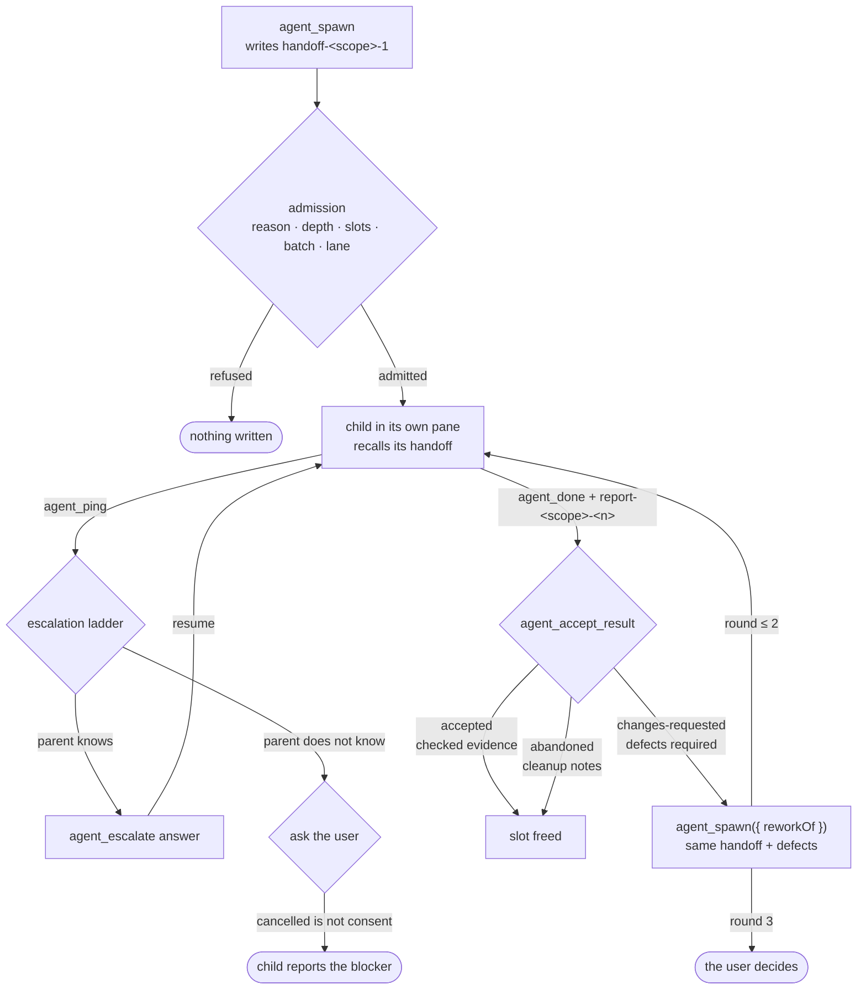
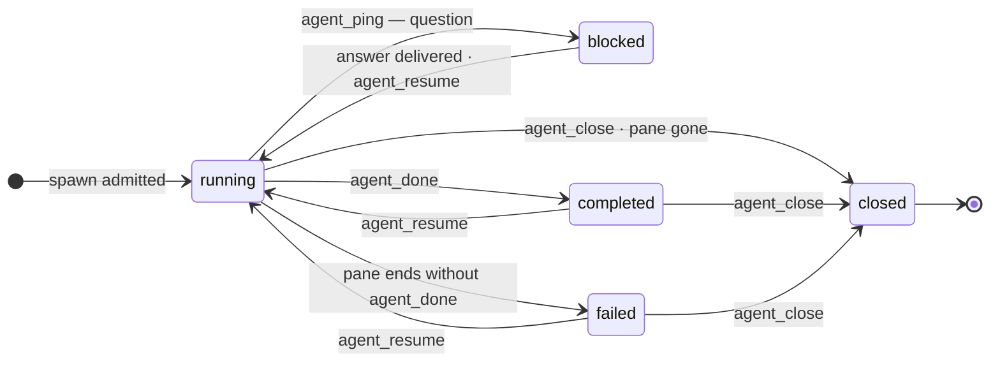

# Delegation: parent, child and handoff

> Part of [pi-workflow-extensions](../README.md). How a parent agent spawns child agents, what a handoff is, who owns the result, and every guardrail that is enforced in code.

## Definition

| Term | Meaning |
| --- | --- |
| **Parent Agent** | the agent that spawns a child agent. It owns the work, the budget and the verdict. |
| **Child Agent** / **Subagent** | the agent that is spawned by a parent agent. It sees its own handoff and nothing else. |
| **Handoff** | the document a parent sends a child, and the report a child sends back. |

Both modes have both roles: Normal and Plan can each spawn, and a child is a child in
either one.

## Behaviour

Four rules. Each is enforced in code, not requested in a prompt.

1. **The parent is responsible for the child's result.** A finished child is not an
   accepted result. If the child did not do what the handoff said, the parent spawns
   again and asks for the part that does not match the **first** handoff. It never
   edits the handoff to fit what the child did — see
   [rework](#rework-spawn-again-against-the-same-handoff).
2. **A child cannot modify the handoff it was given.** `artifact_save` and
   `artifact_edit` on a `handoff-*` or `rework-*` id are refused in a child session.
   A wrong handoff is escalated with `agent_ping`, never corrected in place.
3. **A child reports before it ends** — with an artifact (`report-<scope>-<n>`) or a
   tool call (`agent_progress`, `agent_ping`, `agent_done`). Silence is not a report:
   a pane that ends without `agent_done` is `failed`, not `completed`.
4. **A parent never waits.** No `sleep`, no polling loop, no `tail -f`, no `!sleep`.
   The parent ends its turn; the child's completion, its question, or the watchdog
   re-triggers it. `lib/delegation/wait-guard.ts` refuses the command in a parent
   session, in every mode, including behind `!`.

Delegation is **not a mode**. Normal and Plan both reach the same `agent_*` surface.
A mode narrows the **parent's** own tools; it never narrows what a child may exist
for. Leaving Plan is not a prerequisite for delegating, and no mode is required to
delegate at all. See [modes](modes.md).

## The loop

1. **Spawn.** `agent_spawn` writes a **frozen handoff artifact** and opens one child
   in its own Herdr pane. Purpose is resolved before any pane exists, so a refused
   spawn writes nothing: no registry row, no pane, no artifact.
2. **Work.** The child recalls its handoff by id, does the work inside its lane, and
   reports progress with `agent_progress`. Children with disjoint lanes run in
   parallel.
3. **Ask.** A child that cannot decide calls `agent_ping`. That pauses it and
   re-triggers the parent, who answers with `agent_escalate`.
4. **Report.** The child writes `report-<scope>-<n>` and calls `agent_done`. The
   completion arrives as a message that re-triggers the parent.
5. **Judge.** The parent records a verdict with `agent_accept_result`. A finished
   child is **not** an accepted result; the work-unit slot stays occupied until a
   verdict exists.
6. **Rework.** A missed handoff is answered by spawning again against the **same
   frozen handoff** plus the defect list — never by editing the handoff.



## The handoff is a document, not a prompt

`agent_spawn` authors the handoff as a **scoped artifact** before the pane exists:

| Artifact id | Authored by | Written by |
| --- | --- | --- |
| `handoff-<scope>-<n>` | parent | never rewritten |
| `report-<scope>-<n>` | child | the child's own report |
| `rework-<scope>-<n>` | parent | never rewritten |

- The child's launch ticket is a **pointer**: `artifact_recall({ id: "handoff-…" })`
  plus the lane, the criteria and the escalation ladder at a glance. The prose lives
  in the artifact, so a ticket stays cheap and the document has a version.
- The handoff is **frozen for the child**: `artifact_save` and `artifact_edit` on a
  `handoff-*` or `rework-*` id are refused in the artifact layer when the caller is a
  child session. A prompt is a request; this is a rule. A wrong handoff is escalated,
  not corrected in place.
- **Scope is the boundary.** A child inherits only global artifacts plus its own
  scope, so a sibling's handoff is filtered out before the child can see it. Distance
  in a prompt is not a boundary; absence from the catalog is.
- If the handoff cannot be written, the spawn is **refused before the pane opens**. A
  child that cannot re-read its brief is untraceable, and a pane with no handoff is
  exactly that.
- The row records the handoff id, so a verdict can cite the exact document it judged.

## The parent owns the result

A finished child is not an accepted result. Each row carries durable accountability —
owner session, batch, work unit, the accepted `delegationReason`, a review plan, and a
`resultRevision` that bumps whenever the result is superseded (resume, resettle,
watchdog restart), so a verdict cannot bind to stale output.

```text
agent_accept_result({ childId, disposition, resultRevision, summary, evidence?, integration, defects? })
```

| Disposition | Requires | Effect |
| --- | --- | --- |
| `accepted` | at least one **checked** evidence reference (a file you inspected, a command you ran, an artifact version you read) | releases the slot. The child's summary is not evidence. |
| `changes-requested` | at least one **defect**: the criterion that was not met and what you observed | the defect list becomes the brief for the next round |
| `abandoned` | cleanup notes | recorded as wasted work, not success |

Refusal codes cover the stale-verdict class: a verdict on live work, from the wrong
owner, against a superseded revision, or on an already-settled result is refused in
code. A repeated identical disposition is idempotent.

At settle time the parent gets **one** continuation per changed pending-result set
asking it to judge. After that the obligations stay visible in `agent_running`, but
settlement never loops and never reports unverified work as done. Accepting every
child is still not proof the combined change works: the parent owes one integration
verification across the lanes it accepted.

## Rework: spawn again against the SAME handoff

The rule, in the user's words: *if the child did not do what the handoff said, the
parent spawns again and fixes the part that does not match the first handoff.*

```text
agent_accept_result({ childId, disposition: "changes-requested", defects: [
  "Criterion 'retry budget is configurable' is unmet: it is a constant in src/api.ts:12.",
  "src/billing.ts was modified and is out of lane.",
], … })

agent_spawn({ reworkOf: "<childId>", delegationReason: "…", task: "…" })
  → handoff-api-2 quotes handoff-api-1 (v1) + the two defects
```

- The rework is admitted only when that child's recorded disposition is exactly
  `changes-requested`. Refusals write nothing: `rework-unknown-child`,
  `rework-not-requested`, `rework-handoff-missing`.
- The **original handoff is never edited**, so "what I judged" stays identical to
  "what the new child is judged by".
- A rework is the same work unit, so its round count carries forward on the row and
  is capped at **2** (`MAX_REWORK_ROUNDS`). A third round is evidence the handoff, the
  lane or the goal is wrong — a decision for the user.
- `agent_steer` and `agent_resume` remain the cheap path on the same child; a rework
  is the "spawn again" path, and both are offered when a verdict is recorded.

## Waiting: triggers, not timers

After a spawn, an escalation answer or a verdict, the parent **ends its turn**. It is
re-triggered by the child's completion report, its question (escalation), or a
watchdog budget/stall notice. Idle is the normal state.

This is enforced, not requested:

- `RETRIGGER_CONTRACT` states the contract in every result that starts asynchronous
  work, and says the run is ending rather than asking for it.
- **The run actually ends.** A repeated `agent_running` with nothing actionable
  returns `terminate: true`, so pi stops the run after the batch. Prose alone was not
  enough: session `01a19cd6` was told "your turn ends here" ten times and answered
  with forty `find` calls. A pending escalation or an undispositioned result is
  actionable, so that case keeps the turn — terminating there would strand the
  review duty the parent still owes.
- **A spawn does not end it.** `agent_spawn` keeps the turn so the remaining
  independent lanes can be launched before the parent goes idle. Terminating on a
  spawn serialised session `01a19d41`: its three lanes started at 17:23, 17:35 and
  17:45 because each spawn ended the run and the next lane had to wait for the
  previous child's report. Parallelism is the point of delegation; the poll loop is
  stopped by the `agent_running` repeat and the poll guard instead.
- `lib/delegation/wait-guard.ts` refuses a `bash` command whose **purpose** is to
  wait, in a parent session **while a child is in flight**: `sleep`, `wait`, `watch`,
  `tail -f`/`--follow`, an unbounded `ping`, and never-terminating
  `while true`/`until false`/`for((;;))` loops. Wrapping does not hide it — leading
  `VAR=` assignments, `sudo`/`env`/`nohup`/`time`/`timeout`/`xargs` (compared by
  basename), pipelines, `&&` chains and `bash -c '…'` are all descended into.
- The guard is **scoped** by `lib/delegation/live.ts` (`hasLiveDelegation`). Waiting
  for a service, a port or a build is work, and a parent with no child may wait: in
  session `01a19cd6` a `sleep 8 && docker compose ps`, run to let MySQL accept
  connections, was refused while that session had no child at all. Children are
  exempt for the same reason: a child waiting on its own build is doing its work.
- `lib/delegation/poll-guard.ts` refuses the **same read-only inspection** (the closed
  grammar of `lib/plan/plan-shell.ts`) more than three times while a child is in
  flight. That is the other half of watching a child: the lane is the child's
  workspace, not a progress channel — progress arrives as `agent_progress`
  checkpoints and the report. Work that merely takes time (`npm test`, `cargo build`,
  `pnpm install`, long `git` operations) is never counted, even when repeated.
- A repeated `agent_running` with no new event is answered with one line instead of
  the same page.

## Escalation: child → parent → user

A child that does not know asks. A parent that does not know asks the user. Nobody
invents an answer, and a cancelled dialog is never consent.

```text
agent_escalate({ id, action: "answer" | "to-user" | "relay-user" | "cancel", answer?, reason? })
```

`answer` is legal only while the question is addressed to the parent; once it has been
handed to the user, answering it here would silently override a decision that was
escalated precisely because the parent was not competent to make it. `to-user`
requires a reason. `cancel` resumes the child with an explicit **NOT-approved**
message, and the child must report the blocker rather than pick an interpretation.

## Admission and guardrails

Every guardrail below is enforced in code, in every mode, and a refusal writes
nothing.

| Guardrail | Rule |
| --- | --- |
| `delegationReason` | required, non-empty: the concrete benefit of a separate agent. Small, tightly coupled or coordination-heavy work belongs in the parent session. |
| Depth | a child may not spawn again (`PI_SUBAGENT_DEPTH`, default max 1). |
| Occupancy | a slot is held by a running, blocked **or awaiting-verdict** child. Closing a pane frees nothing; a verdict does. |
| Batch budget | a per-batch launch ceiling (default 4) that completion does not refill. `/agent batch` is the user-owned reset; a model must ask, never run it to bypass a refusal. |
| Duplicate work unit | an occupied work unit is steered, resumed or settled — or replaced explicitly with `replaces` and capacity. |
| One writer per lane | a scope with a live child refuses a second spawn: two writers in one lane produce diffs nobody owns. |
| Handoff frozen | a child cannot rewrite its `handoff-*`/`rework-*` artifact. |
| Verdict evidence | `accepted` requires checked evidence; `changes-requested` requires a defect list. |
| Rework cap | at most 2 rounds per work unit, then the user decides. |
| No waiting | the parent cannot wait **on a child**, poll it, or follow it; a wait on a service or a build is work. |

Defaults are **2 occupied slots** and **4 launches per batch**. An explicitly
configured ceiling (`maxDelegates` from `/agent max`, `maxConcurrentDelegations`, or
`PI_SUBAGENT_MAX_CHILDREN`) is honoured: the strictest configured value wins, and the
defaults only fill unmapped slots. Launch admission is atomic — the slot is reserved
synchronously before the first await, so two spawn calls in one assistant message
cannot both pass the last-slot check, and a failed launch never eats capacity.

```text
/agent status | list | escalations | max [n] [--project] | batch
```

## Spawn shapes

`purpose` (or `role`) is resolved before any registry row or pane exists.

| Shape | Admitted | Child policy |
| --- | --- | --- |
| `adhoc` (worker, default) | ✅ every mode | worker allowlist; writes only inside its declared lane |
| `research` / `role: "planner"` | ✅ every mode | read-only reader: no `write`/`edit`/patch, no general shell, no parent surface |
| `spec`, `review`, `implementation` | ❌ | the spec-review/QA pipeline was removed; these values are refused with their successor named |

A planner produces a plan artifact (`plan-<scope>`); a worker executes a plan step
with `planId`/`stepId`, and the step supplies its lane and criteria.

## Child lifecycle

These are the statuses the registry persists, so a restart reconciles instead of
guessing.



Recording a verdict does not close a child; `agent_close` does that.

## Durability

The registry persists to an atomic, versioned, session-keyed sidecar
(`delegation-registry-<session>.json`) and is restored and reconciled on session
start: dead panes are closed, live panes keep running, pending escalations survive.
The two pre-rename sidecar names are read once on restore, so an upgraded session
does not forget its children.

A watchdog enforces each child's wall-clock budget and stall-detects when the pane has
not changed **and** the child's session file has not been written for ~90s —
interrupting and steering the parent instead of burning tokens, without interrupting a
child that is quietly running its test suite. `agent_running` re-verifies pane
liveness lazily, so a child whose pane died never lingers as a zombie, and
`agent_resume` refuses session paths that do not exist.

## Which model and system prompt a child runs on

Two child roles can be bound to a model: `planner` and `worker`. A binding is
`inherit` (follow the parent), one provider-qualified model, or a pool rolled **once
per spawned child** — a pooled panel is diverse by construction, and a resume replays
the recorded roll instead of switching mid-task.

```text
/agent-model                                  # role menu, then the picker
/agent-model worker                           # picker for worker
/agent-model worker zai/glm-5.3-flash,deepseek/deepseek-4.1-flash   # text form
/agent-model --project worker inherit         # write the project file instead of the global one
```

Each role also has a **system prompt**, resolved per workspace:
`.pi/agents/system-prompts/planner.md` or `worker.md`, then a global file under the
agent dir (`~/.pi/agent/agents/system-prompts/`), then a built-in default. The prompt
is passed as a real `--append-system-prompt` file, so pi's own prompt stays and the
role brief refines it. An empty or whitespace-only file falls through instead of
silencing the role.

```text
/agent-prompts                 # role → source (project | global | builtin) and path
/agent-prompts init            # write the two defaults into .pi/agents/system-prompts/
/agent-prompts init --force    # regenerate them
```

Candidates come from the live model registry, so a provider added in pi appears with
no code change. Bindings persist in `subagents.json` as `{ provider, model }` (project
wins over global) and are read tolerantly: one malformed role never discards the rest.
Precedence is explicit `model` argument → role binding → agent profile → global
default; `inherit` passes no `--model` at all. A binding whose model vanished from the
registry falls back to the next pool member, then to inherit, and every spawn result
names the model and why it was chosen.

## Research surface (read-only)

The parent and a research child can learn the web and the codebase without a writer.

| Concern | Tools | Guarantee |
| --- | --- | --- |
| Web | `web_research`, `web_read` | every source carries `url`, `fetchedAt`, `sha256`, excerpt; content is untrusted data |
| Codebase | `read/grep/find/ls`, `ffgrep/fffind` | path-scoped; control-plane state stays denied |
| History | `shell_read` | closed grammar (`git status/log/diff/show`, `rg`, `find`, `cat`, `wc`); no redirection, heredoc, `$()`, or unknown commands |
| Evidence | `artifact_save/edit/recall` | the child's own scope only |

Budgets are per child: 6 web searches, 20 pages and 200k characters. Fetched pages are
cached in scratch for 10 minutes, so a re-read costs no network call and deleting the
scratch directory is always safe.

Research may write scratch (page cache, index) only under
`.pi/delegation-research/<run>/` — `.pi/` is gitignored — falling back to
`$TMPDIR/delegation-research/<run>/` when it is not, and `PI_DELEGATION_SCRATCH` may
relocate it. The pre-rename `PI_ORCH_SCRATCH` and `.pi/orch-research/` are still
accepted. The repository itself is never a write target, and scratch is bounded
(50 MB, 10-minute cache TTL, 24-hour stale GC). Scratch is created lazily on the first
cached fetch: a session that only searches code never writes disk at all. Artifacts
are the durable channel; scratch is disposable.

## Tool surface

Parent-only: `agent_spawn`, `agent_resume`, `agent_interrupt`, `agent_close`,
`agent_steer`, `agent_route`, `agent_running`, `agent_accept_result`,
`agent_escalate`, `agent_history`.

Child-only: `agent_progress`, `agent_done`, `agent_ping`, `agent_parent_recall`,
`agent_parent_digest`.

A child session never holds a parent-role tool at any depth, and a parent-role call
from a child is refused with the reporting tools named instead. The v1 names
(`subagent*`, `caller_ping`, `parent_*`) are **removed**, not aliased; a stale install
that registers one is stripped from the active set and refused at call time.
`lib/delegation-tools.ts` is the single capability table.

## Known limitations

- The verdict gate is the **parent's own reading** of the report and the lane. There
  is no transcript receipt check yet: nothing mechanically proves the child opened its
  handoff, only that the document was written, frozen and recorded on the row.
- `accepted` is evidence-checked in shape, not in truth: the parent attests that it
  inspected what it lists.
- Harness isolation is not an OS sandbox. A child that escaped its `--tools`
  allowlist would still be a process with the parent's UID.
- The watchdog and registry are per process; a restarted session reconciles from the
  sidecar but cannot vouch for work it did not observe.

Tests: `node --test tests/delegation/*.test.ts`.
