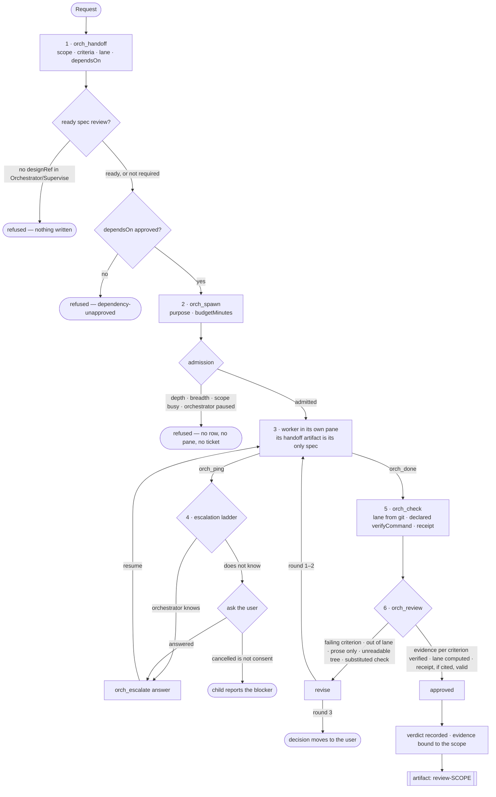
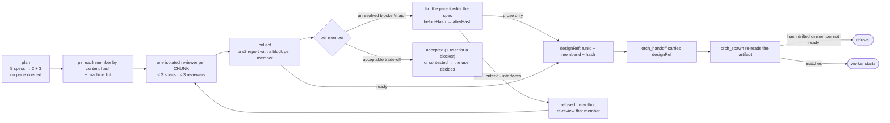
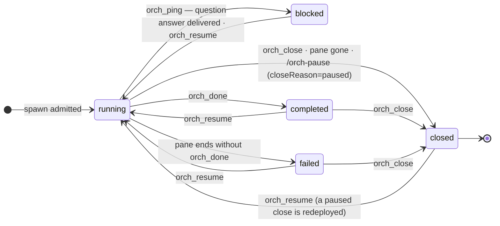

# Orchestrator: delegated work

> Part of [pi-workflow-extensions](../README.md). The author → spawn → check → review loop, its gates, and the escalation ladder.

Mode: **Orchestrator** (`/mode orchestrator`). The supervisor decomposes a large request into work units, delegates each to a cheap-model child with a handoff spec, runs them in parallel, reviews the results with evidence, and escalates only what it cannot decide.

## Lifecycle: product manager → workers → QA

The orchestrator is a product manager, not a reviewer career. Three phases, then it
waits:

1. **Spec — author the wave, review it in chunks, fix what is real.** Investigate
   with at most one research child, author the PRD and one `orch_handoff` per work
   unit, then `orch_spec_review({ action: "plan" })` to see the split before paying
   for reviewers (five specs become 2 + 3). `start` launches **one reviewer per
   chunk** — three specs each, at most three reviewers — and each reviewer's ticket
   contains only its own chunk. `collect`, then resolve every finding: `fix` applies
   the parent's own edit and keeps the approval, `accepted`/`contested` record a
   decision the parent owns. A structural edit (lane, criteria, interfaces, report
   shape, vision) is refused and needs re-authoring plus a review of that member
   only. One review round per wave; a second opinion is the user's call.
2. **Execute — workers in parallel lanes.** One `orch_handoff` per work unit, then
   `orch_spawn`. The spec is frozen here; it is never re-reviewed.
3. **QA — parallel result review with immediate defect routing.** On each worker
   completion, one QA child judges the RESULT against the frozen criteria
   (`orch_spawn({ purpose: "review", qaFor: "<scope>" })`), or the whole wave is
   fanned out at once with `orch_qa({ scopes: [...] })` — at most 3 reviewers,
   3 units each (see [waves](#waves-worker-and-qa-concurrency)). A defect pings the
   orchestrator at once; the orchestrator opens a ticket on the todo ledger
   (`todo_plan`, resource = the defective file), claims it, spawns a defect-scoped
   fix unit, and resumes the QA. QA pass → `todo_act done` with evidence; still
   failing → `todo_act failed` (reopen; twice → the user). Other results keep being
   reviewed in the meantime.

## Waiting: triggers, not timers

After a spawn, a review start, an escalation answer or a ticket transition, the
parent **ends its turn**. It is re-triggered by the child's completion report, its
question (escalation), or a watchdog budget/stall notice. It never sleeps and never
polls: `bash sleep` is not in the read-only grammar, and a repeated status/collect
call with no new event is answered with one line. Idle is the normal state.

**The loop:**

1. **Author** — `orch_handoff` writes one spec per work unit (scope slug, goal, acceptance criteria, lane files, out-of-lane files, interfaces, guidance) and publishes it as a **scoped artifact**. A child recalls its spec by id and sees nothing else: no sibling scope, no sibling path.
2. **Delegate** — `orch_spawn` takes a `handoffId` (spec work), or runs an **ad-hoc** child with `purpose`, optional `laneFiles`/`acceptanceCriteria`, and `budgetMinutes` (default 30). The child runs in its own Herdr pane; workers with disjoint lanes run in parallel. Purpose is resolved before any pane exists, so a refused spawn leaves no trace.
3. **Steer** — `orch_steer` (Esc→settle→type→observe delivery, confirmed by echo), `orch_route` (deterministic owner resolution), `orch_interrupt`/`orch_resume`. `orch_running` reports every child with scope, lane, and pending escalations.
4. **Review** — `orch_review` records each criterion against evidence the orchestrator gathered itself; an approved verdict with a failing criterion or an out-of-lane diff is refused in code. Two consecutive `revise` rounds stop the loop and move the decision to the user.
5. **Escalate** — `orch_escalate` is the ladder: `answer` / `to-user` (through the ask-user extension — a cancelled dialog is unanswered, never consent) / `relay-user` / `cancel`.

### The flow

Every gate below is enforced in code, not by prompt text — and a refused step writes nothing: no
registry row, no pane, no ticket.



**Specification review runs in front of implementation**, and the handoff carries the reviewed
revision, so an approval cannot transfer to text nobody read:



**Child lifecycle** — these are the statuses the registry persists, so a restart reconciles
instead of guessing:



A pause is not a status: `/orch-pause` closes the row with `closeReason: "paused"`, and
`orch_resume` redeploys it. Reviewing a child records a verdict; it does not close the child —
`orch_close` does that.

#### The handoff is read, not assumed

A ticket that says "call `artifact_recall`" is a request, not a mechanism. Nothing used to check
that a worker did it, so a child could implement from the assignment paragraph alone and the review
would still judge its diff against criteria it never saw. Two structural rules close that gap:

1. **The read is a receipt.** `orch_check` and an `orch_review` approval inspect the child's own
   transcript for a successful `artifact_recall({ id: "<handoff>" })`. No read → the check is refused
   (`handoff-not-read`) and an approval cannot be recorded; a missing transcript is
   `handoff-unverified`, never treated as compliance. A rejection or `revise` is still allowed — a
   reviewer must be able to act on the suspicion. Resuming the child (or steering it to recall the
   spec) is the only way to open the gate.
2. **The spec is frozen.** A child may read a `handoff-*` artifact but `artifact_save`/`artifact_edit`
   targeting it is refused. The document is pinned by content hash for review and re-read before every
   spawn; letting the worker rewrite it would re-point an approval at text nobody reviewed. If it is
   wrong, the child escalates and the **orchestrator** revises it with `orch_handoff`.

The receipt carries the artifact version the child actually read, so a spec re-authored afterwards is
visible as drift rather than silently re-attributed.

**Durability.** The registry persists to an atomic versioned sidecar (`orchestrator-registry.json`) and is restored + reconciled on session start: dead panes are closed, live panes keep running, pending escalations survive. A watchdog enforces each child's wall-clock budget and stall-detects when the pane has not changed **and** the child's session file has not been written for ~90s — interrupting and steering the parent instead of burning tokens, without interrupting a child that is quietly running its test suite. `orch_running` lazily re-verifies pane liveness, so a child whose pane died never lingers as a zombie triggering cleanup loops across sessions; `orch_resume` refuses session paths that do not exist.

### Spawn shapes and mode policy

`purpose` is resolved before any registry row or pane exists. A refused spawn writes nothing.

| `purpose` | Normal | Plan | Child policy |
|---|---|---|---|
| `research` (Plan default) | ✅ | ✅ | read-only tools + `bash`/web inspection; no `write`/`edit`/patch |
| `review` | `orch_qa` / `qaFor` | `orch_qa` / `qaFor` | isolated reviewer: read-only research, `shell_read`, scoped evidence; no write/edit |
| `spec` (`handoffId`) | ✅ | ✅ | worker allowlist, lane frozen |
| `adhoc` (Normal default) | ✅ | ❌ | worker allowlist; no lane unless declared |
| `implementation` | ✅ | ❌ without an execution approval | worker allowlist |

Plan is read-only for the **parent**; delegating research, review or spec work is not implementation. Plan refuses `adhoc` and `implementation` with an explicit message. `orch_check` reports `lane: not-declared` for an ad-hoc unit with no `laneFiles` (it is not a failure), and `orch_review` treats an empty lane as "nothing to violate".

A delegated child may not spawn again (`PI_SUBAGENT_DEPTH`, default max-depth 1), and one parent may hold at most 8 running children (`PI_SUBAGENT_MAX_CHILDREN`). Both are hard stops before a pane exists and both are overridable.

### Waves: worker and QA concurrency

A wave runs in two tiers: at most **5 concurrent workers** (`spec`, `implementation`, `adhoc`), then at most **3 QA reviewers**, each judging at most **3 units**. These caps are concurrency, not lifetime quotas — a completed child frees its slot, which is what makes wave → review → next wave work. Research readers are not workers and hold no slot; a running specification reviewer is not QA and holds no QA slot, so a live spec review cannot silently halve QA capacity.

```text
orch_qa({ scopes: ["a", "b", "c", "d", "e"] })
  → qa-1 judges a, b
  → qa-2 judges c, d, e
```

The split is balanced with the remainder on later groups, and each reviewer gets a batch ticket naming only its own units, criteria, lanes and verify commands — a finding never crosses verdicts. Capacity is checked for the whole batch before the first pane opens, so a wave is never half-reviewed. `orch_spawn({ purpose: "review", qaFor: [...] })` is the manual single-reviewer form; `orch_qa` is the wave form. Labels are `qa-1…qa-K` and are reused once an earlier reviewer is closed.

### Which model and system prompt a child runs on

Three child roles can be bound to a model: `devil-advocate`, `worker`, and `qa-review`. A binding is `inherit` (follow the parent), one provider-qualified model, or a pool rolled **once per spawned child** — a pooled panel is diverse by construction, and a resume replays the recorded roll instead of switching mid-task.

```text
/orch-model                                  # role menu, then the picker
/orch-model worker                           # picker, current binding pre-ticked
/orch-model worker zai/glm-5.3-flash,deepseek/deepseek-4.1-flash   # text form
/orch-model --project worker inherit         # write the project file instead of the global one
```

Each role also has a **system prompt**, resolved per workspace: `.pi/orch-agents/devil-advocate.md`, `worker.md`, `qa-reviewer.md` (the role-id alias `qa-review.md` is accepted), then a global file under the agent dir, then a built-in default. The prompt is passed as a real `--append-system-prompt` file, so pi's own prompt stays and the role brief refines it.

```text
/orch-prompts                 # role → source (project | global | builtin) and path
/orch-prompts init            # write the three defaults; never overwrites authored content
/orch-prompts init --force    # regenerate them
```

An empty file falls through instead of silencing the role. Worker prompts apply to `spec`, `implementation` and `adhoc` children, `qa-reviewer.md` to QA reviewers, and `devil-advocate.md` to every specification reviewer; research readers are unchanged.

Candidates come from the live model registry, so a provider added in pi appears with no code change. Bindings persist in `subagents.json` as `{ provider, model }` (project wins over global) and are read tolerantly: one malformed role never discards the rest. Precedence is explicit `model` argument → role binding → agent profile → global default; `inherit` passes no `--model` at all. A binding whose model vanished from the registry falls back to the next pool member, then to inherit, and every spawn/review result names the model and why it was chosen. Worker bindings cover `spec`, `implementation` and `adhoc` children; `research` readers keep the default and stay cheap.

### Research surface (read-only)

The orchestrator and the devil's advocate can research the web and learn the codebase without a
writer. The tool surface is deliberately narrow on the write side and wide on the read side:

| Concern | Tools | Guarantee |
| --- | --- | --- |
| Web | `web_research`, `web_fetch`, `web_read` | every source carries `url`, `fetchedAt`, `sha256`, excerpt; content is untrusted data |
| Codebase | `code_map`, `code_search`, `code_read`, `read/grep/find/ls`, `ffgrep/fffind` | path-scoped; control-plane state stays denied |
| History | `shell_read` | closed grammar (`git status/log/diff/show`, `rg`, `find`, `cat`, `wc`); no redirection, heredoc, `$()`, or unknown commands |
| Evidence | `artifact_save/edit/recall` | scoped to `review:<runId>:<chunkId>` or `orch-research:<scope>`; `artifact_search/list` stay denied for reviewers |

Search is engine-backed, never a JavaScript directory walk: `rg --json` → `git grep` → `grep -r`,
spawned with an argv array at most two at a time, with a 10 s timeout that returns partial results.
`ffgrep`/`fffind` remain available directly for fast interactive lookups; `code_search` prefers the
structured engine because it needs context and stable `path:line:column` citations. `code_read`
returns a line-numbered window plus a whole-file digest, so a review can cite the exact revision it
read.

Budgets are per child: 6 web searches, 20 pages and 200k characters; 50 code searches, 100 reads
and 2 MB. Fetched pages are cached in scratch for 10 minutes, so a re-read costs no network call and
deleting the scratch directory is always safe.

Research may write scratch (page cache, index) only under `.pi/orch-research/<run>/` — `.pi/` is
gitignored — falling back to `$TMPDIR/orch-research/<run>/` when it is not, and `PI_ORCH_SCRATCH`
may relocate it. The repository itself is never a write target, and scratch is bounded (50 MB,
10-minute cache TTL, 24-hour stale GC). Scratch is created lazily on the first cached fetch: a
session that only searches code never writes disk at all. Artifacts are the durable channel; scratch
is disposable.

### v1 removal and cut-over

The old `subagent*`, `caller_ping` and `parent_*` names are **removed**, not aliased. Everything is `orch_*`; `/subagents on|off|status` is the single switch, and `lib/delegation-tools.ts` is the single capability table. A stale global install that registers a v1 name is stripped from the active set and refused at call time. A v1 child launched before the migration must be finished or closed before reloading: resuming it would call a tool that no longer exists.

**Commands:** `/orch status | list | handoffs | escalations`, `/orch-model`, `/orch-prompts`.
`orch_qa` is a tool, not a command: the parent calls it to fan a wave out to QA.

### Independent specification review: one reviewer per chunk

Reviewing only the finished diff catches problems after they are expensive. In front
of implementation, a wave of work-unit specs is reviewed **in chunks**, because a
reviewer who is handed everything reads one spec and skims the rest:

```text
orch_spec_review({ action: "plan", handoffIds: [a, b, c, d, e] })
  → review-1 judges a, b · review-2 judges c, d, e   (nothing launched)

orch_spec_review({ action: "start", handoffIds: [a, b, c, d, e], prdArtifactId: "prd" })
  → pins each member by content hash, launches TWO isolated reviewers, one per chunk

orch_spec_review({ action: "collect", runId })
  → reads one version-2 report per chunk; every member needs a block and coverage

orch_spec_review({ action: "fix", runId, findingId, memberId, patch, rationale })
  → applies the orchestrator's own edit, records beforeHash → afterHash, keeps the approval

orch_spec_review({ action: "resolve", runId, dispositions: [...] })
  → records accepted/contested; a blocker needs the user's confirmation
```

The split is the shared wave chunker: at most **3 specs per reviewer**, at most **3
reviewers**, balanced with the remainder on the later chunk (5 → 2 + 3). Scopes are
sorted first, so the split a `plan` prints is the split `start` launches.

**A single handoff is a one-member wave.** `handoffIds: [a]` opens one chunk
reviewer, not a document review. This matters: the document path keeps a
session-wide round budget, and a lane that blocks a priority (a foundation, say)
must be fixable and spawnable without spending that budget.

**The plan is pinned, not assumed.** `prdArtifactId` quotes the PRD/plan into every
reviewer's ticket — the chunk form above and the document form
(`targetArtifactId` + `prdArtifactId`). Reviewers have no artifact discovery, so
without it the honest report is "the plan was not supplied", which used to be a gate
nobody could answer.

A reviewer gets only its own chunk's pinned text, `read`, named-path search, the todo
tools, and `orch_spec_review_submit`, plus the read-only research surface:
`code_map`/`code_search`/`code_read`, `web_read`/`web_research`/`web_fetch`, and
`shell_read` (the closed grammar). It may write **evidence artifacts** scoped to
`review:<runId>:<chunkId>` (`artifact_save/edit/recall`) — never a user artifact,
never the work tree. It has **no** write/edit/patch, **no** general shell, **no**
artifact discovery (`artifact_search`/`artifact_list`), **no** parent transcript
pointer, and it is forced to `standalone` so an agent profile cannot widen its
context. Broad search without a path and control-plane reads are refused; checkpoint
and parent-brief injection are suppressed. That is enforced by the launcher and the
parent's `tool_call` guard, not by prompt text.

**A version-2 report is judged per member.** Every pinned member must appear exactly
once; a member with no findings must state `coverage[]`; a finding lives inside its
own member's block. A reviewer that skips a spec produces an *incomplete* chunk, not
a clean one — the same anti-rubber-stamp rule as before, now with a unit the reviewer
cannot satisfy by reading a third of its assignment.

**Readiness is per member.** One spec can go to a worker while its sibling is still
being fixed. A member is ready when its chunk report covers it, every blocker and
major finding has a settling disposition, and a `fix` has an applied `afterHash` that
matches the spec now. Nits never gate.

**Missing context is addressable.** A reviewer's `missingContext[]` entries get
stable ids (`C-gate-1`, `C-review-2-1`) and gate readiness until the parent answers
them with a recorded disposition:

```text
orch_spec_review({ action: "resolve", runId, dispositions: [
  { findingId: "C-gate-1", action: "accepted", rationale: "the plan is pinned as prdArtifactId" },
] })
```

`accepted` with a rationale is the answer ("the context is available now, or it is
not needed"); `contested`/`unresolved` stay open because they are disagreements the
parent owns. Answering a note never needs another review round — the old anonymous
missing-context reason was a dead end that could only be escaped by starting a new
session.

**A running reviewer is reported as running.** `status` and `collect` answer with
`gate is still running for 3m12s (pane w4:p70); no report yet` while a reviewer
works, and never collapse that into "no new events". Silent polling was misread as
a stall in a real session, which cancelled a healthy reviewer four checks in.

**A prose fix keeps the approval.** `action: "fix"` edits the worker-facing handoff
document through the same authoring path (`revision++`, republished artifact) and
records the amendment. `lane`, `acceptance criteria`, `interfaces`, `report shape`
and `vision` may not change: those are the contract the review bound, so the edit is
refused (`structural-change-needs-reauthor`) and the member must be re-authored and
re-reviewed — that member only, not the wave. Two rounds are never spent on one
member's prose, which is what the old `requiresReReview` rule did.

Bind the result to the work unit with `designRef`, and the gate refuses a stale
approval at both ends:

```text
orch_handoff({ scope, …, designRef: { runId, memberId, targetHash } })  // refuses an unready member
orch_spawn({ handoffId, … })                                            // re-reads the artifact, refuses drift
```

A document review is still available and unchanged in shape: point `start` at
`targetArtifactId` or `targetFile` instead of `handoffIds`, and one reviewer judges
that document with the merged gate rubric. There are no lens presets: a design that
needs several opinions is a design that should have been split into specs.

**Check receipts.** `orch_check` now returns a `checkRunId`. `orch_review({ …, checkRunId })` refuses a verdict when the receipt is missing, belongs to another scope, was taken against different acceptance criteria, or was taken against a different tree. Without a receipt, `cmd`/`test` evidence is still accepted as *attested* (shape-verified) — the difference is now visible in the audit trail instead of being indistinguishable from a real run.

**Known limitations:** receipts live in memory for the process that observed the run (a restart cannot vouch for work it did not watch); `treeDigest` covers the whole worktree, so two lanes in one checkout invalidate each other's receipt; reviewer isolation is harness isolation, not an OS sandbox.

Tests: `node --test tests/orchestrator/*.test.ts`.

## Role contract

| Role | Context | May change | Purpose |
| --- | --- | --- | --- |
| Elephant (Orchestrator parent) | full session, artifacts, repository | specs and control plane; no product code in Supervise | decompose, delegate, verify |
| Goldfish (spec reviewer) | pinned snapshot, permitted paths, read-only web/code research | its report and scoped evidence artifacts | independent judgement |
| Worker | exactly one handoff/ticket | its lane | implement and verify |
| QA reviewer | completed units, frozen criteria, read-only research | verdicts and scoped evidence artifacts | judge the result, not the spec |

An ordinary Normal or Plan child is a worker, not a Goldfish. Goldfish is a
mechanism — a fresh `standalone` session with a spec-only policy and no author
channel — not a persona name.

## Review-ready, human-approved, implemented

These are three different facts:

- **Review-ready**: every chunk reviewer filed a complete report, each member in
  its chunk has coverage, and no blocker or missing-context finding is open. It is
  per member: one spec can be ready while its sibling is still being revised.
- **Human-approved**: the user authorized implementation. Review readiness is
  never consent; a cancelled dialog is not consent either.
- **Implemented**: a worker changed its lane and verification passed.

An edit after approval invalidates it, because the member's content hash moves. A
prose fix moves the hash too — deliberately — and re-binds `designRef` to the revised
revision with a recorded `beforeHash → afterHash`; that is what lets a fix become a
worker without a second reviewer. A structural edit is not a fix: it is re-authored
and re-reviewed.

## Supported subset

Ported: pinned artifact/file review, chunked spec review with one reviewer per
chunk, direct reviewer dispatch, findings and dispositions, stale-review detection,
`designRef` admission, and read/write separation between roles.

Not ported: upstream skills/commands, the staged scheduler and review UI,
bootstrap/drift machinery, and every upstream persona. The former lens panel
(`gate`, `comprehension`, `readiness`, `zoom-out`, `critic`) survives as the single
merged gate rubric a chunk reviewer applies, plus the cross-member checks: a second
opinion is a chunk split, not a second reader of the same text.

Reviewer context is the ticket's pinned text, explicitly named references, and
the read-only research surface (`code_map`/`code_search`/`code_read`,
`web_read`/`web_research`/`web_fetch`, `shell_read`). Reviewers get `read`,
named-path search, todo tools, the submit tool, and scoped evidence artifacts
(`artifact_save/edit/recall`); `artifact_search`/`artifact_list` stay denied. A
search with no path is refused because it can walk control-plane state; a
reviewer cannot read the registry sidecar even when it lives under the working
tree. Checkpoint snapshots and parent briefs are suppressed for spec-only
reviewers.

## Audit targets

All audit targets below are implemented and covered by regression tests:

- Reject partial reviewer policy instead of treating it as an ordinary worker.
- Refuse generic reviewer resume/author-answer routes before side effects; fresh
  isolated review attempts are the recovery path.
- Block readiness on blocked/incomplete reports and unresolved missing context.
- Require ready matching spec reviews for Orchestrator implementation admission,
  including resume; Normal delegation is unchanged.
- Inspect real reviewer context and filesystem search boundaries; no parent
  pointer, no checkpoint injection, no broad search, no control-plane reads.
- Research tools are path-scoped and engine-backed; a search never walks the
  tree in JavaScript, and a timed-out engine returns partials with a warning.
- Reviewer writes are artifact-only and scope-checked (`review:<runId>:<chunkId>`);
  the work tree has no writer, and foreign/unknown artifact ids are refused
  identically.

Review-ready is not human execution approval. Ordinary user authorization to
implement is still required; a model-authored boolean is not proof of consent.
